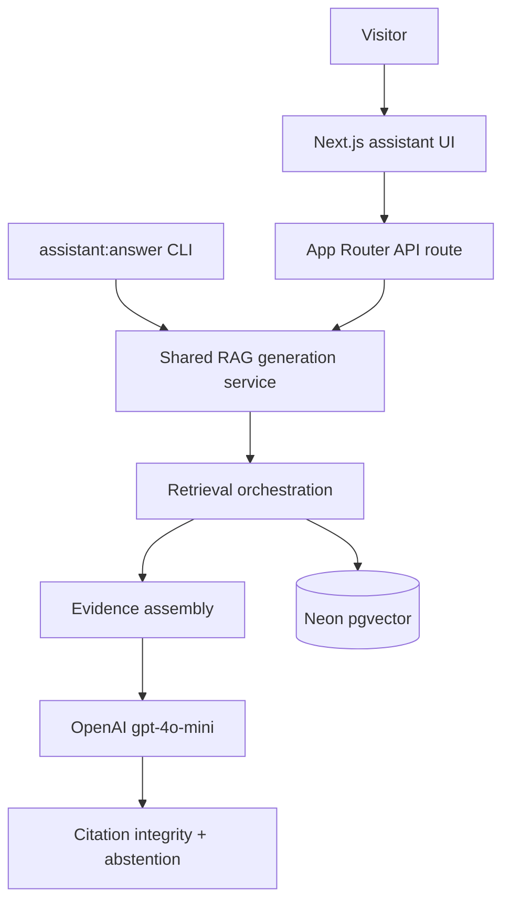

# Assistant grounded RAG generation

**Goal:** Deliver a **working portfolio assistant on [michaeltruong.ai](https://michaeltruong.ai)** — visitor questions answered with **evidence-aware, attributable** responses using the indexed OKF corpus (101 concepts; retrieval-eval baseline on current index), Neon pgvector retrieval, and OpenAI generation. **Generation quality, inspectability, and citation integrity first**; UI stays minimal.

**Plan amendment (2026-10-08):** Milestone scope expanded from dev-only `assistant:answer` to **server-backed deployment**. PR #55 (plan) and PR #56 (`generation-contract`) are merged.

**Plan amendment (2026-10-16):** Generation philosophy revised from **evidence-only** to **evidence-aware generation with observable attribution**. The model may use general knowledge where appropriate; the milestone measures how retrieval contributes to answer quality and keeps personal/professional facts strongly corpus-grounded. Minimal **contract extension** (claim-level attribution) lands in **`generation-cli`** (no separate contract-only slice unless implementation reveals a hard boundary).

**Plan amendment (2026-10-16, contract tightening):** **`claims[]` is the canonical model output** — the service derives `answer_text` and top-level `citations[]`; **`support_level`** measures evidence coverage only (orthogonal to abstention); **`abstention_reason`** is set only when the assistant actually abstains; overlong structured model output is **rejected**, not truncated post-generation.

**Plan amendment (2026-10-16, initial UI placement):** Ship the milestone assistant on a **dedicated `/assistant` route** with a **primary navigation entry** — a deliberate portfolio destination, not a site-wide floating chat widget. Interaction components must stay **reusable** for a future homepage integration; **AI-first homepage composition is deferred** (documented in [rag-generation-direction.md](../../docs/assistant/rag-generation-direction.md)). This amendment does not expand `generation-ui` into a homepage redesign.

This document amends the active plan in place; do not fork a competing plan.

**Direction (design background):** [rag-generation-direction.md](../../docs/assistant/rag-generation-direction.md)

**Prerequisites (shipped):** OKF + structure-aware derive/ingest/retrieve; cross-repository corpus + retrieval-eval — [cross-repository-corpus-eval-findings.md](../../docs/assistant/cross-repository-corpus-eval-findings.md); **generation contract** (`scripts/assistant/generation/*`, `tests/assistant-generation-contract.test.ts`).

**Non-goals (milestone):** corpus expansion, retrieval-eval baseline changes, streaming, LangChain/LlamaIndex, automatic corpus updates, live web search, elaborate chat product (threads, memory, tool use), neighbour ±1 expansion, tokenizer-exact budgets, LLM-as-judge in required CI, **homepage replacement or cinematic homepage redesign**, **site-wide floating chat widget**, **agentic tool execution**, **heavy chat framework**, **new design system**, **additional retrieval architecture changes** (beyond shipped contract/service). Do not reopen the archived cinematic homepage redesign initiative.

## Locked decisions

Preserve unless a future plan amendment explicitly revises them.

| Topic                  | Decision                                                                                                                                                                                                                                                                                    |
| ---------------------- | ------------------------------------------------------------------------------------------------------------------------------------------------------------------------------------------------------------------------------------------------------------------------------------------- |
| Chat model             | `gpt-4o-mini` default (`ASSISTANT_GENERATION_MODEL` override); **native fetch** Chat Completions (mirror embeddings adapter); no LangChain/LlamaIndex                                                                                                                                       |
| Shared service         | **One** RAG generation implementation: query validation → retrieve → assemble → generate → parse → citation integrity → abstention/diagnostics. **`assistant:answer` CLI and App Router API route are thin adapters** — no shell-out, no duplicate generation paths                         |
| Default assembly       | **Bounded full-parent** at **OKF concept** boundary (`okf_concept_id`); Postgres-backed parent units                                                                                                                                                                                        |
| Eval baseline assembly | `top_k_only` (non-default for operators/eval)                                                                                                                                                                                                                                               |
| Generation retrieve K  | Default **10** (`--top-k` / service default); retrieve CLI default **5** unchanged                                                                                                                                                                                                          |
| Budget                 | Truncate **unmatched** chunks only, or **`EvidenceBudgetExceeded`** — never silently drop top-K matched units                                                                                                                                                                               |
| Generation philosophy  | **Evidence-aware** — general technical knowledge allowed; **personal/professional facts about Michael** require corpus grounding or explicit uncertainty; model-declared attribution is observable output, not proof of internal reasoning                                                  |
| Citations              | **Integrity** (deterministic: `evidence_id`, `unit_id`, approved URLs) in contract + runtime; **support** and **attribution accuracy** (semantic) in generation-eval only — structural validity ≠ factual support                                                                           |
| Response contract      | Model: ordered nonempty **`claims[]`** + **`support_level`** (evidence coverage) + **`abstained`** / **`abstention_reason`** when refusing; service derives **`answer_text`** and deduped **`citations[]`** — see [Contract amendment (generation-cli)](#contract-amendment-generation-cli) |
| Resource bounds        | Configurable evidence char budget (120k = **dev default**), approximate prompt token cap, max output tokens, timeouts, max question/body size — no tokenizer-exact budgeting this milestone                                                                                                 |
| Eval baselines         | **`no_retrieval`** (model-only), **`top_k_only`**, **`full_parent`** — `no_retrieval` is eval-only, not production architecture                                                                                                                                                             |
| Index + corpus         | **Neon pgvector** + existing operator-controlled `okf:build` → `assistant:ingest` workflow; no automatic corpus updates                                                                                                                                                                     |
| Deployment target      | **michaeltruong.ai** (Vercel production); server-only `DATABASE_URL`, `OPENAI_API_KEY`, and generation config                                                                                                                                                                               |

## Recommended execution authority

| Slice                  | Recommended authority    | Agent instruction                          |
| ---------------------- | ------------------------ | ------------------------------------------ |
| generation-contract    | Open PR only             | **Completed** (merged).                    |
| generation-cli         | Open PR only             | Do not merge. Stop after opening the PR.   |
| generation-eval        | Open PR only             | Do not merge. Stop after opening the PR.   |
| generation-api         | Open PR only             | Do not merge. Stop after opening the PR.   |
| generation-ui          | Open PR only             | Do not merge. Stop after opening the PR.   |
| operational-acceptance | Manual verification gate | No commit/PR; gitignored run notes allowed |
| plan-closure           | Open PR only             | Do not merge. Stop after opening the PR.   |

Repo default: **Open PR only** ([planning-standards.md](../standards/planning-standards.md)).

## Repository topology (default)

Multi-slice plans stack **execution order**, not Git branches. Integration branch: **`main`**.

**Before each implementation slice:** `git fetch` → fresh branch from `origin/main`.

**Before opening a PR:** branch contains **only** that slice’s changes.

**After opening:** PR base is `main`; diff has no prior-slice work except through merged `main`.

---

## Target architecture



### Generation philosophy (evidence-aware)

| Principle                     | Requirement                                                                                                                                                                                 |
| ----------------------------- | ------------------------------------------------------------------------------------------------------------------------------------------------------------------------------------------- |
| Retrieval role                | Understand **how retrieved evidence contributes** to answer quality; retrieval remains the production path for corpus-grounded answers                                                      |
| General knowledge             | Allowed for general technical explanations **without** fabricating evidence citations; must not masquerade as retrieved evidence                                                            |
| Personal / professional facts | Stronger grounding — no invented career history, project outcomes, employment, or private details; prefer published evidence or qualify as **`uncertain`**                                  |
| Evidence vs model knowledge   | When evidence conflicts with model prior about Michael's work, prefer published evidence or acknowledge uncertainty                                                                         |
| Attribution                   | Model-declared **claim-level** categories are **observable classifications** for eval and UI — not proof of internal knowledge source                                                       |
| Abstention                    | Meaningful abstention for unverifiable personal claims and unsupported corpus questions; **do not** abstain solely because retrieval is thin when a general technical answer is appropriate |

**Claim-level attribution categories** (per claim/segment in structured output):

- `evidence_supported` — directly supported by retrieved evidence (requires valid citations).
- `evidence_inferred` — reasonable inference from evidence; qualify appropriately (citations required when asserting corpus-specific facts).
- `general_knowledge` — not established by retrieved evidence; no evidence citations.
- `uncertain` — insufficient confidence; answer text must be appropriately qualified.

### Shared RAG generation service (core)

Owns end-to-end generation for **both** CLI and server:

1. **Query validation** — non-empty, max length, max body size, reject obvious abuse patterns (eval expands injection cases).
2. **Retrieval orchestration** — embed question, `top-K` (default 10), optional filters; reuse existing retrieve stack. **`no_retrieval`** skips this step for eval-only baselines.
3. **Evidence assembly** — `full_parent` default; `EvidenceBudgetExceeded` fail-closed; contract packet types; retain invariant that matched retrieval units are never silently discarded.
4. **Generation** — structured JSON via fetch adapter; configurable timeouts and max output tokens; token usage capture.
5. **Response handling** — parse contract schema; **deterministic structural validation** (claim/citation rules below); **citation integrity** + URL whitelist; map failures to safe abstention/errors.
6. **Diagnostics** — structured internal telemetry (latency, tokens, budget, attribution counts, abstention outcomes, error categories); **strip private diagnostics from API client payloads** unless explicitly safe for rendering.

Keep **retrieval**, **assembly**, **generation**, and **validation** independently unit-testable; service composes them.

### Contract amendment (generation-cli)

**Shipped contract (`generation-contract`):** `answer_text`, `support_level` (`full` \| `partial` \| `none`), detached `citations[]`, optional `diagnostics`. Prompt templates today imply evidence-only answers — **superseded in `generation-cli`**.

**Canonical model output** (structured JSON from the LLM — implement in **`generation-cli`**, with contract tests extended in the same slice):

| Field               | Source    | Role                                                                                                                                                                                                                                                                   |
| ------------------- | --------- | ---------------------------------------------------------------------------------------------------------------------------------------------------------------------------------------------------------------------------------------------------------------------- |
| `claims[]`          | **Model** | **Canonical answer.** Ordered, **non-empty** segments: `{ text, attribution, citations? }`. Every visitor-facing statement lives here.                                                                                                                                 |
| `support_level`     | **Model** | **Evidence coverage only** — how much retrieved evidence supports corpus-relevant / personal claims in the answer (`full` \| `partial` \| `none`). **`none` is valid for a good general-knowledge answer** that does not rely on the packet; it is **not** abstention. |
| `abstained`         | **Model** | `true` when the assistant refuses or only explains why it cannot answer substantively; `false` when delivering a normal answer (including general-knowledge-only).                                                                                                     |
| `abstention_reason` | **Model** | **Only when `abstained` is true.** Enum distinguishing no hits, irrelevant evidence, unsupported personal, conflicting evidence, etc. **Independent of `support_level`.**                                                                                              |

**Service-derived public fields** (deterministic — not separate model opinions):

| Field         | Derivation                                                                                                                                          |
| ------------- | --------------------------------------------------------------------------------------------------------------------------------------------------- |
| `answer_text` | Concatenate `claims[].text` in order (with sensible separators, e.g. spaces or paragraph breaks between segments).                                  |
| `citations[]` | **Deduplicated union** of all per-claim `citations` (stable order, e.g. first-seen `evidence_id`). Integrity validated against the evidence packet. |

CLI, API, and UI all consume the **same** `claims[]` plus derived fields — **no** parallel prose or citation lists from the model. UI renders **`claims[]`** (attribution + per-claim citations); derived `answer_text` is for convenience, previews, and clients that want flat prose.

**Deterministic validation (runtime)** — only what is verifiable without semantic interpretation:

- `claims[]` non-empty array; each claim has non-empty `text` and valid `attribution`.
- `evidence_supported` claims: non-empty `citations` with passing **citation integrity** (IDs/units/URLs in packet).
- `general_knowledge` claims: citations optional; must not be the sole basis for invented personal facts (semantic enforcement in eval).
- `uncertain` claims: no structural citation requirement; qualification checked in generation-eval.
- When `abstained` is `true`: require `abstention_reason`; when `false`, `abstention_reason` must be absent.
- Derived `answer_text` non-empty; derived `citations[]` passes integrity when non-empty.
- Fabricated `evidence_id` / `unit_id` / URLs: fail integrity (existing validators).
- **Do not** require every claim to cite evidence.

**Semantic validation (generation-eval only):** citation support, attribution accuracy, unsupported personal claims, injection resistance, abstention appropriateness (including `abstained` vs qualified partial answers).

### Generation resource controls

| Control                         | Notes                                                                                                                                                                                                       |
| ------------------------------- | ----------------------------------------------------------------------------------------------------------------------------------------------------------------------------------------------------------- |
| Evidence character budget       | `DEFAULT_EVIDENCE_CHARACTER_BUDGET` (120_000) = **development default**; production value set via env/config after measurement — **`EvidenceBudgetExceeded`** remains fail-closed                           |
| Approximate prompt token budget | Heuristic cap on evidence + instructions + question metadata (not tokenizer-exact)                                                                                                                          |
| Max generated output tokens     | Server/CLI config; **reject** overlong or unparseable structured JSON with a **controlled error** — do **not** truncate model output after generation (truncation risks invalid JSON and severed citations) |
| Request timeout                 | End-to-end generation timeout; align with Vercel Fluid Compute limits on API slice                                                                                                                          |
| Max question / body size        | Validated before retrieval or model call                                                                                                                                                                    |

Optional **smaller retrieval K** or retry policies are **separate observable policies** — document in eval findings if adopted; never silently drop matched top-K units.

### Prompt-injection and trust boundaries

Retrieved passages are **untrusted as instructions** but are the authoritative source for **corpus-grounded claims about Michael**.

System prompt (in `generation-cli`) must: allow appropriate general knowledge; distinguish evidence from model knowledge; require honest attribution; ignore override instructions embedded in evidence; never expose secrets, raw packets, or internal diagnostics to visitors.

**Tests** (mocked, deterministic — expand across `generation-cli` and `generation-eval`): instruction overrides in evidence, fabricated citation IDs/URLs, malformed JSON, unsupported personal claims (fixtures), overlong responses, conflicting evidence packets, safe rendering assumptions.

### Evidence assembly (`full_parent` default)

1. Retrieve top-K (default 10); record `matched_hits[]`.
2. Distinct parents ordered by best hit rank.
3. Per parent: fetch all `assistant_retrieval_units` for `okf_concept_id`; order by `chunk_index`, `unit_id`.
4. Dedupe `content_hash` **within** OKF concept; matched `unit_id` preserved; matched supersedes unmatched hash duplicates.
5. **Budget:** all matched units, then unmatched chunks until cap; else **`EvidenceBudgetExceeded`** (no LLM).
6. **`top_k_only`:** retrieved rows only (eval baseline).

### Citation layers

| Layer                    | Slice                                                            | Purpose                                                                                                   |
| ------------------------ | ---------------------------------------------------------------- | --------------------------------------------------------------------------------------------------------- |
| **Citation integrity**   | `generation-contract` (done), `generation-cli`, `generation-api` | IDs/URLs refer to supplied packet only; claim-level citations validated where attribution requires them   |
| **Citation support**     | `generation-eval`, operational review                            | Cited evidence backs the associated claim/segment (semantic)                                              |
| **Attribution accuracy** | `generation-eval`, operational review                            | Declared `attribution` matches claim type; personal facts not labeled `general_knowledge` without support |

### Public deployment requirements (API + production)

Resource controls are **server-side**; the browser is untrusted.

**V1 rate limiting and cost containment (practical):**

- **Per-client limits** — IP- or fingerprint-based request budget (e.g. requests per minute/hour/day) enforced in the API route or edge middleware compatible with **Vercel Fluid Compute** (multiple instances). **Do not rely solely on in-memory counters** — use a **durable shared store** (e.g. Vercel KV / Upstash Redis, or Postgres-backed counters on the assistant DB) so limits hold across instances and cold starts.
- **Global safeguards** — OpenAI project budget/alerts (existing operator practice); optional daily cap on generation calls logged in durable store; fail closed with a safe public error when limits trip.
- **Request bounds** — max question length, max JSON body size, server timeouts aligned with platform limits (Node Fluid Compute default duration).
- **Response bounds** — never return raw evidence packets, embedding vectors, SQL errors, stack traces, or API keys; map `EvidenceBudgetExceeded` and validation failures to stable client messages.
- **Secrets** — `DATABASE_URL`, `OPENAI_API_KEY`, and generation overrides **server-only** (Vercel env); never `NEXT_PUBLIC_*` for credentials.

**Runtime:** App Router route on default **Node.js** runtime (Fluid Compute); no Edge-only APIs required for pgvector access. Document deployment env in [assistant-database.md](../../docs/assistant/assistant-database.md) when `generation-api` lands.

### Deferred

Streaming, neighbour expansion, automatic ingest on deploy, external web search, conversational memory, LLM-as-judge as required CI gate, **AI-first homepage** (assistant as primary discovery surface — product/UX milestone; see [rag-generation-direction.md](../../docs/assistant/rag-generation-direction.md)).

---

## Slice — `generation-contract` (shipped)

**Status:** **Completed** (merged via PR #56).

**Delivered:** `full_parent` + `top_k_only` assembly, `EvidenceBudgetExceeded`, baseline response schema (`answer_text`, `support_level`, `citations[]`), citation integrity (IDs + approved URLs from packet entries), contract tests. Evidence-only prompt wording — superseded by evidence-aware direction in **`generation-cli`**.

**PR boundary:** Contract modules + tests only. **Claim-level attribution** is intentionally deferred to `generation-cli` (extends schema + validators + prompts in one merge-safe slice).

---

## Slice — `generation-cli`

**Recommended authority:** Open PR only

**Rationale:** Introduces the **shared service** and operator CLI before eval and server adapters.

**Agent instruction:** Do not merge. Stop after opening the PR.

**Goal:** Implement **shared RAG generation service** + fetch-based OpenAI chat adapter + **`npm run assistant:answer`** as a thin CLI adapter (`--assembly-mode`, `--top-k`, `--json`, `--dry-run-retrieval`, optional `--no-retrieval` for operator/eval baseline).

**Contract work in this slice:** Model schema = **`claims[]`** (canonical) + **`support_level`** + **`abstained`** / **`abstention_reason`**; service **derives** `answer_text` and deduped `citations[]`; revise prompts; structural validators; reject overlong structured output; update `tests/assistant-generation-contract.test.ts`.

**Non-goals:** `app/api/` route, UI, full generation-eval harness, duplicate generation logic outside the service.

**Likely files:** `scripts/assistant/generation/run-generation.mjs` (or equivalent service entry), `openai-chat.mjs`, `generation-config.mjs`, `validate-response.mjs`, `response-schema.mjs`, `prompt-templates.mjs`, `assistant:answer` script wiring, tests with mocked `fetch`, [assistant-database.md](../../docs/assistant/assistant-database.md), `.env.example`.

**Dependencies:** `generation-contract` on `main`.

**Acceptance:**

- Service callable from CLI without spawning subprocesses.
- Evidence-aware sample question: mix of `general_knowledge` and `evidence_supported` claims with valid citations where required when `DATABASE_URL` + `OPENAI_API_KEY` set.
- **Structured diagnostics** emitted internally (retrieval/assembly/generation latency, model id, token usage, evidence count/char budget, assembly mode/truncation, attribution category counts, abstention/error categories) — reusable by API slice; CLI may print subset with `--json`.
- Configurable resource bounds (evidence budget, heuristic prompt budget, max output tokens, timeout, max question length) with documented production-oriented defaults separate from 120k dev budget.
- Non-zero exit on `EvidenceBudgetExceeded`, integrity failure, structural validation failure, API errors.
- Mocked `fetch` tests for service + adapter boundaries; mocked tests for injection strings in evidence, fabricated citations, malformed model JSON.

**PR boundary:** Service + CLI + contract extension + config/docs; no API route, no UI, no eval harness fixtures.

---

## Slice — `generation-eval`

**Recommended authority:** Open PR only

**Rationale:** Answer-quality and safety signals before exposing a public endpoint.

**Agent instruction:** Do not merge. Stop after opening the PR.

**Goal:** `tests/assistant-generation-eval.test.ts`, **frozen evidence-packet fixtures** (generation independent of live Neon/embeddings), `scripts/assistant/generation/eval.mjs`, stub [generation-eval-findings.md](../../docs/assistant/generation-eval-findings.md).

**Assembly / retrieval modes compared:**

1. **`no_retrieval`** — model-only baseline (empty or minimal packet); eval-only, not production.
2. **`top_k_only`** — matched passages only.
3. **`full_parent`** — default production assembly.

**Question coverage (fixtures):** direct personal/career facts; project architecture decisions; general technical explanations; blended experience + general engineering; multi-unit inference; unsupported/unverifiable personal claims; adversarial prompt-injection in evidence.

**Abstention scenarios (scored in eval, not all deterministic):** no retrieval results; irrelevant evidence; partial evidence; general technical without retrieval; unsupported personal; conflicting evidence.

**Metrics (where practical):** answer correctness, citation integrity, semantic citation support, attribution accuracy, unsupported-claim frequency, completeness, abstention appropriateness, latency, input/output tokens and estimated cost. **Do not change** retrieval-eval fixtures or [eval-cases.json](../../tests/fixtures/assistant-retrieval/eval-cases.json).

**Dependencies:** `generation-cli` merged.

**Acceptance:**

- Deterministic CI: mock model outputs → integrity + structural validators + support/attribution scorers; case where integrity passes but support fails; case where personal claim is wrongly `general_knowledge`.
- Frozen packet fixtures exercised without `DATABASE_URL`.
- Live-model comparison and semantic judgments: **operator-run optional**; no mandatory LLM-as-judge in required CI.
- Integration `skipIf` without secrets for end-to-end spot checks.

**PR boundary:** Eval harness + fixtures + stub doc only.

---

## Slice — `generation-api`

**Recommended authority:** Open PR only

**Rationale:** Production entrypoint; must reuse shared service from `generation-cli`.

**Agent instruction:** Do not merge. Stop after opening the PR.

**Goal:** Next.js **server-side** API route (e.g. `app/api/assistant/...`) that calls the **same shared RAG generation service** as the CLI.

**Non-goals:** Chat UI, shell-out to CLI, client-side retrieval/generation, exposing internal packets or secrets.

**Requirements:**

- Request validation (schema, size, method).
- Server-only secrets and configuration.
- **Rate limiting** and usage controls per [Public deployment requirements](#public-deployment-requirements-api--production).
- Timeouts and safe error mapping for clients.
- Tests: route handler unit tests with mocked service; no live keys in CI.

**Dependencies:** `generation-cli` merged (`generation-eval` may land in parallel only if merge-safe; prefer **eval after CLI**, **API after CLI**).

**Acceptance:**

- Route returns public-safe JSON (`claims[]`, derived `answer_text`, derived `citations[]`, `support_level`, `abstained`, `abstention_reason` when applicable, stable error codes); **no** raw evidence packets, embeddings, or internal diagnostics unless explicitly safe.
- Service integration test or handler test proves no duplicate generation implementation.
- Document production env vars and limits in assistant-database or dedicated assistant API doc section.

**PR boundary:** API route + server wiring + tests + docs; no UI slice work.

---

## Slice — `generation-ui`

**Recommended authority:** Open PR only

**Rationale:** First public assistant surface after API exists — a dedicated portfolio page, not a generic embedded widget.

**Agent instruction:** Do not merge. Stop after opening the PR.

**Goal:** Ship a **standalone, responsive, accessible** assistant experience at **`/assistant`** on [michaeltruong.ai](https://michaeltruong.ai) — a deliberate portfolio destination that reuses existing typography, layout, components, and [design-system.md](../../docs/design-system.md) conventions.

**Scope:**

- **Route:** `app/assistant/page.tsx` (or equivalent App Router page) at `/assistant`.
- **Discovery:** Add a discoverable entry in **primary site navigation** (e.g. extend [lib/nav.ts](../../lib/nav.ts) / [SiteHeader.tsx](../../components/SiteHeader.tsx) — label TBD in implementation, e.g. “Assistant”).
- **Page content:** Concise introduction explaining what visitors can ask; a small curated **suggested-questions** set; question input; loading states; answer rendering from canonical **`claims[]`** (attribution + per-claim citations; same shape as API); **clickable evidence citations** (public URLs from citation metadata); error surfaces; abstention and **`uncertain`** / qualification messaging when `abstained` or attribution warrants it; **safe rendering** of model-generated text (no raw HTML injection). Do not render a divergent prose path from `answer_text` alone.
- **Component architecture:** Extract reusable assistant interaction components (input, message/claim list, citation links, suggested prompts, status states) so the same experience can later integrate into the homepage **without rebuilding** — **homepage integration is out of scope for this slice**.

**Non-goals:** Site-wide **floating chat widget**; homepage replacement or redesign; cinematic homepage work; thread history or conversational memory; streaming; new design system; heavy chat framework dependencies; agentic tool execution; retrieval or generation architecture changes; eval harness changes.

**Dependencies:** `generation-api` merged (or same PR only if truly merge-safe — **prefer separate PR**).

**Likely files:** `app/assistant/page.tsx`, `app/assistant/*` or `components/assistant/*` (reusable interaction modules), `lib/nav.ts`, `components/SiteHeader.tsx`, scoped styles under `app/styles/` as needed; client fetch to the generation API route only.

**Acceptance:**

- **`/assistant`** is live in the app router and reachable on production after deploy; **primary nav** includes a clear link to it.
- Page feels like part of the portfolio (tokens, spacing, typography, existing components) — not a third-party chat embed.
- Full interaction loop: intro → suggested question or typed question → loading → **`claims[]`** rendering with claim-level attribution → clickable citations → API errors and abstention/uncertainty copy handled gracefully.
- Uses existing tokens/components ([design-system.md](../../docs/design-system.md)); calls API route only; no secrets in client bundle.
- Reusable assistant components are structured for future homepage embedding (no floating widget).
- Basic a11y: labels, focus order, keyboard use, `prefers-reduced-motion` respect; responsive layout (mobile + desktop).
- Playwright or component tests where practical; manual mobile check documented in PR.

**PR boundary:** UI routes/components/styles + nav entry + client fetch; no eval harness changes; no homepage composition changes.

---

## Slice — `operational-acceptance`

**Recommended authority:** Manual verification gate

**Rationale:** Model quality, cost, abuse resistance, and deployment config require operator review before calling the assistant publicly ready.

**Agent instruction:** Do not commit or open a PR. Optional `.agent-runs/assistant-generation/**`.

**Prerequisites:** `generation-contract` through `generation-ui` merged; production index ingested; Vercel env configured for michaeltruong.ai.

**Procedure (expanded):**

- **Local:** ~12–15 `assistant:answer` runs (`full_parent`); 3–4 `top_k_only` and 2–3 `no_retrieval` eval comparisons; tokens, resource bounds, `EvidenceBudgetExceeded`, citation-support and attribution spot checks.
- **Deployed:** E2E on production/preview — evidence-backed vs general-knowledge answers, citation links, abstention on unsupported personal questions, **rate limit** and quota behavior, timeout/error surfaces, mobile layout, latency and cost sanity.
- **Cost:** confirm OpenAI project budget/alerts; note observed usage band against configured max tokens and rate limits.
- **Sign-off:** explicit operator approval recorded in findings (no fabricated metrics).

**Acceptance:** [generation-eval-findings.md](../../docs/assistant/generation-eval-findings.md) (or successor ops doc) updated; operator sign-off; assistant not declared “public-ready” without this gate.

---

## Slice — `plan-closure`

**Recommended authority:** Open PR only

**Agent instruction:** Do not merge. Stop after opening the PR.

**Prerequisites:** All implementation slices + **operational-acceptance** complete; assistant **deployed and verified** on michaeltruong.ai.

**Deliverables:** `# Shipped` note; move plan to `.cursor/plans/archive/2026-10-08-assistant-grounded-rag-generation.plan.md`; update [architecture-direction.md](../../docs/assistant/architecture-direction.md) and [rag-generation-direction.md](../../docs/assistant/rag-generation-direction.md); mark `plan-closure` completed.

---

## Agent prompts (copy/paste for Cursor)

### generation-cli

```text
@.cursor/plans/2026-10-08-assistant-grounded-rag-generation.plan.md

Implement slice generation-cli only. Prerequisite: generation-contract merged. Do not start generation-eval, generation-api, generation-ui, or later. Do not archive the plan.

Authority: Open PR only — implement and open the PR; do not merge.

Topology: start from latest origin/main; branch represents only this slice; PR base must be main.

Deliverables: shared RAG generation service, fetch OpenAI chat adapter, assistant:answer CLI as thin adapter; canonical claims[] model output with service-derived answer_text and citations[]; abstained/abstention_reason orthogonal to support_level; evidence-aware prompts + structural validators; reject overlong structured JSON; configurable resource bounds; structured internal diagnostics; tests (including injection/fabrication mocks), assistant-database + .env.example docs. Mark generation-cli completed in plan frontmatter in this PR.

Verification: npm run test; npm run lint; npm run typecheck; npm run format:check; manual assistant:answer when DATABASE_URL + OPENAI_API_KEY available.
```

### generation-eval

```text
@.cursor/plans/2026-10-08-assistant-grounded-rag-generation.plan.md

Implement slice generation-eval only. Prerequisite: generation-cli merged. Do not start generation-api, generation-ui, operational-acceptance, or plan-closure. Do not archive the plan.

Authority: Open PR only — implement and open the PR; do not merge.

Topology: start from latest origin/main; branch represents only this slice; PR base must be main.

Deliverables: frozen evidence-packet fixtures; generation eval harness comparing no_retrieval, top_k_only, full_parent; scorers for citation support, attribution accuracy, abstention; tests/assistant-generation-eval.test.ts; docs/assistant/generation-eval-findings.md stub. Do not change assistant-retrieval eval-cases.json. No mandatory LLM-as-judge CI. Mark generation-eval completed in plan frontmatter in this PR.

Verification: npm run test -- tests/assistant-generation-eval.test.ts; npm run lint; npm run typecheck; npm run format:check.
```

### generation-api

```text
@.cursor/plans/2026-10-08-assistant-grounded-rag-generation.plan.md

Implement slice generation-api only. Prerequisite: generation-cli merged. Do not start generation-ui, operational-acceptance, or plan-closure. Do not archive the plan.

Authority: Open PR only — implement and open the PR; do not merge.

Topology: start from latest origin/main; branch represents only this slice; PR base must be main.

Deliverables: Next.js server API route calling the shared RAG generation service (no CLI shell-out); request validation, durable rate limiting strategy, timeouts, safe client errors; tests + deployment docs. Mark generation-api completed in plan frontmatter in this PR.

Verification: npm run test; npm run lint; npm run typecheck; npm run format:check; manual route test against local dev with server env vars.
```

### generation-ui

```text
@.cursor/plans/2026-10-08-assistant-grounded-rag-generation.plan.md

Implement slice generation-ui only. Prerequisite: generation-api merged. Do not start operational-acceptance or plan-closure. Do not archive the plan.

Authority: Open PR only — implement and open the PR; do not merge.

Topology: start from latest origin/main; branch represents only this slice; PR base must be main.

Deliverables: dedicated /assistant page on michaeltruong.ai with primary-nav entry; standalone responsive accessible assistant UI (intro, suggested questions, input, loading/errors, canonical claims[] rendering with attribution, clickable citations, abstention/uncertainty messaging, safe text rendering) using existing portfolio design conventions; reusable assistant interaction components (no site-wide floating chat widget; no homepage redesign — future homepage integration is deferred). Client calls generation API only. Mark generation-ui completed in plan frontmatter in this PR.

Non-goals: homepage replacement, cinematic homepage, streaming, chat memory/history, agentic tools, new design system, heavy chat framework, retrieval architecture changes.

Verification: npm run lint; npm run typecheck; npm run format:check; npm run test; manual desktop + mobile check on /assistant.
```

### operational-acceptance

```text
@.cursor/plans/2026-10-08-assistant-grounded-rag-generation.plan.md

Run the manual verification gate (operational-acceptance) only. Prerequisites: generation-contract through generation-ui merged and marked completed. Do not start plan-closure.

Authority: Manual verification gate.

Topology: no tracked-file changes unless operator chooses to commit findings doc in a follow-up; optional gitignored .agent-runs/assistant-generation/**.

Deliverables: execute plan operational-acceptance procedure (local + deployed on michaeltruong.ai); report verdict and paths to any gitignored notes.
```

### plan-closure

```text
@.cursor/plans/2026-10-08-assistant-grounded-rag-generation.plan.md

Execute only plan-closure.

Authority: Open PR only — docs-only archive PR; do not merge.

Prerequisites: all implementation slices and operational-acceptance complete; assistant verified on michaeltruong.ai; slice todos marked completed in frontmatter.

Topology: start from latest origin/main; branch represents only this slice; PR base must be main.

Deliverables: verify slice todos, add # Shipped note, move plan to .cursor/plans/archive/2026-10-08-assistant-grounded-rag-generation.plan.md, mark plan-closure completed, update architecture-direction and rag-generation-direction.

Verification: confirm prerequisite PRs merged and production verification recorded before archiving.
```
