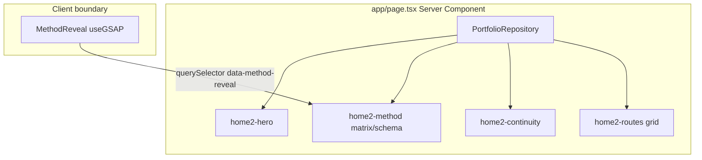
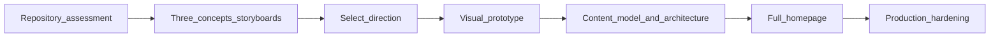

# Homepage cinematic redesign

**Goal:** Ship a cinematic scroll homepage behind PostHog boolean flag **`cinematic-homepage`**, keeping **Homepage 2 as the default** for visitors until the flag is enabled in PostHog (targeted to you first, then everyone at launch). Roll back by disabling the flag—no redeploy required. Creative direction, prototype validation, and merge-safe staged implementation follow the [slices](#execution-slices). Repository assessment below is **Phase 0 — frozen findings**.

## Recommended execution authority

| Slice                       | Recommended authority | Agent instruction                                      |
| --------------------------- | --------------------- | ------------------------------------------------------ |
| `creative-three-concepts`   | Open PR only          | Do not merge. Stop after opening the PR.               |
| `creative-direction-select` | Human gate            | Human decision only; agents do not execute this slice. |
| `visual-prototype`          | Open PR only          | Do not merge. Stop after opening the PR.               |
| `content-and-architecture`  | Open PR only          | Do not merge. Stop after opening the PR.               |
| `full-homepage-implement`   | Open PR only          | Do not merge. Stop after opening the PR.               |
| `production-hardening`      | Open PR only          | Do not merge. Stop after opening the PR.               |
| `plan-closure`              | Open PR only          | Do not merge. Stop after opening the PR.               |

Repo default: **Open PR only** ([planning-standards.md](../standards/planning-standards.md#repo-default-when-no-plan-slice-applies)).

Per-slice rationale and verification details are in each slice section below.

## Repository topology (default)

Multi-slice plans stack **execution order**, not Git branches. Integration branch: **`main`**.

**Before each implementation slice:** `git fetch` → fresh branch from `origin/main`.

**Before opening a PR:** branch contains **only** that slice’s changes; prior-slice work is on `main`, not via branch ancestry.

**After opening a PR:** PR base is `main`; diff has no prior-slice work except through merged `main`.

On mismatch: stop; do not continue on that PR.

---

## Official GSAP AI Skills (Cursor plugin)

The **gsap-skills** marketplace plugin is installed in Cursor (cache under `~/.cursor/plugins/cache/cursor-public/gsap-skills/`). Skills are **not** vendored into this repo; agents should read them at the start of motion/choreography work (requires **Agent Skills** enabled in Cursor).

| Skill                                | Use on this project                                                                                       |
| ------------------------------------ | --------------------------------------------------------------------------------------------------------- |
| **gsap-scrolltrigger**               | Pin/scrub, `once`, triggers, scroll-linked chapters (primary for cinematic home)                          |
| **gsap-react**                       | `useGSAP`, context cleanup, React + ScrollTrigger lifecycle (matches existing `MethodReveal` / Codenames) |
| **gsap-timeline**                    | Multi-beat chapter sequences, staggered reveals                                                           |
| **gsap-core**                        | Tweens, easing, `gsap.matchMedia()` branches                                                              |
| **gsap-performance**                 | Scroll-heavy home: invalidate/reflow, `will-change`, mobile pin discipline                                |
| **gsap-plugins**                     | Only if design needs ScrollSmoother, SplitText, etc. (all free on npm post-Webflow)                       |
| **gsap-frameworks** / **gsap-utils** | Secondary; Next.js specifics usually covered by gsap-react + repo patterns                                |

**Repo authority still wins for product constraints:** [AGENTS.md § Scroll runtime](AGENTS.md) (ScrollTrigger as single scroll runtime; SSR resolved floor; reduced-motion / focus / print escapes per [scroll-craft baseline](docs/experiments/scroll-craft-baseline.md)). Official skills inform API usage; portfolio patterns in [`components/projects/codenames-choreography.ts`](components/projects/codenames-choreography.ts) and [`components/home/MethodReveal.tsx`](components/home/MethodReveal.tsx) inform architecture.

**Visual direction:** Impeccable (`/impeccable`, in-repo [`.cursor/skills/impeccable/`](.cursor/skills/impeccable/)) for typography and layout; GSAP skills for motion implementation.

**Agent habit:** Before motion implementation, read **gsap-scrolltrigger** and **gsap-react** (add **gsap-performance** for pin/scrub). `@` skill files if the session does not auto-load them.

**Verify installation (global, not repo-local):** confirm `~/.cursor/plugins/cache/cursor-public/gsap-skills/*/skills/*/SKILL.md` exists; Cursor **Plugins → gsap-skills** installed; **Agent Skills** enabled. Re-check at the start of each implementation slice — plugin cache updates do not copy skills into the portfolio tree.

**Scroll authority:** GSAP + ScrollTrigger remain the **only** scroll orchestration runtime ([AGENTS.md](AGENTS.md)). Three.js / React Three Fiber are optional **render layers** (hero centerpiece, environmental motion) synchronized **to** ScrollTrigger timelines — not a second scroll system.

---

## Current homepage structure and dependencies

### Routing and page composition

- **Single root layout** — [`app/layout.tsx`](app/layout.tsx): fonts, global metadata, `ThemeScript` / `ThemeProvider`, skip link → `#content`, [`SiteHeader`](components/SiteHeader.tsx), page `children`, [`SiteFooter`](components/SiteFooter.tsx). No nested route layouts.
- **Home route** — [`app/page.tsx`](app/page.tsx): async Server Component; loads `getProfile()` + `getHomepage()` from [`getPortfolioRepository()`](lib/portfolio.ts) → [`repositories/static-portfolio-repository.ts`](repositories/static-portfolio-repository.ts).
- **Sections today** (class prefix `home2`):
  1. **Hero** — kicker from profile (headline · location · availability), H1 + lead from `homepage.hero`
  2. **Method** — “Two systems, one method”: wide ARIA `role="table"` matrix + narrow schema/system blocks; shared [`ChannelAnswer`](app/page.tsx) helper + [`QualifiedFigure`](components/QualifiedFigure.tsx)
  3. **Continuity** — “One practice” band + figure + About link
  4. **Routes** — four-card nav grid (`projects`, `articles`, `about`, `ecosystem`) + footer availability/mailto
  5. **Client leaf** — [`MethodReveal`](components/home/MethodReveal.tsx) at end of `<main>` (renders `null`)



### Content and domain model

- **Types** — [`domain/homepage.ts`](domain/homepage.ts): `Homepage` = `hero`, `method[]`, `channels[]`, `continuity`, `routes[]` (explicitly tied to the two-channel matrix IA).
- **Content** — [`content/homepage.ts`](content/homepage.ts): inventory-transcribed copy; tests assert equality via [`tests/static-portfolio-repository.test.ts`](tests/static-portfolio-repository.test.ts) and [`tests/content-foundation.test.ts`](tests/content-foundation.test.ts).
- **Profile** (hero kicker only on home today) — [`content/profile.ts`](content/profile.ts), typed in [`domain/profile.ts`](domain/profile.ts).

### Runtime dependencies ([`package.json`](package.json))

| Package                                                                                                                         | Role on home                    |
| ------------------------------------------------------------------------------------------------------------------------------- | ------------------------------- |
| `next` 16.3, `react` 19                                                                                                         | App Router, RSC                 |
| `gsap` + `@gsap/react`                                                                                                          | `MethodReveal` only on `/`      |
| `posthog-js`                                                                                                                    | Global init (not home-specific) |
| **No** `@react-three/fiber`, `three`, Tailwind-only styling via `@import "tailwindcss"` in [`app/globals.css`](app/globals.css) |

Home styles: [`app/styles/home.css`](app/styles/home.css) (breakpoint `--home2-break` at 820px; wide/narrow projections).

---

## Existing GSAP usage and animation architecture

**Policy (authoritative):** [AGENTS.md § Scroll runtime](AGENTS.md) — **GSAP ScrollTrigger is the single production scroll runtime**; scroll-craft is **retired** ([`docs/experiments/scroll-craft-baseline.md`](docs/experiments/scroll-craft-baseline.md)).

### Homepage (`MethodReveal`)

- **Pattern:** DOM-less client component; arms elements marked `[data-method-reveal]` in the server markup.
- **Effect:** Once-on-entry stagger (opacity + 10px y, 90ms stagger, `start: "top 85%"`, `once: true`).
- **Responsive:** `gsap.matchMedia()` — wide `(min-width: 821px)` vs narrow `(max-width: 820px)`; only visible projection armed (`offsetParent` / height check).
- **Lifecycle:** `useGSAP` revert on unmount → client nav back to `/` re-arms (covered by [`e2e/home-method-reveal.spec.ts`](e2e/home-method-reveal.spec.ts)).
- **A11y contract (must carry forward for any scroll-hide):**
  - **No JS / reduced motion:** SSR markup is the floor; arming gated on `(prefers-reduced-motion: no-preference)`; no CSS-only hide.
  - **Keyboard / print:** [`app/styles/home.css`](app/styles/home.css) `:focus-within` + `@media print` overrides for `[data-method-reveal] > *` (GSAP inline opacity needs `!important`).

### Codenames case study (reference architecture for “cinematic”)

- [`components/projects/CodenamesCaseExperience.tsx`](components/projects/CodenamesCaseExperience.tsx) + [`components/projects/codenames-choreography.ts`](components/projects/codenames-choreography.ts): richer ScrollTrigger (pin, scrub, beat slots), choreography extracted from JSX, **resolved SSR document as degradation floor**, `matchMedia` for desktop vs mobile (mobile = native document, no pin).
- **Reuse for home redesign:** split **server-resolved story markup** vs **client choreography module**; keep `domain/` / `repositories/` unaware of GSAP.

### What you can drop after IA change

- `MethodReveal` as implemented (matrix row stagger) — **replace on the cinematic branch** in phased slices; **remove entirely** only in post-flag cleanup PR.
- Most of [`app/styles/home.css`](app/styles/home.css) tied to `.home2-matrix`, `.home2-schema`, `.home2-route-grid`, etc. — **after** legacy renderer and `cinematic-homepage` flag are removed.
- `ChannelAnswer` and ARIA table roles — tied to removed IA.
- E2E assertions in [`e2e/home-method-reveal.spec.ts`](e2e/home-method-reveal.spec.ts) and home slices of [`e2e/happy-path.spec.ts`](e2e/happy-path.spec.ts) — **rewrite** when new DOM/contracts land.

---

## Shared layouts, routing, navigation

| Surface   | Path                            | Notes                                                                           |
| --------- | ------------------------------- | ------------------------------------------------------------------------------- |
| Home      | `/`                             | Redesign target                                                                 |
| Projects  | `/projects`, `/projects/[slug]` | Codenames slug uses heavy GSAP                                                  |
| Articles  | `/articles`                     |                                                                                 |
| About     | `/about`                        | Practice record                                                                 |
| Ecosystem | `/ecosystem`                    | In homepage route grid today; **not** in [`lib/nav.ts`](lib/nav.ts) primary nav |

**Primary nav (fixed per your direction):** [`lib/nav.ts`](lib/nav.ts) — Projects, Articles, About; header also mailto + [`ThemeSwitch`](components/ThemeSwitch.tsx). Logo → `/`. Mobile sheet in [`SiteHeader`](components/SiteHeader.tsx) (breakpoint 921px).

**Safe to keep untouched in v1 redesign:** `app/layout.tsx`, `SiteHeader`, `SiteFooter`, theme stack, all non-home routes.

---

## SEO, analytics, portfolio assistant

### SEO / structured data

- **Global:** [`app/layout.tsx`](app/layout.tsx) — `metadataBase`, title template, description, keywords, OG/Twitter, viewport theme colors.
- **Home-specific:** [`app/page.tsx`](app/page.tsx) — `title.absolute: SITE_TITLE`, `canonical: "/"`, `openGraph.url: "/"`.
- **JSON-LD:** [`PersonJsonLd`](components/PersonJsonLd.tsx) in layout (Person + WebSite); tests in [`tests/jsonld-graph.test.tsx`](tests/jsonld-graph.test.tsx).
- **Sitemap:** [`app/sitemap.ts`](app/sitemap.ts) + [`lib/sitemap-paths.ts`](lib/sitemap-paths.ts) (includes `/ecosystem`).
- **Redesign guardrails:** Keep meaningful `<h1>`, stable `id="content"`, and page metadata on **each** home variant; cinematic motion must not remove crawlable narrative text from the initial HTML response when the flag is ON. Until global launch, crawlers without a targeted flag cookie should continue to receive **legacy** HTML (fail-closed evaluator).

### Analytics

- [`instrumentation-client.ts`](instrumentation-client.ts) → [`lib/posthog.ts`](lib/posthog.ts): init only when `NEXT_PUBLIC_POSTHOG_PROJECT_TOKEN` set; `autocapture: false`, session recording off.
- **Events today:** `outbound_link` via [`ExternalLink`](components/ExternalLink.tsx) only — homepage uses plain `<Link>` / `<a>` (no custom home events).
- **Server-side PostHog today:** none — no `posthog-node`, no `@posthog/next`, no feature flags ([archived PostHog plan](.cursor/plans/archive/2026-08-10-portfolio-posthog-analytics.plan.md) explicitly deferred flags and server SDK).
- **Distinct ID today:** created and persisted by `posthog-js` in the **browser** only (cookie/local persistence after client init). It is **not** available to the App Router on first SSR unless we add a small identity bridge (see [PostHog feature flag rollout](#posthog-feature-flag-rollout-cinematic-homepage)).
- **Follow-up:** define PostHog events for scroll chapters / CTA taps if product health needs them (optional in `production-hardening`).

### Portfolio assistant

- **Production UI:** none ([`docs/assistant/architecture-direction.md`](docs/assistant/architecture-direction.md) — “another view”, additive on landing when built).
- **Shipped tooling (CLI, not in Next bundle):** `okf:build`, `assistant:derive`, `assistant:ingest`, `assistant:retrieve`; corpus producers under `scripts/assistant/okf/`.
- **Homepage coupling:** OKF does not reference `content/homepage.ts` by name today; future assistant should ingest **published** narrative. When `homepage` content model changes, plan an OKF/portfolio-producer update so retrieval stays aligned (merge-safe content + ingest slice).

---

## What can be replaced safely vs must be preserved

### Replace / restructure (your stated direction)

| Asset                                                                                     | Verdict                                                                                                                                                                                                                                                                                                                                                               |
| ----------------------------------------------------------------------------------------- | --------------------------------------------------------------------------------------------------------------------------------------------------------------------------------------------------------------------------------------------------------------------------------------------------------------------------------------------------------------------- |
| [`domain/homepage.ts`](domain/homepage.ts) + [`content/homepage.ts`](content/homepage.ts) | **Dual model during rollout:** add scroll-chapter narrative types + content for the **flagged** home in `content-and-architecture`; **retain** legacy matrix-era model (extract to `homepage-legacy` modules or equivalent) until post-launch cleanup removes the flag and legacy path.                                                                               |
| [`app/page.tsx`](app/page.tsx)                                                            | **Flag router (server):** evaluate `cinematic-homepage` on the server; render **legacy Homepage 2** when flag OFF/unavailable; render cinematic implementation when flag ON. Keep shared `metadata` patterns; `/` must be **dynamic** while the flag exists (see rollout section).                                                                                    |
| [`components/home/MethodReveal.tsx`](components/home/MethodReveal.tsx)                    | **Two-slice replacement on the flagged path only:** `content-and-architecture` removes matrix/`MethodReveal` from the **cinematic** branch and ships **static** chapter markup — **no cinematic GSAP in Phase D**. `full-homepage-implement` adds final GSAP choreography on the flagged path. **Legacy branch** keeps current `MethodReveal` behavior until cleanup. |
| [`app/styles/home.css`](app/styles/home.css)                                              | **Slice-owned styling:** `content-and-architecture` adds static chapter layout CSS for the flagged home (new classes; do not delete legacy `.home2-*` yet). `full-homepage-implement` adds cinematic motion styling on the flagged path. **Post-stabilization cleanup PR** removes obsolete legacy rules after the flag and legacy renderer are deleted.              |

### Preserve or reuse

| Asset                                               | Verdict                                                                                                                                                                                                                    |
| --------------------------------------------------- | -------------------------------------------------------------------------------------------------------------------------------------------------------------------------------------------------------------------------- |
| `PortfolioRepository.getHomepage()`                 | **Keep interface**; evolve return type with tests updated.                                                                                                                                                                 |
| [`QualifiedFigure`](components/QualifiedFigure.tsx) | **Reuse** if any beat still shows qualified metrics; optional on a copy-light home.                                                                                                                                        |
| [`content/profile.ts`](content/profile.ts)          | **Keep** for header/footer; hero kicker may shrink or move into chapters.                                                                                                                                                  |
| Global shell, routes, subpages                      | **Preserve** (explicit requirement).                                                                                                                                                                                       |
| GSAP + a11y discipline                              | **Preserve pattern**, not current effect.                                                                                                                                                                                  |
| React Three Fiber                                   | **Evaluate in creative phase** — not rejected by default; adopt only if a concept + prototype show **material** visual gain over DOM/CSS/GSAP alone, with lazy bundle, static SSR fallback, and reduced-motion equivalent. |

### Narrative source of truth (for design proposal — not implementation)

Transform (not verbatim paste) from your resume summary into scroll beats:

1. **12+ years** production engineering — full-stack product, experimentation infra, technical leadership **at Atlassian**
2. **Four years EM** → deliberate return to **hands-on IC**
3. **Recent:** independent software, AI-assisted dev workflows, developer infrastructure
4. **Positioning:** experienced hands-on **Senior SWE**, product fundamentals, **AI-native** practice — not EM-first, Staff, or researcher

Cross-check claims against sibling [`resumes/`](file:///Users/michaeltruong/code/resumes) inventory when writing [`content/homepage.ts`](content/homepage.ts) (same discipline as today’s “transcribed from inventory” comment). [`content/profile.ts`](content/profile.ts) bio is a secondary voice reference.

**UX:** contextual inline links during scroll story; **no** closing route grid; top nav always available (header `topnav` remains reachable at all times).

**Creative bar:** ambition and polish comparable to [webfueled.dev](https://webfueled.dev) as a **reference for motion craft and scroll narrative** — not a layout clone. Concepts must be **original** to this portfolio’s evidence-backed positioning.

---

## PostHog feature flag rollout (`cinematic-homepage`)

Controlled migration only — **not** a general feature-flag framework. Reuse the existing Portfolio Projects PostHog project (`NEXT_PUBLIC_POSTHOG_PROJECT_TOKEN`, `NEXT_PUBLIC_POSTHOG_HOST`; same vars on Vercel preview/production per [AGENTS.md](AGENTS.md)).

### Phase 0 infrastructure findings (frozen)

| Area            | Today                                                                                                                                                   | Implication for rollout                                                                                                                                                                     |
| --------------- | ------------------------------------------------------------------------------------------------------------------------------------------------------- | ------------------------------------------------------------------------------------------------------------------------------------------------------------------------------------------- |
| Client SDK      | [`posthog-js`](package.json) via [`instrumentation-client.ts`](instrumentation-client.ts) / [`lib/posthog.ts`](lib/posthog.ts)                          | Extend init to **bootstrap** server-evaluated flags + `distinct_id` when token present — avoid client-only flag fetch flicker.                                                              |
| Server SDK      | **Absent**                                                                                                                                              | Add **`posthog-node`** (or equivalent minimal server client) **only** for `isFeatureEnabled('cinematic-homepage', distinctId)` — scoped helpers under `lib/`, not a reusable flag platform. |
| Distinct ID     | Browser-only after `posthog.init`                                                                                                                       | **Do not assume** an anonymous ID exists on first SSR. Bridge identity before flag evaluation (below).                                                                                      |
| App Router      | [`app/page.tsx`](app/page.tsx) is a Server Component; no `cookies()` / flag reads today                                                                 | Home route becomes **request-dynamic** while the flag is active (`cookies()` or documented `dynamic = 'force-dynamic'` on `/`).                                                             |
| Caching         | No home-specific `fetch` cache; static generation may still apply to `/` until dynamic                                                                  | Personalized HTML must not be served from a shared static shell — document Vercel/Next behavior in the architecture note.                                                                   |
| CI / Playwright | [`e2e/home-method-reveal.spec.ts`](e2e/home-method-reveal.spec.ts), [`e2e/happy-path.spec.ts`](e2e/happy-path.spec.ts) assert **legacy** home contracts | Default CI remains **flag OFF**; add parallel coverage for **flag ON** via deterministic test doubles (no live PostHog).                                                                    |
| Secrets         | Public token only in `.env.example`                                                                                                                     | Add **server-only** PostHog credential for flag API (e.g. personal/project API key) in Vercel **server** env — never prefix `NEXT_PUBLIC_`; document in `.env.example` comments only.       |

### Flag contract

| State                                                            | `/` renders                                                                                      |
| ---------------------------------------------------------------- | ------------------------------------------------------------------------------------------------ |
| `cinematic-homepage` **disabled** (default)                      | **Existing Homepage 2** (matrix, `MethodReveal`, current e2e contracts).                         |
| `cinematic-homepage` **enabled** for this `distinct_id`          | **Cinematic** implementation (static chapters in Phase D; full GSAP/WebGL in Phase E).           |
| PostHog **unavailable**, misconfigured, or evaluation **errors** | **Fail closed to legacy** — same as flag OFF.                                                    |
| Launch                                                           | Enable flag for **100%** of users in PostHog UI (release condition), not percentage experiments. |
| Rollback                                                         | Disable flag or remove release in PostHog — **no deploy** required.                              |

**Out of scope:** authentication, query-parameter overrides, preview-toggle UI, custom flag service, percentage rollouts, PostHog experiments infrastructure.

### Identity propagation (server ↔ browser)

Goal: the **same** `distinct_id` PostHog uses for targeting in the UI is the ID passed to server-side `isFeatureEnabled`.

Recommended minimal pattern (implement in `content-and-architecture`; refine in PR if PostHog docs prescribe a newer Next.js recipe):

1. **Middleware** (or equivalent edge-safe hook): on requests to `/`, read the PostHog persistence cookie if present; if missing, generate a cryptographically random anonymous `distinct_id`, set the **first-party** cookie PostHog expects (document exact name in `docs/experiments/`), `Secure`/`SameSite` appropriate for production.
2. **Server Component** [`app/page.tsx`](app/page.tsx): read `distinct_id` from `cookies()` → call wrapped `isCinematicHomepageEnabled(distinctId)` → branch render.
3. **Client** [`lib/posthog.ts`](lib/posthog.ts): `posthog.init` with **`bootstrap`** `{ distinctID, featureFlags }` from server props or inline script payload so the first paint matches SSR and IDs do not fork.
4. **Your targeting:** in PostHog → Persons / Live events, copy your browser’s `distinct_id` and add a **release condition** on the flag (person/`distinct_id` allowlist). Expect **separate IDs per browser/profile** (laptop vs phone, cleared storage, incognito) — target each ID you use or accept re-copying after cookie reset.

**Limitations to document in the architecture note:** anonymous IDs are not accounts; storage clears re-target; crawlers without cookies evaluate as flag OFF (legacy HTML) until global launch.

### Caching and flag refresh

- Treat `/` as **dynamic** for the migration window so HTML reflects the flag for the request’s `distinct_id`.
- Server flag evaluation: prefer **per-request** `posthog-node` calls with a **short bounded cache** (optional, e.g. 30–60s in-memory) only if latency requires it — trade freshness vs TTFB in the PR.
- PostHog UI changes typically propagate within **seconds to a few minutes**; document observed delay after toggling. No redeploy needed; avoid long-lived edge caches of HTML for `/`.
- After global launch + cleanup PR removes the flag, `/` may return to static optimization if desired.

### Automated testing (deterministic)

Plan coverage in **`content-and-architecture`** (helpers + unit tests) and expand in later runtime slices:

| Scenario            | Expected                                                                   | How to test (no live PostHog)                                                                                                                                 |
| ------------------- | -------------------------------------------------------------------------- | ------------------------------------------------------------------------------------------------------------------------------------------------------------- |
| Flag OFF            | Legacy home DOM                                                            | Default Playwright + Vitest mock returns `false`.                                                                                                             |
| Flag ON             | Cinematic branch DOM (static, then motion in Phase E)                      | Playwright sets **test-only** env or server mock hook (e.g. `CINEMATIC_HOMEPAGE_E2E=1` read only in test/CI server config) — **not** a public query override. |
| PostHog failure     | Legacy home                                                                | Unit tests force evaluator throw/timeout → `false`.                                                                                                           |
| SSR/CSR consistency | Same branch on first paint and after hydration                             | Playwright + optional snapshot of root marker `data-home-variant="legacy                                                                                      | cinematic"`. |
| Shell / SEO         | Nav, subpages, canonical, `id="content"`, crawlable copy on active variant | Extend `happy-path` / metadata tests; cinematic variant keeps meaningful `<h1>` in SSR HTML when flag ON.                                                     |

Do **not** assert against your real PostHog `distinct_id` in CI.

### Operational rollout and cleanup

1. Create boolean flag **`cinematic-homepage`** in PostHog (Portfolio Projects) — **default OFF** for all users.
2. Load production (or preview with token), find **your** `distinct_id` in PostHog Persons/Live; add targeting so only that ID (and any other devices you care about) gets the flag **ON**.
3. Merge implementation slices incrementally; **public** visitors stay on legacy until step 5.
4. Verify flagged experience on deployed site with your targeted browser.
5. **Launch:** enable flag for **everyone** in PostHog.
6. **Rollback:** disable flag in PostHog if needed.
7. **After stabilization:** separate **cleanup PR** (not a frontmatter slice) — remove legacy homepage renderer, matrix content modules, `MethodReveal`, flag helper, `posthog-node` usage if no longer needed, and dual-path tests; simplify `/` to cinematic-only.

---

## Execution overview

Engineering guardrails above (SSR floor, reduced motion, focus/print escapes, SEO, shell nav, `useGSAP` lifecycle, tests) apply to **all** implementation slices. **Do not** finalize [`domain/homepage.ts`](domain/homepage.ts), [`content/homepage.ts`](content/homepage.ts), or production route markup until **after** `creative-direction-select` and `visual-prototype` exit criteria pass.



| Phase | Frontmatter todo            | Goal                                                                         |
| ----- | --------------------------- | ---------------------------------------------------------------------------- |
| **0** | (this document)             | Repository assessment + planning envelope                                    |
| **A** | `creative-three-concepts`   | Three concepts + storyboards                                                 |
| **B** | `creative-direction-select` | One chosen concept + written rationale                                       |
| **C** | `visual-prototype`          | Hero + first scroll transition, reviewed                                     |
| **D** | `content-and-architecture`  | PostHog flag + legacy default; cinematic static home behind flag; dual tests |
| **E** | `full-homepage-implement`   | Cinematic GSAP/WebGL behind flag; prototype teardown; flag ON e2e            |
| **F** | `production-hardening`      | Flag OFF/ON/failure validation, launch/rollback, perf/a11y/SEO               |

### Merge-safe regression (all runtime slices)

Any slice that changes **runtime behavior** or **production DOM** on `/` (or routes exercised by CI Playwright) must, in the **same PR**:

1. Run **`npm run test:e2e`** (after `npm run build`) when the diff touches `app/`, `components/`, `e2e/`, or other runtime paths — not deferred to a later slice.
2. Update **unit**, **integration**, and **Playwright** specs affected by the change; do not leave `main` red or tests asserting removed contracts.
3. **Not defer** correctness, compatibility, or regression fixes to a later slice.
4. **Flag discipline:** merging must **not** switch the public default to cinematic — CI and default mocks keep **`cinematic-homepage` OFF** unless a test explicitly enables ON. When a slice changes the cinematic branch, update **both** legacy (OFF) and cinematic (ON) coverage as applicable.

Docs-only slices (`creative-three-concepts`, `plan-closure`) and the **human gate** are exempt. `production-hardening` follows the same rule when it touches runtime paths.

**Canonical plan path:** [`.cursor/plans/2026-10-15-homepage-cinematic-redesign.plan.md`](.cursor/plans/2026-10-15-homepage-cinematic-redesign.plan.md).

---

## Execution slices

### Slice — `creative-three-concepts`

**Recommended authority:** Open PR only

**Rationale:**

- Creative deliverable is a design doc under `docs/` (and optional static comps), not production homepage code
- Must land for human review before prototype or schema work
- Merge-safe alone: no route or type contract changes

**Agent instruction:** Do not merge. Stop after opening the PR.

**Goal:** Produce **three genuinely distinct** cinematic homepage concepts per the creative requirements below (Impeccable + scroll-craft methodology, webfueled.dev polish bar, GSAP/WebGL/CSS split per concept).

**Tools and references**

- **Impeccable** ([`.cursor/skills/impeccable/`](.cursor/skills/impeccable/)): use `/impeccable` **live** or shape/finish flows to produce **three genuinely distinct** directions (Impeccable’s “three variants / three axes” discipline — not three shades of the same layout). Ground in [PRODUCT.md](PRODUCT.md), [DESIGN.md](DESIGN.md), [docs/design-system.md](docs/design-system.md).
- **scroll-craft methodology** ([docs/experiments/scroll-craft-baseline.md](docs/experiments/scroll-craft-baseline.md)): use **runtime-agnostic** creative constraints only — scope containment, SSR-resolved floor before arming, portfolio **hard** reduced-motion floor, no load-bearing copy hidden in CSS-only cues, keyboard `:focus-within` and print settles for any armed hide, pin discipline on mobile (Codenames: mobile = native document). **Do not** reintroduce the retired engine, `data-sc-*` devices, or vendored scroll-craft assets.
- **GSAP skills:** read **gsap-scrolltrigger**, **gsap-react**, **gsap-timeline** while storyboarding scroll beats (verify global install per section above).
- **Polish reference:** webfueled.dev — scroll pacing, transition confidence, typographic restraint vs spectacle; adapt to portfolio amber budget and evidence tone.

**Deliverable:** a design document (recommended path: `docs/experiments/homepage-cinematic-concepts.md` or Impeccable-exported comps + markdown storyboard) containing **three named concepts**. For **each** concept, include:

1. **Visual identity** — one-sentence world + how it differs from the other two; typography/color/motion personality within existing tokens (no competing design system).
2. **Signature centerpiece** — the single memorable visual (scene, typographic object, spatial metaphor, or WebGL focal) that anchors the experience.
3. **Scroll narrative** — chapter list with major **visual states** and **transitions** (storyboard frames or annotated screenshots/wireframes); scroll-driven pacing inspired by webfueled-level craft.
4. **Contextual navigation** — where and how inline links to **Projects**, **Articles**, and **About** appear in the story (not a route grid); optional Ecosystem link only where narrative warrants.
5. **Positioning story** — how the experience communicates **Senior SWE, hands-on, product-engineering, AI-native** without becoming an animated résumé (show craft and judgment; defer ledger detail to `/about` and evidence to `/projects`).
6. **Desktop vs mobile** — separate storyboard notes: pin vs native scroll, centerpiece behavior, type scale, whether WebGL runs on mobile or degrades.
7. **Technology split table** — per major beat, label effects as **GSAP/ScrollTrigger**, **WebGL (R3F/three)**, or **HTML/CSS**; justify WebGL rows with “what DOM cannot do convincingly.”
8. **Assessment matrix** — rate each concept on **visual impact**, **originality**, **implementation complexity**, and **performance risk** (qualitative: low / medium / high + one-line rationale).

**Explicit non-goals:** no production changes to [`app/page.tsx`](app/page.tsx), no [`domain/homepage.ts`](domain/homepage.ts) / [`content/homepage.ts`](content/homepage.ts) schema changes, no new npm dependencies.

**Acceptance:**

- `docs/experiments/homepage-cinematic-concepts.md` (or equivalent committed path named in PR) contains three named concepts with all eight deliverable bullets per concept
- No changes under `app/`, `components/home/`, `domain/homepage.ts`, or `content/homepage.ts`

**Verification:**

- [ ] `npm run format:check` (docs-only PR)
- [ ] PR diff limited to `docs/**`, `.cursor/**` as needed, and plan frontmatter todo `creative-three-concepts` → `completed`
- [ ] GitHub PR base branch is `main`

---

### Slice — `creative-direction-select`

**Recommended authority:** Human gate

**Rationale:**

- Creative direction is a product decision, not an agent implementation slice
- Blocks `visual-prototype` until recorded

**Agent instruction:** Human decision only; agents do not execute this slice.

**Goal:** Pick **one** concept (or a disciplined hybrid with written rules) after `creative-three-concepts` merges.

**Record in** `docs/experiments/homepage-cinematic-concepts.md` (or a dated amendment in this plan):

- Chosen concept id and link to storyboard section
- What was rejected and why (one paragraph)
- Whether WebGL is **in** or **out** for v1, and which centerpiece must be proven in prototype

**Acceptance:** Written decision exists before any `visual-prototype` branch work begins.

**Verification:** Human sign-off; optionally mark `creative-direction-select` `completed` in plan frontmatter via a small docs-only PR when recording the decision.

---

### Slice — `visual-prototype`

**Recommended authority:** Open PR only

**Rationale:**

- Validates composition, motion, and optional WebGL before schema and full homepage investment
- Isolated scope limits blast radius if direction is wrong

**Agent instruction:** Do not merge. Stop after opening the PR.

**Goal:** One **visually convincing** hero scene plus the **first scroll transition** into chapter 2 — enough to judge composition, type, lighting/atmosphere, and motion craft before building the full page.

**Scope**

- **Preferred:** isolated experimental route (e.g. `/experiments/home-hero-prototype`) so production [`app/page.tsx`](app/page.tsx) at `/` is **unchanged** — prototype code removed or redirected before launch.
- Implement the **technology split** from the chosen concept for these two beats only (GSAP choreography module + optional lazy R3F layer).
- **SSR floor** for prototype beats documented and visible with JS disabled.
- Read official **GSAP skills**; match portfolio patterns ([`codenames-choreography.ts`](components/projects/codenames-choreography.ts) extraction, `useGSAP` revert).

**Merge-safe regression (this slice)**

- If the PR touches **any runtime path** (including an experiment route): run **`npm run test:e2e`** in Verification.
- If production `/` is **unchanged:** existing home Playwright specs must still pass; document smoke coverage in the PR (happy-path home + any new experiment-route checks added in this PR).
- If the PR modifies production `/` or its DOM: **update every affected Playwright spec in the same PR** — do not defer to `content-and-architecture` or `full-homepage-implement`.

**Review (required before Phase D)**

- **Screenshot-based:** desktop and mobile stills at key scroll positions (load, mid-transition, settled chapter 2); compare against storyboard frames.
- **Browser-based:** interactive pass at 1280×800 and ~390×844; reduced-motion on; keyboard tab through hero CTAs/links.
- **Iteration loop:** at least one revision cycle on composition, typography, lighting/material (if WebGL), easing, and transition timing — capture deltas in PR description or design doc appendix.

**Exit criteria:** Stakeholder sign-off that the prototype matches the selected concept’s ambition; performance acceptable on mid-tier laptop and phone (no sustained jank on scroll); WebGL either validated or explicitly cut with fallback art direction.

**Acceptance:**

- Hero + first transition implemented per chosen concept technology split
- Screenshot + browser review documented in PR (desktop + mobile; reduced-motion pass)
- SSR floor for prototype beats documented; experiment route clearly non-production or removed before launch
- Merge-safe regression satisfied: production `/` unchanged with passing existing home e2e, **or** production DOM changes ship with updated Playwright in this PR

**Verification:**

- [ ] `npm run lint`
- [ ] `npm run typecheck`
- [ ] `npm run format:check`
- [ ] `npm run test` / `npm run test:coverage`
- [ ] `npm run build`
- [ ] `npm run test:e2e` (after `npm run build`; required when PR touches runtime paths)
- [ ] Manual: scroll review at 1280×800 and ~390×844 per slice review checklist
- [ ] GitHub PR base branch is `main`

**Dependencies:** `creative-three-concepts` merged; `creative-direction-select` recorded.

---

### Slice — `content-and-architecture`

**Recommended authority:** Open PR only

**Rationale:**

- Introduce the cinematic **content model** and **static** narrative UI without changing the visitor default — PostHog flag + legacy renderer keep Homepage 2 live on `main`
- Flag infrastructure and dual-path tests must land with the first cinematic markup or merge-unsafe regressions slip through
- Architecture doc must exist before `full-homepage-implement` adds cinematic choreography

**Agent instruction:** Do not merge. Stop after opening the PR.

**Goal:** **Atomic, merge-safe** introduction of PostHog flag **`cinematic-homepage`**, server-side evaluation (fail closed to legacy), and the **static** scroll-chapter cinematic home **behind the flag**, while **preserving Homepage 2** as the default `/` experience when the flag is OFF.

**Deliver in this slice (single PR):**

1. Create/configure flag **`cinematic-homepage`** in PostHog (document in PR); default **OFF** globally; document how to target your `distinct_id` in PostHog UI.
2. Add minimal server flag helper (`posthog-node` or equivalent) + middleware/cookie **distinct_id** bridge per [Identity propagation](#identity-propagation-server--browser); server-only env var on Vercel.
3. Refactor [`app/page.tsx`](app/page.tsx) into a **server flag router**: legacy branch (current home) vs cinematic branch; mark root with `data-home-variant` for tests; ensure `/` is dynamic while flag exists.
4. Extract **legacy** homepage into dedicated module(s) (markup + `MethodReveal` unchanged for OFF path).
5. Add cinematic **domain/content** (scroll chapters + contextual `links[]`); keep legacy matrix types in `homepage-legacy` (or equivalent) until cleanup PR.
6. Implement **static** cinematic chapter markup on the ON branch only (SSR floor; no GSAP choreography leaf).
7. Add static cinematic styles in [`app/styles/home.css`](app/styles/home.css) (or scoped file) without deleting legacy `.home2-*` rules yet.
8. Unit tests: flag evaluator fail-closed; repository/content for new model; mock PostHog — **no network**.
9. Playwright: **keep** legacy specs passing with default OFF ([`e2e/home-method-reveal.spec.ts`](e2e/home-method-reveal.spec.ts), [`e2e/happy-path.spec.ts`](e2e/happy-path.spec.ts)); **add** flag-ON static cinematic specs via test-only enablement (see [Automated testing](#automated-testing-deterministic)).
10. Architecture note in `docs/experiments/`: flag router, identity cookie, caching/dynamic `/`, server vs client bootstrap, file map for Phase E, SEO notes for both variants.

**Non-goals (reserved for `full-homepage-implement`):** Cinematic GSAP/WebGL choreography, pin/scrub timelines, visual refinement, motion e2e, prototype route teardown.

**Acceptance:** `main` merge-safe with **flag OFF = legacy Homepage 2** for default CI/visitors; **flag ON** serves static cinematic chapters; PostHog errors → legacy; no accidental public cutover.

**Verification:**

- [ ] `npm run lint`
- [ ] `npm run typecheck`
- [ ] `npm run format:check`
- [ ] `npm run test` / `npm run test:coverage`
- [ ] `npm run build`
- [ ] `npm run test:e2e` (after `npm run build`; required because this slice may modify `app/page.tsx`)
- [ ] GitHub PR base branch is `main`

**Dependencies:** `visual-prototype` exit criteria met (stakeholder sign-off).

---

### Slice — `full-homepage-implement`

**Recommended authority:** Open PR only

**Rationale:**

- Ships the visitor-facing `/` experience; must not leave CI red on required Playwright gates
- Merge-safe rule: tests for behavior this PR introduces ship **in the same PR**, not deferred to `production-hardening`

**Agent instruction:** Do not merge. Stop after opening the PR.

**Goal:** Layer **cinematic** GSAP/WebGL choreography and visual refinement on the **flagged** static home from `content-and-architecture` — **only when `cinematic-homepage` is ON**. Legacy branch unchanged. Retain shell, metadata patterns, `id="content"`. Do not re-open domain/content unless a merge-safe fix is required.

**Deliver in this slice (same PR unless noted):**

1. Cinematic GSAP/WebGL choreography and visual refinement on the **cinematic branch** per architecture and prototype sign-off.
2. Motion styling for the cinematic branch; remove obsolete rules **only where they apply to the cinematic path** (legacy `.home2-*` remain until post-flag cleanup).
3. **Prototype teardown:** remove the temporary `visual-prototype` experiment route (e.g. `/experiments/home-hero-prototype`), its dedicated assets, and prototype-only Playwright coverage — unless **deliberately promoted** (document in PR).

**Required in the same PR(s) that introduce runtime behavior or DOM changes:**

- Update Playwright (and any unit tests) for **cinematic** contracts: scroll choreography, optional WebGL, no-JS settled floor, `prefers-reduced-motion`, focus/print escapes, client nav remount (GSAP `useGSAP` revert)
- Do not defer motion-specific regression coverage to `production-hardening`

May span multiple merge-safe PRs only if **each** PR is shippable (including its e2e delta); prefer a single narrative launch when possible.

**Acceptance:** Flag OFF still legacy; flag ON cinematic matches architecture and prototype sign-off; CI e2e covers motion/a11y on **ON** path without breaking **OFF** legacy specs; no orphaned prototype route/assets/tests unless promoted.

**Verification:**

- [ ] `npm run lint`
- [ ] `npm run typecheck`
- [ ] `npm run format:check`
- [ ] `npm run test` / `npm run test:coverage`
- [ ] `npm run build`
- [ ] `npm run test:e2e` (after `npm run build`; home specs exercised)
- [ ] GitHub PR base branch is `main`

**Dependencies:** `content-and-architecture` merged.

---

### Slice — `production-hardening`

**Recommended authority:** Open PR only

**Rationale:**

- Optional polish and operator-facing follow-ups after the homepage ships
- Does **not** carry required e2e rewrites deferred from `full-homepage-implement`

**Agent instruction:** Do not merge. Stop after opening the PR.

**Goal:** Validate the **flagged rollout** on production/preview, confirm launch and rollback, then perf/a11y/SEO hardening.

**Scope:**

- **Flag matrix (manual + automated):** OFF → legacy; ON → cinematic; PostHog disabled/mocked failure → legacy; SSR/CSR variant marker consistent.
- **Targeted preview:** confirm your PostHog-targeted `distinct_id` sees cinematic on deployed site while an untargeted browser stays legacy.
- Bundle size review, lazy WebGL verification, ScrollTrigger count sanity check, Lighthouse spot-check (both variants as appropriate).
- Document **launch** (enable flag for everyone) and **rollback** (disable in PostHog) runbook in PR or `docs/experiments/`.
- Optional: PostHog chapter/CTA events; OKF producer + ingest if homepage copy enters retrieval scope.
- **Cleanup PR checklist** (human follow-up after stabilization): remove legacy renderer, flag plumbing, dual tests — per [Operational rollout and cleanup](#operational-rollout-and-cleanup).

**Non-goals:** Deferring homepage Playwright or correctness fixes that belong in `full-homepage-implement` or `content-and-architecture`; building query-param or admin preview toggles.

**Acceptance:** Documented validation of all flag states + launch/rollback steps; perf notes; optional integrations merge-safe alone; if runtime paths change, all affected tests updated in this PR per [Merge-safe regression](#merge-safe-regression-all-runtime-slices).

**Verification:**

- [ ] `npm run lint`
- [ ] `npm run typecheck`
- [ ] `npm run format:check`
- [ ] `npm run test` / `npm run test:coverage`
- [ ] `npm run build`
- [ ] `npm run test:e2e` when PR touches runtime paths (otherwise note N/A in PR)
- [ ] GitHub PR base branch is `main`

**Dependencies:** `full-homepage-implement` merged.

---

## Plan closure (docs-only PR)

**Recommended authority:** Open PR only

**Rationale:**

- Docs-only archival; human review of closure checklist
- No application behavior changes

**Agent instruction:** Do not merge. Stop after opening the PR.

After the last implementation slice merges, open a final docs-only closure PR:

1. Verify all implementation todos are already `completed` (or `cancelled`); fix stragglers only.
2. Add a `# Shipped` closure note at the top of the plan body (date, merged PR links, deferred work).
3. Move this file to `.cursor/plans/archive/2026-10-15-homepage-cinematic-redesign.plan.md`.
4. Mark `plan-closure` `completed` and update agent prompt references to the archived path.

Do not archive inside implementation PRs.

---

### Future — Portfolio assistant on home

Separate plan per [architecture-direction.md](docs/assistant/architecture-direction.md): additive UI on `/`, does not replace structured routes.

---

## Agent prompts (copy/paste for Cursor)

Use a **fresh Agent-mode chat** per slice. Each frontmatter todo has exactly one `### <todo-id>` heading below.

### creative-three-concepts

```text
@.cursor/plans/2026-10-15-homepage-cinematic-redesign.plan.md

Implement slice creative-three-concepts only. Do not start visual-prototype, content-and-architecture, full-homepage-implement, production-hardening, or plan-closure. Do not archive the plan.

Authority: Open PR only — implement and open the PR; do not merge.

Topology: start from latest origin/main; branch represents only this slice; PR base must be main.

Deliverables: docs/experiments/homepage-cinematic-concepts.md (or equivalent) with three distinct concepts per slice section. No app/, domain/homepage.ts, or content/homepage.ts changes. Mark creative-three-concepts completed in plan frontmatter in this PR.

Verification: format:check; PR diff scope per slice Acceptance; read gsap-scrolltrigger + gsap-react skills globally before motion storyboarding.
```

### creative-direction-select

```text
@.cursor/plans/2026-10-15-homepage-cinematic-redesign.plan.md

Human gate creative-direction-select only. Do not start visual-prototype or later slices until the decision is recorded.

Authority: Human gate — human decision only; agents do not execute this slice unless asked to record the decision in a docs-only PR.

Topology: n/a for human decision; if recording via PR, start from latest origin/main; PR base must be main.

Deliverables: chosen concept id, rejection rationale, WebGL in/out for v1 documented in docs/experiments/homepage-cinematic-concepts.md. Mark creative-direction-select completed in plan frontmatter when recording merges.

Verification: Phase B acceptance in slice section satisfied before any visual-prototype branch.
```

### visual-prototype

```text
@.cursor/plans/2026-10-15-homepage-cinematic-redesign.plan.md

Implement slice visual-prototype only. Prerequisite: creative-three-concepts merged and creative-direction-select recorded. Do not start content-and-architecture, full-homepage-implement, production-hardening, or plan-closure. Do not archive the plan.

Authority: Open PR only — implement and open the PR; do not merge.

Topology: start from latest origin/main; branch represents only this slice; PR base must be main.

Deliverables: hero + first scroll transition per chosen concept; GSAP ScrollTrigger authoritative; WebGL only if selected. Prefer isolated experiment route so production / is unchanged; if production DOM or runtime changes, update affected Playwright in this PR. Screenshot + browser review in PR. Mark visual-prototype completed in plan frontmatter in this PR.

Verification: lint, typecheck, format:check, test:coverage, build, test:e2e when runtime paths change; manual scroll review per slice Verification; production home smoke passes when / is unchanged.
```

### content-and-architecture

```text
@.cursor/plans/2026-10-15-homepage-cinematic-redesign.plan.md

Implement slice content-and-architecture only. Prerequisite: visual-prototype exit criteria met. Do not start full-homepage-implement, production-hardening, or plan-closure. Do not archive the plan.

Authority: Open PR only — implement and open the PR; do not merge.

Topology: start from latest origin/main; branch represents only this slice; PR base must be main.

Deliverables: PostHog flag cinematic-homepage + server eval (fail closed); legacy home default; static cinematic branch behind flag; dual Playwright (OFF legacy + ON static); architecture doc per slice. No cinematic GSAP on /. Mark content-and-architecture completed in plan frontmatter in this PR.

Verification: lint, typecheck, format:check, test:coverage, build, test:e2e per slice Verification; confirm default CI path is flag OFF.
```

### full-homepage-implement

```text
@.cursor/plans/2026-10-15-homepage-cinematic-redesign.plan.md

Implement slice full-homepage-implement only. Prerequisite: content-and-architecture merged. Do not start production-hardening or plan-closure. Do not archive the plan.

Authority: Open PR only — implement and open the PR; do not merge.

Topology: start from latest origin/main; branch represents only this slice; PR base must be main.

Deliverables: cinematic GSAP/WebGL on flagged branch only (legacy unchanged when OFF); remove visual-prototype experiment route, assets, and prototype-only tests unless promoted; update Playwright/unit for flag ON motion/DOM without breaking OFF legacy specs (same PR). Mark full-homepage-implement completed in plan frontmatter in this PR.

Verification: lint, typecheck, format:check, test:coverage, build, test:e2e per slice Verification.
```

### production-hardening

```text
@.cursor/plans/2026-10-15-homepage-cinematic-redesign.plan.md

Implement slice production-hardening only. Prerequisite: full-homepage-implement merged. Do not start plan-closure. Do not archive the plan.

Authority: Open PR only — implement and open the PR; do not merge.

Topology: start from latest origin/main; branch represents only this slice; PR base must be main.

Deliverables: validate flag OFF/ON/failure, targeted PostHog preview, launch/rollback runbook, perf/a11y/SEO notes; optional PostHog chapter events + OKF per slice Scope; cleanup PR checklist. Mark production-hardening completed in plan frontmatter in this PR.

Verification: lint, typecheck, format:check, test:coverage, build; test:e2e when runtime paths change; manual flag targeting check on deploy.
```

### plan-closure

```text
@.cursor/plans/2026-10-15-homepage-cinematic-redesign.plan.md

Execute only plan-closure.

Authority: Open PR only — docs-only archive PR; do not merge.

Prerequisites: all implementation slices merged and already marked completed in frontmatter.

Topology: start from latest origin/main; branch represents only this slice; PR base must be main.

Deliverables: verify slice todos, add # Shipped note, move plan to .cursor/plans/archive/2026-10-15-homepage-cinematic-redesign.plan.md, mark plan-closure completed, update agent prompt references to the archived path.

Verification: confirm all prerequisite implementation PRs are merged and slice todos are completed before archiving.
```

---

## Risk notes

- **Creative risk:** three weak variants wastes Phase C; Impeccable must enforce distinct axes/families, not density tweaks.
- **Prototype risk:** approving prototype without mobile + reduced-motion review repeats scroll-craft-era a11y gaps.
- **Bundle size:** R3F + `three` is a major step up; prototype must justify it; code-split and measure `npm run build` if adopted.
- **CI:** Any non-docs path change runs Playwright e2e ([AGENTS.md](AGENTS.md)); `visual-prototype`, `content-and-architecture`, and `full-homepage-implement` each own e2e deltas for their runtime/DOM changes — not deferred across slices or to `production-hardening`.
- **Flag rollout:** distinct_id is per-browser/storage; targeting only your laptop ID will not enable cinematic on phone until you add that ID in PostHog. SSR must not cache one variant for all users. Server flag API adds latency — bound or cache consciously.
- **Accidental cutover:** a PR that removes legacy renderer or defaults the flag ON in code (vs PostHog UI) breaks merge-safe intent — reviewers should verify fail-closed evaluator and CI default OFF.
- **Breakpoint drift:** Header uses 921px; home matrix uses 820px — new design should document a single breakpoint story.
- **Ecosystem:** Removed from cinematic narrative grid but still valid deep link; weave into narrative where “developer infrastructure / workflows” beats need it (legacy grid unchanged until cleanup).
