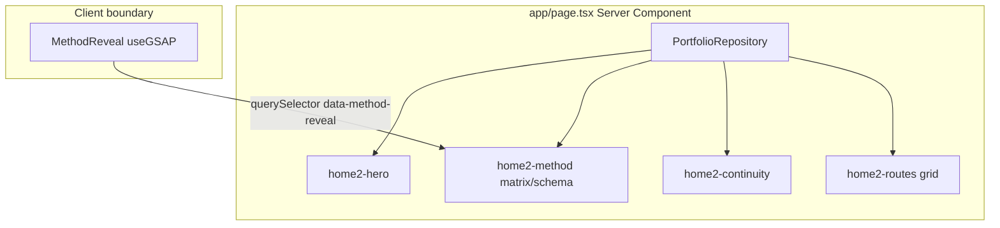
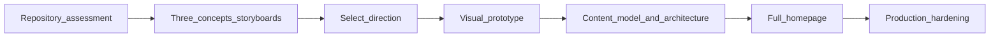

# Homepage cinematic redesign

**Goal:** Replace Homepage 2 with a cinematic scroll narrative after creative direction, prototype validation, and merge-safe staged implementation. Repository assessment below is **Phase 0 — frozen findings**; executable work follows the [slices](#execution-slices) in order.

## Recommended execution authority

| Slice                       | Recommended authority | Agent instruction                                      |
| --------------------------- | --------------------- | ------------------------------------------------------ |
| `creative-three-concepts`   | Open PR only          | Do not merge. Stop after opening the PR.               |
| `creative-direction-select` | Human gate            | Human decision only; agents do not execute this slice. |
| `visual-prototype`          | Open PR only          | Do not merge. Stop after opening the PR.               |
| `content-and-architecture`  | Open PR only          | Do not merge. Stop after opening the PR.               |
| `full-homepage-implement`   | Open PR only          | Do not merge. Stop after opening the PR.               |
| `production-hardening`      | Open PR only          | Do not merge. Stop after opening the PR.               |
| `plan-closure`              | Open PR only          | Do not merge. Stop after opening the PR.               |

Repo default: **Open PR only** ([planning-standards.md](../standards/planning-standards.md#repo-default-when-no-plan-slice-applies)).

Per-slice rationale and verification details are in each slice section below.

## Repository topology (default)

Multi-slice plans stack **execution order**, not Git branches. Integration branch: **`main`**.

**Before each implementation slice:** `git fetch` → fresh branch from `origin/main`.

**Before opening a PR:** branch contains **only** that slice’s changes; prior-slice work is on `main`, not via branch ancestry.

**After opening a PR:** PR base is `main`; diff has no prior-slice work except through merged `main`.

On mismatch: stop; do not continue on that PR.

---

## Official GSAP AI Skills (Cursor plugin)

The **gsap-skills** marketplace plugin is installed in Cursor (cache under `~/.cursor/plugins/cache/cursor-public/gsap-skills/`). Skills are **not** vendored into this repo; agents should read them at the start of motion/choreography work (requires **Agent Skills** enabled in Cursor).

| Skill                                | Use on this project                                                                                       |
| ------------------------------------ | --------------------------------------------------------------------------------------------------------- |
| **gsap-scrolltrigger**               | Pin/scrub, `once`, triggers, scroll-linked chapters (primary for cinematic home)                          |
| **gsap-react**                       | `useGSAP`, context cleanup, React + ScrollTrigger lifecycle (matches existing `MethodReveal` / Codenames) |
| **gsap-timeline**                    | Multi-beat chapter sequences, staggered reveals                                                           |
| **gsap-core**                        | Tweens, easing, `gsap.matchMedia()` branches                                                              |
| **gsap-performance**                 | Scroll-heavy home: invalidate/reflow, `will-change`, mobile pin discipline                                |
| **gsap-plugins**                     | Only if design needs ScrollSmoother, SplitText, etc. (all free on npm post-Webflow)                       |
| **gsap-frameworks** / **gsap-utils** | Secondary; Next.js specifics usually covered by gsap-react + repo patterns                                |

**Repo authority still wins for product constraints:** [AGENTS.md § Scroll runtime](AGENTS.md) (ScrollTrigger as single scroll runtime; SSR resolved floor; reduced-motion / focus / print escapes per [scroll-craft baseline](docs/experiments/scroll-craft-baseline.md)). Official skills inform API usage; portfolio patterns in [`components/projects/codenames-choreography.ts`](components/projects/codenames-choreography.ts) and [`components/home/MethodReveal.tsx`](components/home/MethodReveal.tsx) inform architecture.

**Visual direction:** Impeccable (`/impeccable`, in-repo [`.cursor/skills/impeccable/`](.cursor/skills/impeccable/)) for typography and layout; GSAP skills for motion implementation.

**Agent habit:** Before motion implementation, read **gsap-scrolltrigger** and **gsap-react** (add **gsap-performance** for pin/scrub). `@` skill files if the session does not auto-load them.

**Verify installation (global, not repo-local):** confirm `~/.cursor/plugins/cache/cursor-public/gsap-skills/*/skills/*/SKILL.md` exists; Cursor **Plugins → gsap-skills** installed; **Agent Skills** enabled. Re-check at the start of each implementation slice — plugin cache updates do not copy skills into the portfolio tree.

**Scroll authority:** GSAP + ScrollTrigger remain the **only** scroll orchestration runtime ([AGENTS.md](AGENTS.md)). Three.js / React Three Fiber are optional **render layers** (hero centerpiece, environmental motion) synchronized **to** ScrollTrigger timelines — not a second scroll system.

---

## Current homepage structure and dependencies

### Routing and page composition

- **Single root layout** — [`app/layout.tsx`](app/layout.tsx): fonts, global metadata, `ThemeScript` / `ThemeProvider`, skip link → `#content`, [`SiteHeader`](components/SiteHeader.tsx), page `children`, [`SiteFooter`](components/SiteFooter.tsx). No nested route layouts.
- **Home route** — [`app/page.tsx`](app/page.tsx): async Server Component; loads `getProfile()` + `getHomepage()` from [`getPortfolioRepository()`](lib/portfolio.ts) → [`repositories/static-portfolio-repository.ts`](repositories/static-portfolio-repository.ts).
- **Sections today** (class prefix `home2`):
  1. **Hero** — kicker from profile (headline · location · availability), H1 + lead from `homepage.hero`
  2. **Method** — “Two systems, one method”: wide ARIA `role="table"` matrix + narrow schema/system blocks; shared [`ChannelAnswer`](app/page.tsx) helper + [`QualifiedFigure`](components/QualifiedFigure.tsx)
  3. **Continuity** — “One practice” band + figure + About link
  4. **Routes** — four-card nav grid (`projects`, `articles`, `about`, `ecosystem`) + footer availability/mailto
  5. **Client leaf** — [`MethodReveal`](components/home/MethodReveal.tsx) at end of `<main>` (renders `null`)



### Content and domain model

- **Types** — [`domain/homepage.ts`](domain/homepage.ts): `Homepage` = `hero`, `method[]`, `channels[]`, `continuity`, `routes[]` (explicitly tied to the two-channel matrix IA).
- **Content** — [`content/homepage.ts`](content/homepage.ts): inventory-transcribed copy; tests assert equality via [`tests/static-portfolio-repository.test.ts`](tests/static-portfolio-repository.test.ts) and [`tests/content-foundation.test.ts`](tests/content-foundation.test.ts).
- **Profile** (hero kicker only on home today) — [`content/profile.ts`](content/profile.ts), typed in [`domain/profile.ts`](domain/profile.ts).

### Runtime dependencies ([`package.json`](package.json))

| Package                                                                                                                         | Role on home                    |
| ------------------------------------------------------------------------------------------------------------------------------- | ------------------------------- |
| `next` 16.3, `react` 19                                                                                                         | App Router, RSC                 |
| `gsap` + `@gsap/react`                                                                                                          | `MethodReveal` only on `/`      |
| `posthog-js`                                                                                                                    | Global init (not home-specific) |
| **No** `@react-three/fiber`, `three`, Tailwind-only styling via `@import "tailwindcss"` in [`app/globals.css`](app/globals.css) |

Home styles: [`app/styles/home.css`](app/styles/home.css) (breakpoint `--home2-break` at 820px; wide/narrow projections).

---

## Existing GSAP usage and animation architecture

**Policy (authoritative):** [AGENTS.md § Scroll runtime](AGENTS.md) — **GSAP ScrollTrigger is the single production scroll runtime**; scroll-craft is **retired** ([`docs/experiments/scroll-craft-baseline.md`](docs/experiments/scroll-craft-baseline.md)).

### Homepage (`MethodReveal`)

- **Pattern:** DOM-less client component; arms elements marked `[data-method-reveal]` in the server markup.
- **Effect:** Once-on-entry stagger (opacity + 10px y, 90ms stagger, `start: "top 85%"`, `once: true`).
- **Responsive:** `gsap.matchMedia()` — wide `(min-width: 821px)` vs narrow `(max-width: 820px)`; only visible projection armed (`offsetParent` / height check).
- **Lifecycle:** `useGSAP` revert on unmount → client nav back to `/` re-arms (covered by [`e2e/home-method-reveal.spec.ts`](e2e/home-method-reveal.spec.ts)).
- **A11y contract (must carry forward for any scroll-hide):**
  - **No JS / reduced motion:** SSR markup is the floor; arming gated on `(prefers-reduced-motion: no-preference)`; no CSS-only hide.
  - **Keyboard / print:** [`app/styles/home.css`](app/styles/home.css) `:focus-within` + `@media print` overrides for `[data-method-reveal] > *` (GSAP inline opacity needs `!important`).

### Codenames case study (reference architecture for “cinematic”)

- [`components/projects/CodenamesCaseExperience.tsx`](components/projects/CodenamesCaseExperience.tsx) + [`components/projects/codenames-choreography.ts`](components/projects/codenames-choreography.ts): richer ScrollTrigger (pin, scrub, beat slots), choreography extracted from JSX, **resolved SSR document as degradation floor**, `matchMedia` for desktop vs mobile (mobile = native document, no pin).
- **Reuse for home redesign:** split **server-resolved story markup** vs **client choreography module**; keep `domain/` / `repositories/` unaware of GSAP.

### What you can drop after IA change

- `MethodReveal` as implemented (matrix row stagger) — **replace**, not extend, if the method matrix markup goes away.
- Most of [`app/styles/home.css`](app/styles/home.css) tied to `.home2-matrix`, `.home2-schema`, `.home2-route-grid`, etc.
- `ChannelAnswer` and ARIA table roles — tied to removed IA.
- E2E assertions in [`e2e/home-method-reveal.spec.ts`](e2e/home-method-reveal.spec.ts) and home slices of [`e2e/happy-path.spec.ts`](e2e/happy-path.spec.ts) — **rewrite** when new DOM/contracts land.

---

## Shared layouts, routing, navigation

| Surface   | Path                            | Notes                                                                           |
| --------- | ------------------------------- | ------------------------------------------------------------------------------- |
| Home      | `/`                             | Redesign target                                                                 |
| Projects  | `/projects`, `/projects/[slug]` | Codenames slug uses heavy GSAP                                                  |
| Articles  | `/articles`                     |                                                                                 |
| About     | `/about`                        | Practice record                                                                 |
| Ecosystem | `/ecosystem`                    | In homepage route grid today; **not** in [`lib/nav.ts`](lib/nav.ts) primary nav |

**Primary nav (fixed per your direction):** [`lib/nav.ts`](lib/nav.ts) — Projects, Articles, About; header also mailto + [`ThemeSwitch`](components/ThemeSwitch.tsx). Logo → `/`. Mobile sheet in [`SiteHeader`](components/SiteHeader.tsx) (breakpoint 921px).

**Safe to keep untouched in v1 redesign:** `app/layout.tsx`, `SiteHeader`, `SiteFooter`, theme stack, all non-home routes.

---

## SEO, analytics, portfolio assistant

### SEO / structured data

- **Global:** [`app/layout.tsx`](app/layout.tsx) — `metadataBase`, title template, description, keywords, OG/Twitter, viewport theme colors.
- **Home-specific:** [`app/page.tsx`](app/page.tsx) — `title.absolute: SITE_TITLE`, `canonical: "/"`, `openGraph.url: "/"`.
- **JSON-LD:** [`PersonJsonLd`](components/PersonJsonLd.tsx) in layout (Person + WebSite); tests in [`tests/jsonld-graph.test.tsx`](tests/jsonld-graph.test.tsx).
- **Sitemap:** [`app/sitemap.ts`](app/sitemap.ts) + [`lib/sitemap-paths.ts`](lib/sitemap-paths.ts) (includes `/ecosystem`).
- **Redesign guardrails:** Keep meaningful `<h1>`, stable `id="content"`, and page metadata; cinematic motion must not remove crawlable narrative text from the initial HTML response.

### Analytics

- [`instrumentation-client.ts`](instrumentation-client.ts) → [`lib/posthog.ts`](lib/posthog.ts): init only when `NEXT_PUBLIC_POSTHOG_PROJECT_TOKEN` set; `autocapture: false`, session recording off.
- **Events today:** `outbound_link` via [`ExternalLink`](components/ExternalLink.tsx) only — homepage uses plain `<Link>` / `<a>` (no custom home events).
- **Follow-up:** define PostHog events for scroll chapters / CTA taps if product health needs them (optional slice).

### Portfolio assistant

- **Production UI:** none ([`docs/assistant/architecture-direction.md`](docs/assistant/architecture-direction.md) — “another view”, additive on landing when built).
- **Shipped tooling (CLI, not in Next bundle):** `okf:build`, `assistant:derive`, `assistant:ingest`, `assistant:retrieve`; corpus producers under `scripts/assistant/okf/`.
- **Homepage coupling:** OKF does not reference `content/homepage.ts` by name today; future assistant should ingest **published** narrative. When `homepage` content model changes, plan an OKF/portfolio-producer update so retrieval stays aligned (merge-safe content + ingest slice).

---

## What can be replaced safely vs must be preserved

### Replace / restructure (your stated direction)

| Asset                                                                                     | Verdict                                                                                                                                                                               |
| ----------------------------------------------------------------------------------------- | ------------------------------------------------------------------------------------------------------------------------------------------------------------------------------------- |
| [`domain/homepage.ts`](domain/homepage.ts) + [`content/homepage.ts`](content/homepage.ts) | **Replace schema** — move from matrix/channels/continuity/routes to scroll-chapter narrative model (beats, optional inline CTAs to `/projects`, `/articles`, `/about`, `/ecosystem`). |
| [`app/page.tsx`](app/page.tsx) markup                                                     | **Replace** section structure; keep repository fetch pattern and home `metadata`.                                                                                                     |
| [`components/home/MethodReveal.tsx`](components/home/MethodReveal.tsx)                    | **Replace** with new client choreography (or multiple scene components).                                                                                                              |
| [`app/styles/home.css`](app/styles/home.css)                                              | **Replace** (large delete/rename acceptable; avoid breaking global tokens in [`app/styles/tokens.css`](app/styles/tokens.css)).                                                       |

### Preserve or reuse

| Asset                                               | Verdict                                                                                                                                                                                                                    |
| --------------------------------------------------- | -------------------------------------------------------------------------------------------------------------------------------------------------------------------------------------------------------------------------- |
| `PortfolioRepository.getHomepage()`                 | **Keep interface**; evolve return type with tests updated.                                                                                                                                                                 |
| [`QualifiedFigure`](components/QualifiedFigure.tsx) | **Reuse** if any beat still shows qualified metrics; optional on a copy-light home.                                                                                                                                        |
| [`content/profile.ts`](content/profile.ts)          | **Keep** for header/footer; hero kicker may shrink or move into chapters.                                                                                                                                                  |
| Global shell, routes, subpages                      | **Preserve** (explicit requirement).                                                                                                                                                                                       |
| GSAP + a11y discipline                              | **Preserve pattern**, not current effect.                                                                                                                                                                                  |
| React Three Fiber                                   | **Evaluate in creative phase** — not rejected by default; adopt only if a concept + prototype show **material** visual gain over DOM/CSS/GSAP alone, with lazy bundle, static SSR fallback, and reduced-motion equivalent. |

### Narrative source of truth (for design proposal — not implementation)

Transform (not verbatim paste) from your resume summary into scroll beats:

1. **12+ years** production engineering — full-stack product, experimentation infra, technical leadership **at Atlassian**
2. **Four years EM** → deliberate return to **hands-on IC**
3. **Recent:** independent software, AI-assisted dev workflows, developer infrastructure
4. **Positioning:** experienced hands-on **Senior SWE**, product fundamentals, **AI-native** practice — not EM-first, Staff, or researcher

Cross-check claims against sibling [`resumes/`](file:///Users/michaeltruong/code/resumes) inventory when writing [`content/homepage.ts`](content/homepage.ts) (same discipline as today’s “transcribed from inventory” comment). [`content/profile.ts`](content/profile.ts) bio is a secondary voice reference.

**UX:** contextual inline links during scroll story; **no** closing route grid; top nav always available (header `topnav` remains reachable at all times).

**Creative bar:** ambition and polish comparable to [webfueled.dev](https://webfueled.dev) as a **reference for motion craft and scroll narrative** — not a layout clone. Concepts must be **original** to this portfolio’s evidence-backed positioning.

---

## Execution overview

Engineering guardrails above (SSR floor, reduced motion, focus/print escapes, SEO, shell nav, `useGSAP` lifecycle, tests) apply to **all** implementation slices. **Do not** finalize [`domain/homepage.ts`](domain/homepage.ts), [`content/homepage.ts`](content/homepage.ts), or production route markup until **after** `creative-direction-select` and `visual-prototype` exit criteria pass.



| Phase | Frontmatter todo            | Goal                                           |
| ----- | --------------------------- | ---------------------------------------------- |
| **0** | (this document)             | Repository assessment + planning envelope      |
| **A** | `creative-three-concepts`   | Three concepts + storyboards                   |
| **B** | `creative-direction-select` | One chosen concept + written rationale         |
| **C** | `visual-prototype`          | Hero + first scroll transition, reviewed       |
| **D** | `content-and-architecture`  | Domain, content, wiring; merge-safe `/` markup |
| **E** | `full-homepage-implement`   | Complete `/` + required e2e in same PR(s)      |
| **F** | `production-hardening`      | Perf + optional analytics/OKF                  |

**Canonical plan path:** [`.cursor/plans/2026-10-15-homepage-cinematic-redesign.plan.md`](.cursor/plans/2026-10-15-homepage-cinematic-redesign.plan.md).

---

## Execution slices

### Slice — `creative-three-concepts`

**Recommended authority:** Open PR only

**Rationale:**

- Creative deliverable is a design doc under `docs/` (and optional static comps), not production homepage code
- Must land for human review before prototype or schema work
- Merge-safe alone: no route or type contract changes

**Agent instruction:** Do not merge. Stop after opening the PR.

**Goal:** Produce **three genuinely distinct** cinematic homepage concepts per the creative requirements below (Impeccable + scroll-craft methodology, webfueled.dev polish bar, GSAP/WebGL/CSS split per concept).

**Tools and references**

- **Impeccable** ([`.cursor/skills/impeccable/`](.cursor/skills/impeccable/)): use `/impeccable` **live** or shape/finish flows to produce **three genuinely distinct** directions (Impeccable’s “three variants / three axes” discipline — not three shades of the same layout). Ground in [PRODUCT.md](PRODUCT.md), [DESIGN.md](DESIGN.md), [docs/design-system.md](docs/design-system.md).
- **scroll-craft methodology** ([docs/experiments/scroll-craft-baseline.md](docs/experiments/scroll-craft-baseline.md)): use **runtime-agnostic** creative constraints only — scope containment, SSR-resolved floor before arming, portfolio **hard** reduced-motion floor, no load-bearing copy hidden in CSS-only cues, keyboard `:focus-within` and print settles for any armed hide, pin discipline on mobile (Codenames: mobile = native document). **Do not** reintroduce the retired engine, `data-sc-*` devices, or vendored scroll-craft assets.
- **GSAP skills:** read **gsap-scrolltrigger**, **gsap-react**, **gsap-timeline** while storyboarding scroll beats (verify global install per section above).
- **Polish reference:** webfueled.dev — scroll pacing, transition confidence, typographic restraint vs spectacle; adapt to portfolio amber budget and evidence tone.

**Deliverable:** a design document (recommended path: `docs/experiments/homepage-cinematic-concepts.md` or Impeccable-exported comps + markdown storyboard) containing **three named concepts**. For **each** concept, include:

1. **Visual identity** — one-sentence world + how it differs from the other two; typography/color/motion personality within existing tokens (no competing design system).
2. **Signature centerpiece** — the single memorable visual (scene, typographic object, spatial metaphor, or WebGL focal) that anchors the experience.
3. **Scroll narrative** — chapter list with major **visual states** and **transitions** (storyboard frames or annotated screenshots/wireframes); scroll-driven pacing inspired by webfueled-level craft.
4. **Contextual navigation** — where and how inline links to **Projects**, **Articles**, and **About** appear in the story (not a route grid); optional Ecosystem link only where narrative warrants.
5. **Positioning story** — how the experience communicates **Senior SWE, hands-on, product-engineering, AI-native** without becoming an animated résumé (show craft and judgment; defer ledger detail to `/about` and evidence to `/projects`).
6. **Desktop vs mobile** — separate storyboard notes: pin vs native scroll, centerpiece behavior, type scale, whether WebGL runs on mobile or degrades.
7. **Technology split table** — per major beat, label effects as **GSAP/ScrollTrigger**, **WebGL (R3F/three)**, or **HTML/CSS**; justify WebGL rows with “what DOM cannot do convincingly.”
8. **Assessment matrix** — rate each concept on **visual impact**, **originality**, **implementation complexity**, and **performance risk** (qualitative: low / medium / high + one-line rationale).

**Explicit non-goals:** no production changes to [`app/page.tsx`](app/page.tsx), no [`domain/homepage.ts`](domain/homepage.ts) / [`content/homepage.ts`](content/homepage.ts) schema changes, no new npm dependencies.

**Acceptance:**

- `docs/experiments/homepage-cinematic-concepts.md` (or equivalent committed path named in PR) contains three named concepts with all eight deliverable bullets per concept
- No changes under `app/`, `components/home/`, `domain/homepage.ts`, or `content/homepage.ts`

**Verification:**

- [ ] `npm run format:check` (docs-only PR)
- [ ] PR diff limited to `docs/**`, `.cursor/**` as needed, and plan frontmatter todo `creative-three-concepts` → `completed`
- [ ] GitHub PR base branch is `main`

---

### Slice — `creative-direction-select`

**Recommended authority:** Human gate

**Rationale:**

- Creative direction is a product decision, not an agent implementation slice
- Blocks `visual-prototype` until recorded

**Agent instruction:** Human decision only; agents do not execute this slice.

**Goal:** Pick **one** concept (or a disciplined hybrid with written rules) after `creative-three-concepts` merges.

**Record in** `docs/experiments/homepage-cinematic-concepts.md` (or a dated amendment in this plan):

- Chosen concept id and link to storyboard section
- What was rejected and why (one paragraph)
- Whether WebGL is **in** or **out** for v1, and which centerpiece must be proven in prototype

**Acceptance:** Written decision exists before any `visual-prototype` branch work begins.

**Verification:** Human sign-off; optionally mark `creative-direction-select` `completed` in plan frontmatter via a small docs-only PR when recording the decision.

---

### Slice — `visual-prototype`

**Recommended authority:** Open PR only

**Rationale:**

- Validates composition, motion, and optional WebGL before schema and full homepage investment
- Isolated scope limits blast radius if direction is wrong

**Agent instruction:** Do not merge. Stop after opening the PR.

**Goal:** One **visually convincing** hero scene plus the **first scroll transition** into chapter 2 — enough to judge composition, type, lighting/atmosphere, and motion craft before building the full page.

**Scope**

- Isolated route or feature-flagged branch (e.g. `/experiments/home-hero-prototype` or `app/page.tsx` behind env) acceptable if merge-safe and clearly non-production; prefer a dedicated experiment path removed or redirected before launch.
- Implement the **technology split** from the chosen concept for these two beats only (GSAP choreography module + optional lazy R3F layer).
- **SSR floor** for prototype beats documented and visible with JS disabled.
- Read official **GSAP skills**; match portfolio patterns ([`codenames-choreography.ts`](components/projects/codenames-choreography.ts) extraction, `useGSAP` revert).

**Review (required before Phase D)**

- **Screenshot-based:** desktop and mobile stills at key scroll positions (load, mid-transition, settled chapter 2); compare against storyboard frames.
- **Browser-based:** interactive pass at 1280×800 and ~390×844; reduced-motion on; keyboard tab through hero CTAs/links.
- **Iteration loop:** at least one revision cycle on composition, typography, lighting/material (if WebGL), easing, and transition timing — capture deltas in PR description or design doc appendix.

**Exit criteria:** Stakeholder sign-off that the prototype matches the selected concept’s ambition; performance acceptable on mid-tier laptop and phone (no sustained jank on scroll); WebGL either validated or explicitly cut with fallback art direction.

**Acceptance:**

- Hero + first transition implemented per chosen concept technology split
- Screenshot + browser review documented in PR (desktop + mobile; reduced-motion pass)
- SSR floor for prototype beats documented; experiment route clearly non-production or removed before launch

**Verification:**

- [ ] `npm run lint`
- [ ] `npm run typecheck`
- [ ] `npm run format:check`
- [ ] `npm run test` / `npm run test:coverage`
- [ ] `npm run build`
- [ ] Manual: scroll review at 1280×800 and ~390×844 per slice review checklist
- [ ] GitHub PR base branch is `main`

**Dependencies:** `creative-three-concepts` merged; `creative-direction-select` recorded.

---

### Slice — `content-and-architecture`

**Recommended authority:** Open PR only

**Rationale:**

- [`app/page.tsx`](app/page.tsx) already consumes `Homepage` types — schema-only PRs break `npm run typecheck` and violate merge-safe contract rules
- Architecture doc must exist before full homepage choreography lands

**Agent instruction:** Do not merge. Stop after opening the PR.

**Goal:** Finalize content model, inventory-grounded copy, and technical architecture **in one merge-safe PR** that keeps `main` typecheck-green.

**Deliver in this slice:**

1. Redefine [`domain/homepage.ts`](domain/homepage.ts) (e.g. scroll chapters with minimal copy fields + contextual `links[]`).
2. Author [`content/homepage.ts`](content/homepage.ts) from resume-aligned narrative; inventory-grounded ([`resumes/`](file:///Users/michaeltruong/code/resumes)).
3. Update [`app/page.tsx`](app/page.tsx) (and unit tests) so types and repository wiring align — may be minimal/static chapter markup without final GSAP choreography.
4. Architecture note in `docs/experiments/` (or plan appendix): server markup vs client choreography file map, WebGL bundle boundary, `matchMedia` branches, data attributes for a11y escapes, chapter SEO headings.
5. Update [`tests/static-portfolio-repository.test.ts`](tests/static-portfolio-repository.test.ts) and [`tests/content-foundation.test.ts`](tests/content-foundation.test.ts) for the new shape.

**Merge-safe homepage markup rule:** This slice **must either**:

- **Preserve** existing homepage DOM contracts exercised by current Playwright specs (`.home2-*`, `[data-method-reveal]`, happy-path home selectors), **or**
- **Update** every affected Playwright test in the **same PR** when [`app/page.tsx`](app/page.tsx) markup or visitor-facing `/` structure changes.

No visitor-facing behavior or markup change may defer required regression coverage to `full-homepage-implement`.

**Non-goals:** Full scroll choreography, deleting legacy `home2` CSS, or cinematic GSAP/WebGL behavior (those ship with `full-homepage-implement`).

**Acceptance:** `main` passes typecheck and unit tests with new homepage model; no orphaned `HomepageChannel` / matrix types still referenced from `app/page.tsx`; CI Playwright passes on the PR branch (unchanged DOM or e2e updated in this PR).

**Verification:**

- [ ] `npm run lint`
- [ ] `npm run typecheck`
- [ ] `npm run format:check`
- [ ] `npm run test` / `npm run test:coverage`
- [ ] `npm run build`
- [ ] `npm run test:e2e` (after `npm run build`; required because this slice may modify `app/page.tsx`)
- [ ] GitHub PR base branch is `main`

**Dependencies:** `visual-prototype` exit criteria met (stakeholder sign-off).

---

### Slice — `full-homepage-implement`

**Recommended authority:** Open PR only

**Rationale:**

- Ships the visitor-facing `/` experience; must not leave CI red on required Playwright gates
- Merge-safe rule: tests for behavior this PR introduces ship **in the same PR**, not deferred to `production-hardening`

**Agent instruction:** Do not merge. Stop after opening the PR.

**Goal:** Replace Homepage 2: [`app/page.tsx`](app/page.tsx), [`app/styles/home.css`](app/styles/home.css), new [`components/home/*`](components/home/) choreography per architecture. Retain shell, metadata patterns, `id="content"`. Remove legacy [`MethodReveal`](components/home/MethodReveal.tsx) matrix coupling.

**Required in the same PR(s) that change `/` behavior** (including any e2e not already updated in `content-and-architecture`):

- Rewrite or replace [`e2e/home-method-reveal.spec.ts`](e2e/home-method-reveal.spec.ts) and home sections of [`e2e/happy-path.spec.ts`](e2e/happy-path.spec.ts) for the **final** cinematic DOM/contracts
- Playwright coverage for no-JS settled floor, `prefers-reduced-motion`, focus/print escapes where applicable, client nav remount (GSAP `useGSAP` revert)

May span multiple merge-safe PRs only if **each** PR is shippable (including its e2e delta); prefer a single narrative launch when possible.

**Acceptance:** Production homepage matches architecture; CI e2e job passes on the PR branch.

**Verification:**

- [ ] `npm run lint`
- [ ] `npm run typecheck`
- [ ] `npm run format:check`
- [ ] `npm run test` / `npm run test:coverage`
- [ ] `npm run build`
- [ ] `npm run test:e2e` (after `npm run build`; home specs exercised)
- [ ] GitHub PR base branch is `main`

**Dependencies:** `content-and-architecture` merged.

---

### Slice — `production-hardening`

**Recommended authority:** Open PR only

**Rationale:**

- Optional polish and operator-facing follow-ups after the homepage ships
- Does **not** carry required e2e rewrites deferred from `full-homepage-implement`

**Agent instruction:** Do not merge. Stop after opening the PR.

**Goal:** Performance and optional analytics/corpus follow-ups once `/` is live on the branch.

**Scope:**

- Bundle size review, lazy WebGL verification, ScrollTrigger count sanity check, Lighthouse spot-check
- Optional: PostHog chapter/CTA events; OKF producer + ingest if homepage copy enters retrieval scope

**Non-goals:** Deferring homepage Playwright rewrites that belong in `full-homepage-implement`.

**Acceptance:** Documented perf notes in PR; optional integrations merge-safe alone.

**Verification:**

- [ ] `npm run lint`
- [ ] `npm run typecheck`
- [ ] `npm run format:check`
- [ ] `npm run test` / `npm run test:coverage`
- [ ] `npm run build`
- [ ] `npm run test:e2e` when PR touches runtime paths (otherwise note N/A in PR)
- [ ] GitHub PR base branch is `main`

**Dependencies:** `full-homepage-implement` merged.

---

## Plan closure (docs-only PR)

**Recommended authority:** Open PR only

**Rationale:**

- Docs-only archival; human review of closure checklist
- No application behavior changes

**Agent instruction:** Do not merge. Stop after opening the PR.

After the last implementation slice merges, open a final docs-only closure PR:

1. Verify all implementation todos are already `completed` (or `cancelled`); fix stragglers only.
2. Add a `# Shipped` closure note at the top of the plan body (date, merged PR links, deferred work).
3. Move this file to `.cursor/plans/archive/2026-10-15-homepage-cinematic-redesign.plan.md`.
4. Mark `plan-closure` `completed` and update agent prompt references to the archived path.

Do not archive inside implementation PRs.

---

### Future — Portfolio assistant on home

Separate plan per [architecture-direction.md](docs/assistant/architecture-direction.md): additive UI on `/`, does not replace structured routes.

---

## Agent prompts (copy/paste for Cursor)

Use a **fresh Agent-mode chat** per slice. Each frontmatter todo has exactly one `### <todo-id>` heading below.

### creative-three-concepts

```text
@.cursor/plans/2026-10-15-homepage-cinematic-redesign.plan.md

Implement slice creative-three-concepts only. Do not start visual-prototype, content-and-architecture, full-homepage-implement, production-hardening, or plan-closure. Do not archive the plan.

Authority: Open PR only — implement and open the PR; do not merge.

Topology: start from latest origin/main; branch represents only this slice; PR base must be main.

Deliverables: docs/experiments/homepage-cinematic-concepts.md (or equivalent) with three distinct concepts per slice section. No app/, domain/homepage.ts, or content/homepage.ts changes. Mark creative-three-concepts completed in plan frontmatter in this PR.

Verification: format:check; PR diff scope per slice Acceptance; read gsap-scrolltrigger + gsap-react skills globally before motion storyboarding.
```

### creative-direction-select

```text
@.cursor/plans/2026-10-15-homepage-cinematic-redesign.plan.md

Human gate creative-direction-select only. Do not start visual-prototype or later slices until the decision is recorded.

Authority: Human gate — human decision only; agents do not execute this slice unless asked to record the decision in a docs-only PR.

Topology: n/a for human decision; if recording via PR, start from latest origin/main; PR base must be main.

Deliverables: chosen concept id, rejection rationale, WebGL in/out for v1 documented in docs/experiments/homepage-cinematic-concepts.md. Mark creative-direction-select completed in plan frontmatter when recording merges.

Verification: Phase B acceptance in slice section satisfied before any visual-prototype branch.
```

### visual-prototype

```text
@.cursor/plans/2026-10-15-homepage-cinematic-redesign.plan.md

Implement slice visual-prototype only. Prerequisite: creative-three-concepts merged and creative-direction-select recorded. Do not start content-and-architecture, full-homepage-implement, production-hardening, or plan-closure. Do not archive the plan.

Authority: Open PR only — implement and open the PR; do not merge.

Topology: start from latest origin/main; branch represents only this slice; PR base must be main.

Deliverables: hero + first scroll transition per chosen concept; GSAP ScrollTrigger authoritative; WebGL only if selected. Screenshot + browser review in PR. Mark visual-prototype completed in plan frontmatter in this PR.

Verification: lint, typecheck, format:check, test:coverage, build; manual scroll review per slice Verification.
```

### content-and-architecture

```text
@.cursor/plans/2026-10-15-homepage-cinematic-redesign.plan.md

Implement slice content-and-architecture only. Prerequisite: visual-prototype exit criteria met. Do not start full-homepage-implement, production-hardening, or plan-closure. Do not archive the plan.

Authority: Open PR only — implement and open the PR; do not merge.

Topology: start from latest origin/main; branch represents only this slice; PR base must be main.

Deliverables: domain/homepage.ts, content/homepage.ts, app/page.tsx + tests typecheck-aligned, architecture doc. If app/page.tsx markup changes, preserve existing home DOM contracts or update all affected Playwright tests in this PR (no deferral to full-homepage-implement). Mark content-and-architecture completed in plan frontmatter in this PR.

Verification: lint, typecheck, format:check, test:coverage, build, test:e2e per slice Verification.
```

### full-homepage-implement

```text
@.cursor/plans/2026-10-15-homepage-cinematic-redesign.plan.md

Implement slice full-homepage-implement only. Prerequisite: content-and-architecture merged. Do not start production-hardening or plan-closure. Do not archive the plan.

Authority: Open PR only — implement and open the PR; do not merge.

Topology: start from latest origin/main; branch represents only this slice; PR base must be main.

Deliverables: complete / homepage per architecture; required Playwright e2e updates in the same PR(s) that change / behavior. Mark full-homepage-implement completed in plan frontmatter in this PR.

Verification: lint, typecheck, format:check, test:coverage, build, test:e2e per slice Verification.
```

### production-hardening

```text
@.cursor/plans/2026-10-15-homepage-cinematic-redesign.plan.md

Implement slice production-hardening only. Prerequisite: full-homepage-implement merged. Do not start plan-closure. Do not archive the plan.

Authority: Open PR only — implement and open the PR; do not merge.

Topology: start from latest origin/main; branch represents only this slice; PR base must be main.

Deliverables: perf budget notes; optional PostHog/OKF follow-ups per slice Scope. Mark production-hardening completed in plan frontmatter in this PR.

Verification: lint, typecheck, format:check, test:coverage, build; test:e2e when runtime paths change.
```

### plan-closure

```text
@.cursor/plans/2026-10-15-homepage-cinematic-redesign.plan.md

Execute only plan-closure.

Authority: Open PR only — docs-only archive PR; do not merge.

Prerequisites: all implementation slices merged and already marked completed in frontmatter.

Topology: start from latest origin/main; branch represents only this slice; PR base must be main.

Deliverables: verify slice todos, add # Shipped note, move plan to .cursor/plans/archive/2026-10-15-homepage-cinematic-redesign.plan.md, mark plan-closure completed, update agent prompt references to the archived path.

Verification: confirm all prerequisite implementation PRs are merged and slice todos are completed before archiving.
```

---

## Risk notes

- **Creative risk:** three weak variants wastes Phase C; Impeccable must enforce distinct axes/families, not density tweaks.
- **Prototype risk:** approving prototype without mobile + reduced-motion review repeats scroll-craft-era a11y gaps.
- **Bundle size:** R3F + `three` is a major step up; prototype must justify it; code-split and measure `npm run build` if adopted.
- **CI:** Any non-docs path change runs Playwright e2e ([AGENTS.md](AGENTS.md)); `full-homepage-implement` must update e2e in the same PR(s) that change `/` — not `production-hardening`.
- **Breakpoint drift:** Header uses 921px; home matrix uses 820px — new design should document a single breakpoint story.
- **Ecosystem:** Removed from home grid but still valid deep link; weave into narrative where “developer infrastructure / workflows” beats need it.
