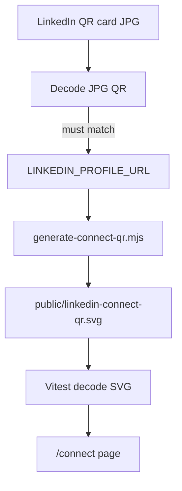

# Connect networking card (`/connect`)

**Goal:** Polished, one-tap LinkedIn networking card at `https://michaeltruong.ai/connect` — portfolio portrait + headline + prominent QR, Google Pixel **Home Screen shortcut** labeled **Connect** that opens `/connect` directly. **No offline requirement** for v1 (local LinkedIn QR export on phone is the offline fallback).

**Non-goals (v1):** Service workers, Serwist, precaching, offline E2E, or any change to site-wide caching. Root [`app/manifest.ts`](app/manifest.ts) stays `display: browser`, `start_url: /`.

**Plan-only PR:** This document only. Implementation slices begin after review.

## Acceptance criteria (milestone)

- `/connect` renders correctly on mobile (portrait, headline, QR, links).
- QR encodes and opens canonical LinkedIn profile (`https://www.linkedin.com/in/michael-truong-dev/`).
- Professional identity matches LinkedIn (name, headline, links).
- Pixel **Home Screen shortcut** opens `/connect` directly (browser chrome acceptable).
- Recognizable shortcut icon **where Chrome uses manifest icons**; if the OS creates a **browser shortcut** with a generated icon instead, that is acceptable (do not expand scope to force a custom launcher icon).
- **No** service worker or offline infrastructure introduced.
- Existing portfolio routes, identity metadata, and root PWA manifest behavior unchanged.

## Recommended execution authority

| Slice                  | Recommended authority | Agent instruction                        |
| ---------------------- | --------------------- | ---------------------------------------- |
| plan-only-pr           | Plan-only PR          | **Completed** (PR #87).                  |
| route-group-shell      | Open PR only          | Do not merge. Stop after opening the PR. |
| connect-page-and-qr    | Open PR only          | Do not merge. Stop after opening the PR. |
| connect-manifest-icons | Open PR only          | Do not merge. Stop after opening the PR. |
| tests-e2e              | Open PR only          | Do not merge. Stop after opening the PR. |
| plan-closure           | Open PR only          | Do not merge. Stop after opening the PR. |

Repo default: **Open PR only** ([planning-standards.md](../standards/planning-standards.md)).

## Repository topology (default)

Multi-slice plans stack **execution order**, not Git branches. Integration branch: **`main`**.

**Before each implementation slice:** `git fetch` → fresh branch from `origin/main`.

**Before opening a PR:** branch contains **only** that slice’s changes.

**After opening:** PR base is `main`; diff has no prior-slice work except through merged `main`.

## Milestone execution sequence

1. `route-group-shell`
2. `connect-page-and-qr`
3. `connect-manifest-icons`
4. `tests-e2e` — dedicated PR for full connect Playwright + axe via sitemap; **may** add straightforward page assertions earlier in `connect-page-and-qr` when merge-safe (do not block page slice waiting for this PR)
5. `plan-closure` (docs-only, after all implementation slices merge)

Each implementation PR runs: `npm run lint`, `npm run typecheck`, `npm test`, `npm run build`, and `npm run test:e2e` when the slice touches product paths (docs-only `plan-closure` excepted per CI allowlist).

---

## Slice — route-group-shell

**Recommended authority:** Open PR only

**Rationale:** Enables a standalone `/connect` shell without duplicating `PersonJsonLd` or changing site-wide metadata; must land before the connect page.

**Agent instruction:** Do not merge. Stop after opening the PR.

**Goal:** Route group `(site)` with slim root layout; `PersonJsonLd` + header/footer only on site routes; no behavior change to URLs or site metadata content.

**Acceptance:** Regression table (metadata, JSON-LD, nav, root manifest tests) passes; `/connect` route not required in this slice.

---

## Slice — connect-page-and-qr

**Recommended authority:** Open PR only

**Rationale:** Delivers the core meetup networking card (identity + scannable QR) in one merge-safe PR without service worker scope.

**Agent instruction:** Do not merge. Stop after opening the PR.

**Goal:** Single PR for the `/connect` page and QR pipeline:

- [`lib/connect.ts`](lib/connect.ts) — `LINKEDIN_PROFILE_URL`, `CONNECT_HEADLINE`, metadata strings
- [`app/connect/layout.tsx`](app/connect/layout.tsx), [`app/connect/page.tsx`](app/connect/page.tsx), [`app/styles/connect.css`](app/styles/connect.css) — mobile-first, QR-first; no site header/footer; page wraps content in **`<main id="content">`** (same contract as [`e2e/accessibility.spec.ts`](e2e/accessibility.spec.ts) and other routes)
- Sitemap + page metadata (`/connect` canonical) — **only add `/connect` to [`lib/sitemap-paths.ts`](lib/sitemap-paths.ts) in the same PR as `main#content`** so axe does not time out waiting for `#content`
- Dev-time: decode official LinkedIn QR card JPG (local); generate [`public/linkedin-connect-qr.svg`](public/linkedin-connect-qr.svg); [`scripts/generate-connect-qr.mjs`](scripts/generate-connect-qr.mjs) + `npm run generate:connect-qr` (not in `npm run build`)
- [`tests/connect-qr.test.ts`](tests/connect-qr.test.ts) — committed SVG decodes to canonical URL
- Optional connect metadata/constants unit tests
- **Encouraged (same PR, when low-cost):** straightforward connect page assertions — e.g. minimal [`e2e/connect.spec.ts`](e2e/connect.spec.ts) smoke (page loads, key links, no primary nav) or equivalent — without waiting for the dedicated `tests-e2e` slice. Do not duplicate the full responsive/axe matrix here if it fits better in `tests-e2e`.

**Acceptance:** Page uses portfolio portrait + HTML name/headline; **`<main id="content">` present** (required for root skip link `href="#content"` as well as axe/sitemap); no JPG on page; canonical LinkedIn URL; not in primary nav. If `/connect` is in `getSitemapPaths()`, `npm run test:e2e` includes passing axe for `/connect`. If early connect e2e was added, it passes in this PR’s CI gates.

---

## Slice — connect-manifest-icons

**Recommended authority:** Open PR only

**Rationale:** Dedicated connect manifest and launcher icons enable Pixel Home Screen shortcut (`Connect` → `/connect`) without altering the root portfolio manifest.

**Agent instruction:** Do not merge. Stop after opening the PR.

**Goal:** [`public/connect.webmanifest`](public/connect.webmanifest), connect layout `metadata.manifest`, `connect-icon-192.png` + `connect-icon-512.png` after pixel vs portrait evaluation; `short_name: Connect`, `start_url: /connect`.

**Acceptance:** Root [`app/manifest.ts`](app/manifest.ts) unchanged; [`tests/connect-manifest.test.ts`](tests/connect-manifest.test.ts); no LinkedIn trademark launcher icon.

---

## Slice — tests-e2e

**Recommended authority:** Open PR only

**Rationale:** Completes connect Playwright coverage (responsive layout, manifest link, axe via sitemap). Any smoke assertions landed in `connect-page-and-qr` should be extended here, not duplicated.

**Agent instruction:** Do not merge. Stop after opening the PR.

**Goal:** [`e2e/connect.spec.ts`](e2e/connect.spec.ts) — identity, LinkedIn/GitHub/portfolio links, no primary nav, manifest link on `/connect`, responsive checks at mobile viewports; add `/connect` to [`lib/sitemap-paths.ts`](lib/sitemap-paths.ts) if not already done (axe via [`e2e/accessibility.spec.ts`](e2e/accessibility.spec.ts)).

**Explicitly out of scope:** Offline Playwright tests, service worker assertions, `context.setOffline`.

**Acceptance:** CI green; PR labels Pixel shortcut vs standalone install per evidence table below.

---

## Slice — plan-closure

**Recommended authority:** Open PR only

**Rationale:** Archives the plan after all implementation slices merge; docs-only hygiene per planning standards.

**Agent instruction:** Do not merge. Stop after opening the PR.

**Goal:** After the last implementation slice merges: `# Shipped` note, archive plan, mark `plan-closure` completed.

---

## Reconnaissance summary (verified)

| Area           | Current state                                                                                       | Implication                                                                                          |
| -------------- | --------------------------------------------------------------------------------------------------- | ---------------------------------------------------------------------------------------------------- |
| PWA            | [`app/manifest.ts`](app/manifest.ts): `display: "browser"`, `start_url: "/"`; **no service worker** | **Do not add** SW or offline layer for `/connect` in v1.                                             |
| Layout         | Single [`app/layout.tsx`](app/layout.tsx) with `SiteHeader` + `SiteFooter`                          | Route group `(site)` omits chrome on `/connect` only.                                                |
| Identity / SEO | `content/profile.ts`, `lib/site-metadata.ts`, `PersonJsonLd`                                        | Reuse profile; connect headline in `lib/connect.ts`. Do not edit global identity/SEO except sitemap. |
| Caching        | Normal HTTP/CDN only                                                                                | **No** changes to caching infrastructure.                                                            |

---

## No offline / no service worker (v1 policy)

- Do **not** register a service worker, add Serwist, precache lists, or offline fallbacks.
- Do **not** modify `next.config.ts` for PWA workers.
- `/connect` requires network like other portfolio pages; acceptable for meetup use (user keeps LinkedIn QR JPG on device as backup).

---

## Preserve existing portfolio behavior (route group)

Refactor is **moves only** under `app/(site)/`; public URLs unchanged.

### Allowed layout split

- **Root** [`app/layout.tsx`](app/layout.tsx): `html`/`body`, fonts, `ThemeScript`, `ThemeProvider`, skip link (`href="#content"`), `globals.css` — minus header/footer/JSON-LD.
- **`app/(site)/layout.tsx`**: `PersonJsonLd`, `SiteHeader`, `SiteFooter`.
- **`app/connect/`**: no site header/footer; no `PersonJsonLd`.

The skip link stays on the **root** layout, so every route (including `/connect`) inherits it even when it does not use `(site)` chrome. Non–`(site)` pages must still expose a `#content` target (see `connect-page-and-qr` acceptance).

### Explicit non-goals

- No edits to global identity/SEO modules except sitemap path and path-only test import fixes from moves.
- No service worker, Serwist, or site-wide cache changes.

### Regression verification (required per implementation PR)

| Check                    | How                                                                                              |
| ------------------------ | ------------------------------------------------------------------------------------------------ |
| Metadata / JSON-LD / nav | Existing Vitest + `e2e/happy-path.spec.ts`                                                       |
| Root manifest            | [`tests/manifest.test.ts`](tests/manifest.test.ts) — `display: browser`, `start_url: /`          |
| Connect                  | No duplicate `PersonJsonLd` on `/connect`; `<main id="content">` before sitemap lists `/connect` |

---

## Android Home Screen — connect manifest + shortcut

**Implementation:** static [`public/connect.webmanifest`](public/connect.webmanifest) + `metadata.manifest` on connect layout only. Root manifest **unchanged**.

| Field        | Value                                                                          |
| ------------ | ------------------------------------------------------------------------------ |
| `id`         | Distinct from default (e.g. `"/connect"`)                                      |
| `name`       | e.g. `LinkedIn Connect — Michael Truong`                                       |
| `short_name` | **`Connect`**                                                                  |
| `start_url`  | **`/connect`**                                                                 |
| `scope`      | `/connect` or site-appropriate scope                                           |
| `display`    | `standalone` (best-effort; shortcut with browser chrome is acceptable minimum) |
| `icons`      | 192 + 512 PNGs — portfolio-branded, not LinkedIn logo                          |

### Minimum vs best-effort (Pixel)

| Experience                          | Requirement                                                                                                                                                                                                                                       |
| ----------------------------------- | ------------------------------------------------------------------------------------------------------------------------------------------------------------------------------------------------------------------------------------------------- |
| **Minimum (required)**              | Home Screen **shortcut** opens `https://michaeltruong.ai/connect` directly; label **Connect** where Chrome shows it; recognizable **custom** icon when the shortcut uses manifest icons                                                           |
| **Best-effort (optional)**          | Separate installable web app with **standalone** chrome (no URL bar) — verify manually; not a merge blocker                                                                                                                                       |
| **Icon fallback (required policy)** | If Chrome creates a **browser shortcut** (not a full installed web app) and uses a **generated** launcher icon instead of `connect-icon-*.png`, **accept it** — do not add Android-specific engineering to force a customized launcher experience |

Chrome may install a web app or add a browser shortcut; shortcut label and icon behavior are **not fully controlled** by `connect.webmanifest`. Manual Pixel verification remains the source of truth for launcher UX.

Document in PR: “shortcut verified on Pixel” vs “standalone install observed”; note whether manifest icons or Chrome-generated shortcut icon was used.

### Home Screen icon — evaluate and pick

| Option                 | Source                                                                                |
| ---------------------- | ------------------------------------------------------------------------------------- |
| **A — Pixel avatar**   | [`public/android-chrome-192x192.png`](public/android-chrome-192x192.png) + 512 export |
| **B — Portrait-based** | Crop from [`public/portrait-michael-1200.jpg`](public/portrait-michael-1200.jpg)      |

Pick whichever reads best at launcher size; maskable-safe padding as needed.

### What CI can prove vs manual (Pixel)

| Claim                                   | CI                      | Manual                                  |
| --------------------------------------- | ----------------------- | --------------------------------------- |
| Connect manifest fields + icons on disk | Yes                     | —                                       |
| Root manifest unchanged                 | Yes                     | —                                       |
| `link[rel=manifest]` on `/connect`      | Yes                     | —                                       |
| Shortcut opens `/connect`               | No                      | Yes                                     |
| Shortcut label **Connect**              | No                      | Yes (when shown)                        |
| Custom manifest icon on launcher        | No                      | Best-effort; generated shortcut icon OK |
| Standalone (no browser chrome)          | No                      | Optional observation                    |
| QR scan → LinkedIn profile              | Partial (Vitest decode) | Yes (second phone)                      |

---

## Page UI — portfolio identity + generated QR SVG

Mobile-first; **QR is the hero** on typical Pixel viewports.

1. Portfolio portrait (About pattern).
2. Name + headline as HTML from `lib/connect.ts` / profile.
3. [`public/linkedin-connect-qr.svg`](public/linkedin-connect-qr.svg) in white panel (both themes).

Do not render or trace the LinkedIn card JPG on the page.

---

## Page implementation (files)

| Action | Path                                                                |
| ------ | ------------------------------------------------------------------- |
| Add    | `lib/connect.ts`, `app/connect/*`, `app/styles/connect.css`         |
| Add    | `public/linkedin-connect-qr.svg`, `scripts/generate-connect-qr.mjs` |
| Add    | `public/connect.webmanifest`, connect icon PNGs (manifest slice)    |
| Modify | `app/(site)/` moves, `lib/sitemap-paths.ts` + `"/connect"`          |

**Do not add:** `ConnectServiceWorker`, `sw.js`, Serwist, `next.config` worker wiring.

---

## QR code — verify LinkedIn export, ship generated SVG

```text
LINKEDIN_PROFILE_URL = "https://www.linkedin.com/in/michael-truong-dev/"
```

1. Decode official LinkedIn QR card JPG (dev) — must match canonical URL.
2. Generate SVG via `npm run generate:connect-qr` (black on white, ECC M/Q, quiet zone).
3. Commit SVG; Vitest decodes to `LINKEDIN_PROFILE_URL`.
4. Manual phone-to-phone scan on preview/production.



---

## Testing and verification

### Unit (Vitest)

- Connect QR decode, connect manifest (manifest slice), connect constants/metadata
- Root manifest unchanged; sitemap includes `/connect`

### E2E

- [`e2e/connect.spec.ts`](e2e/connect.spec.ts): render, links, nav absence, mobile viewport
- A11y: `/connect` via `getSitemapPaths()` — requires `<main id="content">` on the connect page (hydration gate in [`e2e/accessibility.spec.ts`](e2e/accessibility.spec.ts))

### Repo gates

```bash
npm run lint && npm run typecheck && npm test && npm run build && npm run test:e2e
```

---

## Analytics and accessibility

PostHog via existing client init; LinkedIn `ExternalLink` + `analyticsLabel`; redundant link besides QR; semantic headings; **`<main id="content">`** on connect page (skip-link + axe parity with site pages); focus/reduced-motion per site standards.

---

## Trade-offs

| Choice                      | Benefit                             | Cost                                             |
| --------------------------- | ----------------------------------- | ------------------------------------------------ |
| No offline v1               | Smaller diff; no SW risk            | `/connect` needs network                         |
| Combined page + QR slice    | One merge-safe PR for core UX       | Larger single PR                                 |
| Connect manifest + shortcut | Direct `/connect` launch            | Standalone + custom launcher icon not guaranteed |
| Accept Chrome shortcut icon | Avoids Android launcher scope creep | May differ from manifest art                     |
| Verify JPG + generate SVG   | Trusted destination; clean QR       | Dev tooling + tests                              |

## Outstanding manual checks (Pixel)

1. Add to Home Screen from `/connect` — shortcut opens `/connect`; label **Connect** when shown; prefer recognizable custom icon — if Chrome uses a generated shortcut icon instead, note it and **do not** treat as a blocker.
2. Optional: standalone install without browser chrome.
3. Second device scans on-page QR → LinkedIn profile.
4. Visual: QR prominent on device; headline wrapping OK.

---

## Agent prompts (copy/paste for Cursor)

Use a **fresh Agent-mode chat** per slice.

### route-group-shell

```text
@.cursor/plans/2026-10-26-connect-networking-card.plan.md

Implement slice route-group-shell only. Do not start connect-page-and-qr or later slices. Do not archive the plan.

Authority: Open PR only — implement and open the PR; do not merge.

Topology: start from latest origin/main; branch represents only this slice; PR base must be main.

Deliverables: app/(site) route group refactor per plan. Mark route-group-shell completed in plan frontmatter in this PR.

Verification: metadata/JSON-LD/nav regression tests per plan. Do not add service worker or offline code.
```

### connect-page-and-qr

```text
@.cursor/plans/2026-10-26-connect-networking-card.plan.md

Implement slice connect-page-and-qr only. Prerequisite: route-group-shell merged. Do not start connect-manifest-icons or later slices.

Authority: Open PR only — implement and open the PR; do not merge.

Topology: start from latest origin/main; branch represents only this slice; PR base must be main.

Deliverables: lib/connect.ts, app/connect page + layout + connect.css (main id="content"), sitemap/metadata, generate-connect-qr script, public/linkedin-connect-qr.svg, tests/connect-qr.test.ts. Only add /connect to getSitemapPaths in the same PR as main#content. Encouraged when low-cost: minimal e2e/connect.spec.ts smoke (loads, links, no primary nav) in this PR — do not wait for tests-e2e for basic page assertions. Mark connect-page-and-qr completed in plan frontmatter in this PR.

Verification: /connect renders on mobile; main id="content" present (root skip link target — connect is outside (site) but still inherits skip link from app/layout.tsx); Vitest decodes SVG; no JPG on page; no service worker. If sitemap includes /connect, npm run test:e2e passes (including axe). If early connect e2e added, smoke passes.
```

### connect-manifest-icons

```text
@.cursor/plans/2026-10-26-connect-networking-card.plan.md

Implement slice connect-manifest-icons only. Prerequisite: connect-page-and-qr merged. Do not start tests-e2e or plan-closure.

Authority: Open PR only — implement and open the PR; do not merge.

Topology: start from latest origin/main; branch represents only this slice; PR base must be main.

Deliverables: connect.webmanifest, connect icons (192/512), layout metadata.manifest override. Mark connect-manifest-icons completed in plan frontmatter in this PR.

Verification: tests/connect-manifest.test.ts; root manifest unchanged; no service worker.
```

### tests-e2e

```text
@.cursor/plans/2026-10-26-connect-networking-card.plan.md

Implement slice tests-e2e only. Prerequisite: connect-manifest-icons merged. Do not start plan-closure.

Authority: Open PR only — implement and open the PR; do not merge.

Topology: start from latest origin/main; branch represents only this slice; PR base must be main.

Deliverables: complete e2e/connect.spec.ts (extend any smoke from connect-page-and-qr); ensure /connect in getSitemapPaths for axe. Mark tests-e2e completed in plan frontmatter in this PR.

Verification: npm run test:e2e. No offline or service worker tests.
```

### plan-closure

```text
@.cursor/plans/2026-10-26-connect-networking-card.plan.md

Execute only plan-closure.

Authority: Open PR only — docs-only archive PR; do not merge.

Prerequisites: all implementation slices merged and marked completed in frontmatter.

Topology: start from latest origin/main; branch represents only this slice; PR base must be main.

Deliverables: verify slice todos, add # Shipped note, move plan to .cursor/plans/archive/2026-10-26-connect-networking-card.plan.md, mark plan-closure completed.

Verification: all implementation PRs merged before archiving.
```
