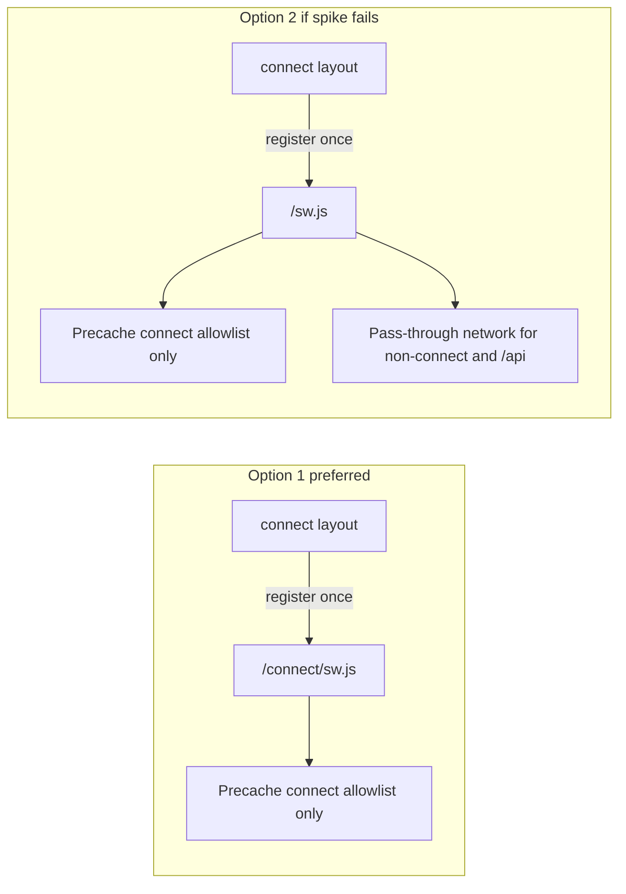
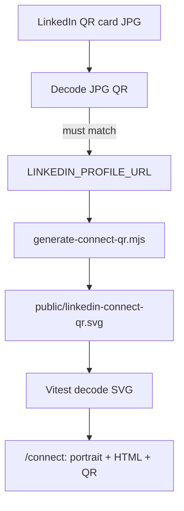

# Connect networking card (`/connect`)

**Goal:** Mobile-first offline-capable LinkedIn networking card at `https://michaeltruong.ai/connect` — portfolio identity + scannable QR, dedicated Android Home Screen entry (`Connect` → `/connect`), without changing root portfolio manifest launch behavior (`display: browser`, `start_url: /`).

**Plan-only PR:** This document only. Implementation slices begin after review.

## Recommended execution authority

| Slice                  | Recommended authority | Agent instruction                        |
| ---------------------- | --------------------- | ---------------------------------------- |
| plan-only-pr           | Plan-only PR          | **Completed** (this PR).                 |
| route-group-shell      | Open PR only          | Do not merge. Stop after opening the PR. |
| connect-page-assets    | Open PR only          | Do not merge. Stop after opening the PR. |
| qr-verify-generate     | Open PR only          | Do not merge. Stop after opening the PR. |
| connect-manifest-icons | Open PR only          | Do not merge. Stop after opening the PR. |
| offline-sw-decision    | Open PR only          | Do not merge. Stop after opening the PR. |
| tests-e2e              | Open PR only          | Do not merge. Stop after opening the PR. |
| plan-closure           | Open PR only          | Do not merge. Stop after opening the PR. |

Repo default: **Open PR only** ([planning-standards.md](../standards/planning-standards.md)).

## Repository topology (default)

Multi-slice plans stack **execution order**, not Git branches. Integration branch: **`main`**.

**Before each implementation slice:** `git fetch` → fresh branch from `origin/main`.

**Before opening a PR:** branch contains **only** that slice’s changes.

**After opening:** PR base is `main`; diff has no prior-slice work except through merged `main`.

## Milestone execution sequence

1. `route-group-shell`
2. `connect-page-assets` (may combine with `qr-verify-generate` in one PR if merge-safe and small)
3. `qr-verify-generate` (if not combined above)
4. `connect-manifest-icons`
5. `offline-sw-decision`
6. `tests-e2e` (or fold required tests into each slice; this slice closes any remaining e2e/offline gaps)
7. `plan-closure` (docs-only, after all implementation slices merge)

Each implementation PR runs: `npm run lint`, `npm run typecheck`, `npm test`, `npm run build`, and `npm run test:e2e` when the slice touches product paths (docs-only `plan-closure` excepted per CI allowlist).

---

## Slice — route-group-shell

**Recommended authority:** Open PR only

**Goal:** Route group `(site)` with slim root layout; `PersonJsonLd` + header/footer only on site routes; no behavior change to URLs or site metadata content.

**Acceptance:** Regression table (metadata, JSON-LD, nav, root manifest tests) passes; `/connect` route not required in this slice.

---

## Slice — connect-page-assets

**Recommended authority:** Open PR only

**Goal:** `lib/connect.ts`, `app/connect/` page + layout (no site chrome), `connect.css`, sitemap + page metadata; QR-first compact layout (portrait + HTML name/headline).

**Acceptance:** `/connect` renders identity; not in primary nav; canonical `/connect`.

---

## Slice — qr-verify-generate

**Recommended authority:** Open PR only

**Goal:** Decode official LinkedIn QR card JPG (dev); generate `public/linkedin-connect-qr.svg` from `LINKEDIN_PROFILE_URL`; `npm run generate:connect-qr` (dev-only); Vitest decodes committed SVG.

**Acceptance:** No JPG on page or in SVG; canonical URL `https://www.linkedin.com/in/michael-truong-dev/`.

---

## Slice — connect-manifest-icons

**Recommended authority:** Open PR only

**Goal:** `public/connect.webmanifest`, connect layout `metadata.manifest`, `connect-icon-192.png` + `connect-icon-512.png` after pixel vs portrait evaluation; `short_name: Connect`, `start_url: /connect`.

**Acceptance:** Root `app/manifest.ts` unchanged; manifest unit tests; no LinkedIn trademark launcher icon.

---

## Slice — offline-sw-decision

**Recommended authority:** Open PR only

**Goal:** Connect-only offline per spike (Option 1 connect-scoped SW preferred); precache connect allowlist only; no API/unrelated route runtime cache; register SW only from `/connect`.

**Acceptance:** Cold offline documented in plan; portfolio routes unaffected.

---

## Slice — tests-e2e

**Recommended authority:** Open PR only

**Goal:** `e2e/connect.spec.ts`, cold-launch offline Playwright test, any remaining connect unit tests; `/connect` in `getSitemapPaths()` for axe.

**Acceptance:** CI green; PR distinguishes automated vs manual Pixel install claims.

---

## Plan closure (docs-only PR)

**Recommended authority:** Open PR only

After the last implementation slice merges: `# Shipped` note, archive plan, mark `plan-closure` completed.

---

## Reconnaissance summary (verified)

| Area           | Current state                                                                                                                                                                | Implication                                                                                                                                                      |
| -------------- | ---------------------------------------------------------------------------------------------------------------------------------------------------------------------------- | ---------------------------------------------------------------------------------------------------------------------------------------------------------------- |
| PWA            | [`app/manifest.ts`](app/manifest.ts): `display: "browser"`, `start_url: "/"`, one 192px icon; **no service worker**                                                          | Offline for `/connect` requires **new** SW work; must not imply the portfolio already had installable/offline PWA behavior.                                      |
| Layout         | Single [`app/layout.tsx`](app/layout.tsx) always renders `SiteHeader` + `SiteFooter`                                                                                         | Route group `(site)` omits chrome on `/connect` only.                                                                                                            |
| Identity / SEO | [`content/profile.ts`](content/profile.ts), [`lib/site-metadata.ts`](lib/site-metadata.ts), [`components/PersonJsonLd.tsx`](components/PersonJsonLd.tsx), per-route metadata | Reuse profile for links/name; connect-only headline in [`lib/connect.ts`](lib/connect.ts). **Do not edit** global identity/SEO modules except sitemap path list. |
| Build          | `next build --webpack`                                                                                                                                                       | Serwist is viable if chosen; **not** the default assumption—evaluate narrower SW first.                                                                          |

---

## Service worker strategy (evaluate before coding)

Offline is **required only for `/connect`**. The implementation must stay proportional: no site-wide offline shell, no generic `~offline` fallback page, and no runtime caching of unrelated pages or APIs unless a spike proves it unavoidable.

### `/connect` vs `/connect/` (must resolve in spike)

Service worker **scope** and **precached URLs** are path-sensitive.

| Topic                | Risk                                                                                                                                       |
| -------------------- | ------------------------------------------------------------------------------------------------------------------------------------------ |
| Scope `/connect/`    | Some browsers treat `/connect` (no trailing slash) as **outside** scope `/connect/`, so navigation or cache match may fail on cold launch. |
| Canonical / sitemap  | Site uses path strings like `"/about"` without trailing slashes in [`lib/sitemap-paths.ts`](lib/sitemap-paths.ts).                         |
| Manifest `start_url` | Must match the URL users install and open (including slash policy).                                                                        |

**Spike (first implementation step, no merge until documented):**

1. Confirm Next.js behavior for `/connect` and `/connect/` in this repo (`trailingSlash` in config, redirects, static export of connect page).
2. Pick **one canonical document URL** for connect (recommend **`/connect`** to match sitemap/canonical spec).
3. Align: page `alternates.canonical`, sitemap entry, manifest `start_url`, precache entry, and e2e navigation URL.
4. If scope `/connect/` is used, add an explicit **same-origin redirect** `/connect` → `/connect/` _or_ use a root-scoped worker with connect-only handlers (see Option 2)—document the choice in the PR.

### Option 1 — **Connect-scoped worker (preferred; lowest portfolio risk)**

| Item         | Choice                                                                                                                                                                                                                                                                          |
| ------------ | ------------------------------------------------------------------------------------------------------------------------------------------------------------------------------------------------------------------------------------------------------------------------------- |
| Script URL   | e.g. `/connect/sw.js` (built output under `public/connect/` or Serwist `swDest`)                                                                                                                                                                                                |
| Registration | **Only** from a client component used in [`app/connect/layout.tsx`](app/connect/layout.tsx) — **not** root layout                                                                                                                                                               |
| Scope        | `/connect/` (after URL policy spike) or maximal scope allowed by script path                                                                                                                                                                                                    |
| Caching      | **Precache only** an explicit allowlist: connect HTML (both slash forms if needed), [`public/linkedin-connect-qr.svg`](public/linkedin-connect-qr.svg), portrait file(s) used on page, fonts/CSS/JS chunks **for connect route**, `connect.webmanifest`, connect launcher icons |
| Runtime      | **No** Serwist `defaultCache` / no stale-while-revalidate for arbitrary assets                                                                                                                                                                                                  |
| Pass-through | All other requests: network only (no caching of `/`, `/about`, `/projects/*`, etc.)                                                                                                                                                                                             |
| API          | **`/api/*` never cached** — no runtime or precache entries for assistant or other API routes                                                                                                                                                                                    |

**Tooling:** Prefer a **small hand-written worker** (or Serwist with `runtimeCaching: []` and minimal precache) if that is less invasive than full `@serwist/next` integration. Add `@serwist/next` only if the spike shows precache/build wiring is clearly simpler than a static `sw.js` + build script.

**Portfolio behavior:** Pages outside `/connect` never register a worker (unless user visited connect in same browser profile—acceptable; no precache of other routes).

### Option 2 — **Root-scoped worker (fallback if Option 1 fails spike)**

Use when connect-scoped script/scope cannot reliably serve cold offline navigation (e.g. slash/scope mismatch cannot be fixed with redirects).

| Item          | Choice                                                                                                |
| ------------- | ----------------------------------------------------------------------------------------------------- |
| Script URL    | `/sw.js` at site root (Serwist or equivalent)                                                         |
| Registration  | **Still only from `/connect`** layout (avoid registering on `(site)` routes)                          |
| Precache      | Same connect-only allowlist as Option 1                                                               |
| Runtime       | **Explicitly disable** default site-wide runtime caching (`defaultCache` off, empty `runtimeCaching`) |
| Fetch handler | Only serve precached connect assets; **bypass cache** for `/api/*` and all non-connect navigations    |

This registers one worker per origin but limits **behavior** to connect assets; unrelated routes should behave as today (network-dependent, no new offline shells).

### Decision criteria (record in PR)

1. Cold offline launch to connect URL works in Playwright (see below).
2. No new offline behavior for `/`, projects, about, or `/api/assistant/*`.
3. Smallest diff: fewer dependencies and no changes to [`app/manifest.ts`](app/manifest.ts) beyond “unchanged” assertions.



---

## Preserve existing portfolio behavior (route group)

Refactor is **moves only** under `app/(site)/`; public URLs unchanged.

### Allowed layout split

- **Root** [`app/layout.tsx`](app/layout.tsx): `html`/`body`, fonts, `ThemeScript`, `ThemeProvider`, skip link, `globals.css` — same as today minus header/footer/JSON-LD.
- **`app/(site)/layout.tsx`**: `PersonJsonLd`, `SiteHeader`, `SiteFooter` — identical props and component tree as current root layout body.
- **`app/connect/`**: no site header/footer; no `PersonJsonLd`.

Leave at `app/` root: `api/`, `robots.ts`, `sitemap.ts`, `manifest.ts`, `opengraph-image.tsx`, etc.

### Explicit non-goals (avoid unrelated churn)

- No edits to [`lib/site-metadata.ts`](lib/site-metadata.ts), [`components/PersonJsonLd.tsx`](components/PersonJsonLd.tsx) graph content, [`app/manifest.ts`](app/manifest.ts) fields, or head-identity tests except where tests must follow file moves.
- No changes to root default OG/Twitter in [`app/layout.tsx`](app/layout.tsx) exports beyond relocation of unchanged values.
- Connect SEO is **only** [`app/connect/page.tsx`](app/connect/page.tsx) metadata + sitemap path.

### Regression verification (required before PR)

| Check                           | How                                                                                                                                                                                                                                                                                 |
| ------------------------------- | ----------------------------------------------------------------------------------------------------------------------------------------------------------------------------------------------------------------------------------------------------------------------------------- |
| Metadata exports                | Existing Vitest: [`tests/site-metadata.test.ts`](tests/site-metadata.test.ts), [`tests/social-metadata-routes.test.ts`](tests/social-metadata-routes.test.ts), [`tests/head-identity.test.ts`](tests/head-identity.test.ts) — all pass unchanged or with **path-only** import fixes |
| JSON-LD on site routes          | [`tests/jsonld-graph.test.tsx`](tests/jsonld-graph.test.tsx), [`tests/person-jsonld.test.tsx`](tests/person-jsonld.test.tsx) — same graph on `/`, `/about` (e2e or unit as today)                                                                                                   |
| Navigation                      | [`e2e/happy-path.spec.ts`](e2e/happy-path.spec.ts) — no regressions on primary nav                                                                                                                                                                                                  |
| Root manifest                   | [`tests/manifest.test.ts`](tests/manifest.test.ts) — still `display: "browser"`, `start_url: "/"`                                                                                                                                                                                   |
| Connect has no duplicate Person | No `PersonJsonLd` in connect tree; no connect-specific JSON-LD                                                                                                                                                                                                                      |

---

## Android Home Screen — dedicated manifest (evidence-based claims)

**Implementation:** static [`public/connect.webmanifest`](public/connect.webmanifest) + `metadata.manifest` on connect layout only. Root [`app/manifest.ts`](app/manifest.ts) **unchanged**.

| Field        | Value                                                                                                       |
| ------------ | ----------------------------------------------------------------------------------------------------------- |
| `id`         | Distinct from default app (e.g. `"/connect"`)                                                               |
| `name`       | e.g. `LinkedIn Connect — Michael Truong` (install UI / full title)                                          |
| `short_name` | **`Connect`** — Home Screen / launcher label                                                                |
| `start_url`  | **`/connect`** (aligned with canonical URL from slash spike)                                                |
| `scope`      | Connect path scope per spike                                                                                |
| `display`    | `standalone`                                                                                                |
| `icons`      | Dedicated **192×192** and **512×512** PNGs (see icon evaluation below) — **no LinkedIn trademark branding** |

### Home Screen icon — evaluate and pick (before commit)

Compare two candidates at **launcher scale** (~48dp and smaller); choose whichever stays **most recognizable** and consistent with the portfolio.

| Option                                      | Source                                                                                                                                                                  | Notes                                                                          |
| ------------------------------------------- | ----------------------------------------------------------------------------------------------------------------------------------------------------------------------- | ------------------------------------------------------------------------------ |
| **A — Pixel avatar (preferred if legible)** | [`public/android-chrome-192x192.png`](public/android-chrome-192x192.png) (and upscaled or re-exported **512×512** from same artwork)                                    | Matches existing web identity; already validated for small sizes in brand docs |
| **B — Portrait-based**                      | Crop/compose from [`public/portrait-michael-1200.jpg`](public/portrait-michael-1200.jpg) (or existing responsive variants) into circular or rounded-square launcher art | More “personal” at large sizes; may lose detail when masked small              |

**Deliverables (winning option only, unless PR documents A/B screenshots):**

- [`public/connect-icon-192.png`](public/connect-icon-192.png) — `purpose: "any"`
- [`public/connect-icon-512.png`](public/connect-icon-512.png) — `purpose: "any"`
- **Maskable:** add maskable variants **or** single icons with safe **padding** inside the canvas (Android adaptive icon safe zone ~66% center) so the owl/face is not clipped by circular masks — follow same discipline as existing pixel icons (full-bleed dark for avatar art where applicable).

**Non-goals:** LinkedIn logo as launcher icon; generic file/image shortcut icons.

**Behavior:** Shortcut/install labeled **Connect** opens **`/connect` directly** (via `start_url` + connect manifest linked from connect pages only).

### What CI can prove vs what it cannot

| Claim                                                            | Automated (Vitest)                                                                 | Manual (Pixel + Chrome)                   |
| ---------------------------------------------------------------- | ---------------------------------------------------------------------------------- | ----------------------------------------- |
| Connect manifest JSON fields, icons on disk                      | Yes — [`tests/connect-manifest.test.ts`](tests/connect-manifest.test.ts)           | —                                         |
| Root manifest unchanged                                          | Yes — [`tests/manifest.test.ts`](tests/manifest.test.ts)                           | —                                         |
| `<link rel="manifest">` on `/connect` points to connect manifest | Yes — metadata/route test or Playwright `link[rel=manifest]`                       | —                                         |
| Separate **installable** app with standalone chrome              | **No**                                                                             | Yes — install from `/connect`, observe UI |
| Home Screen icon label **Connect** (`short_name`)                | **No**                                                                             | Yes                                       |
| Installed app relaunch offline                                   | Partially — Playwright cold offline (below); **not** identical to Android launcher | Yes — airplane mode relaunch from icon    |
| Install from `/` does not replace portfolio identity             | **No**                                                                             | Yes                                       |

**PR language:** Use “manifest verified in CI” vs “standalone install verified on Pixel (manual).” Do not claim successful Android installation without device evidence.

**Fallback (document only):** Chrome “Add to Home screen” shortcut to `/connect` if separate install does not appear — may show browser chrome.

---

## Page UI — portfolio identity + generated QR SVG (not the LinkedIn card)

Mobile-first card; **QR code is the hero** on a typical Pixel viewport (~412×915 logical px).

**Do not** render the official LinkedIn QR card JPG on the page, and **do not** embed or trace that JPG into SVG. The JPG is used **only at development time** to decode and confirm LinkedIn’s QR destination. The live page uses:

1. Portfolio **portrait** (same assets/pattern as About — [`public/portrait-michael-*.jpg`](public/portrait-michael-1200.jpg), [`SITE_PORTRAIT_ALT`](lib/social-metadata.ts)).
2. **Name** and **headline** as semantic HTML (`h1`, `p`) from [`lib/connect.ts`](lib/connect.ts) + `profile.name` — not text baked into an image.
3. Committed **[`public/linkedin-connect-qr.svg`](public/linkedin-connect-qr.svg)** — clean vector QR generated from the canonical URL (see next section).

- **Headline:** [`CONNECT_HEADLINE`](lib/connect.ts) may wrap to multiple lines; use sensible `max-width`, line-height, and `text-wrap: balance` if available — do not truncate with ellipsis.
- **Vertical rhythm:** Tight spacing **above** the QR (compact gap between name, headline, and “Scan to connect…”); avoid large decorative margins. Portrait remains visible but smaller than QR if needed to fit above-the-fold QR on Pixel.
- **QR panel:** White background in both themes; large square (e.g. `min(72vw, 280px)` or similar after spike). Quiet zone must be **included in the generated SVG** (not cropped away in CSS).
- **Below QR:** Primary LinkedIn button + secondary Portfolio/GitHub — may scroll on smallest viewports; QR + portrait should remain visible without scroll on Pixel where practical.
- **Implementation note:** During implementation, verify at **390×844** and **412×915** in Playwright screenshots or viewport assertions (QR bounding box in upper ~70% of viewport).

---

## Page implementation (files)

| Action         | Path                                                                                                                                                                                                        |
| -------------- | ----------------------------------------------------------------------------------------------------------------------------------------------------------------------------------------------------------- |
| Add            | [`lib/connect.ts`](lib/connect.ts) — `LINKEDIN_PROFILE_URL`, `CONNECT_HEADLINE`, metadata strings                                                                                                           |
| Add            | [`public/linkedin-connect-qr.svg`](public/linkedin-connect-qr.svg) — **committed production QR** (dev-time generated, not runtime)                                                                          |
| Add            | [`scripts/generate-connect-qr.mjs`](scripts/generate-connect-qr.mjs) + `npm run generate:connect-qr` — **dev-time only**; not part of `npm run build`                                                       |
| Add (optional) | [`vendor/connect/linkedin-qr-card-source.jpg`](vendor/connect/linkedin-qr-card-source.jpg) — official LinkedIn export for **decode verification** (optional commit; may be supplied at implementation time) |
| Add            | [`app/connect/layout.tsx`](app/connect/layout.tsx), [`app/connect/page.tsx`](app/connect/page.tsx), [`components/ConnectServiceWorker.tsx`](components/ConnectServiceWorker.tsx) (register SW only here)    |
| Add            | [`app/styles/connect.css`](app/styles/connect.css)                                                                                                                                                          |
| Add            | [`public/connect.webmanifest`](public/connect.webmanifest), connect icon PNGs                                                                                                                               |
| Modify         | `app/(site)/` moves, [`lib/sitemap-paths.ts`](lib/sitemap-paths.ts) + `"/connect"`                                                                                                                          |
| Modify         | `next.config.ts` / worker build **only if** spike selects Serwist or build step for `sw.js`                                                                                                                 |

Connect metadata: title, description, canonical `/connect`, `openGraphForCanonicalPath` — no page-level Person JSON-LD.

---

## QR code — verify LinkedIn export, ship generated SVG

The user already has LinkedIn’s official QR card as a **JPG export**. Production ships a **fresh SVG QR** encoded from the canonical profile URL—not a raster crop or trace of the card.

### Canonical destination

Single source of truth in [`lib/connect.ts`](lib/connect.ts):

```text
LINKEDIN_PROFILE_URL = "https://www.linkedin.com/in/michael-truong-dev/"
```

All generation, tests, and the primary LinkedIn CTA use this exact string (including trailing slash).

### Development-time workflow (implementation order)

1. **Decode the official JPG** — rasterize/decode the QR on the LinkedIn card image (e.g. `sharp` + `jsqr` in a one-off step or optional Vitest fixture). Confirm the payload resolves to the same profile as `LINKEDIN_PROFILE_URL` (allow normalizing `www`, trailing slash, or `https` variants in comparison; **stop** if the card points elsewhere).
2. **Generate clean SVG** — dev script [`scripts/generate-connect-qr.mjs`](scripts/generate-connect-qr.mjs) (`npm run generate:connect-qr`) using a small generator (e.g. `qrcode` devDependency):
   - **Black modules on white background**
   - **Error correction** M or Q
   - **Quiet zone** included in SVG output (generator margin / standard padding)
   - Square aspect ratio; no logo overlay; **no** embedding or vector-tracing of the JPG
3. **Write** [`public/linkedin-connect-qr.svg`](public/linkedin-connect-qr.svg) and commit.
4. **Verify shipped asset** — Vitest ([`tests/connect-qr.test.ts`](tests/connect-qr.test.ts)) rasterizes the committed SVG and decodes to `LINKEDIN_PROFILE_URL`.
5. **Manual** — phone-to-phone scan of the on-page QR once deployed/previewed.

**Runtime:** The Next.js app **never** generates QR codes per request. Regenerate only when the URL or QR parameters change.

### Source vs shipped assets

| Asset                                                              | Role                                                                                |
| ------------------------------------------------------------------ | ----------------------------------------------------------------------------------- |
| LinkedIn card JPG                                                  | **Dev verification only** — decode destination; not displayed; not committed to SVG |
| [`public/linkedin-connect-qr.svg`](public/linkedin-connect-qr.svg) | **Shipped** — precached for offline; `` or inline in white panel               |

### Dependencies

- **`qrcode`** (or equivalent): devDependency for `generate-connect-qr` only.
- **`sharp` + `jsqr`**: devDependencies for decode tests (and optional JPG verification). Omit JPG from repo if verification is documented as a one-time local step before generation.



---

## Testing and verification

### Unit (Vitest)

- Connect QR, connect manifest, connect constants/metadata
- Root manifest unchanged; sitemap includes `/connect`
- Optional: SW precache URL list matches canonical connect URL policy

### E2E — connect functional

[`e2e/connect.spec.ts`](e2e/connect.spec.ts) (or focused section): identity, LinkedIn href, GitHub, portfolio link, no primary nav; manifest link on connect page.

### E2E — **cold-launch offline (required)**

Simulates “installed shortcut, network gone, open connect” more than an in-tab reload.

**Procedure (Playwright, against `npm run build` + `npm start`):**

1. **Context A — warm cache:** Navigate to canonical `/connect` URL; wait until service worker is **activated** and precache completes (helper: `navigator.serviceWorker.ready` + optional `caches.keys()` / known precache URL fetch).
2. Close **all** pages in the context (or use a fresh context that inherits SW registration from same origin—prefer **same browser context**, zero pages, then new page).
3. `context.setOffline(true)`.
4. **Context B — cold document:** `page.goto('/connect')` (or canonical URL from spike) in a **new page** with no prior document in that page (new `Page` instance).
5. **Assert without network:** portrait `` visible (or `img[src*="portrait"]`), QR visible (`img[src*="linkedin-connect-qr"]` or equivalent for committed SVG); optional: `response.fromServiceWorker()` on document or subresources where Playwright exposes it.
6. **Assert non-goals offline:** `page.goto('/')` fails or shows browser error (not a full offline homepage)—confirms we did not build a site-wide offline app shell.

If cold-launch fails under Option 1, document spike result and switch to Option 2 before widening caching.

### A11y

[`e2e/accessibility.spec.ts`](e2e/accessibility.spec.ts) includes `/connect` via `getSitemapPaths()`.

### Repo gates

```bash
npm run lint && npm run typecheck && npm test && npm run build && npm run test:e2e
```

---

## Analytics and accessibility

PostHog pageviews via existing client init; LinkedIn via `ExternalLink` + `analyticsLabel`; redundant link besides QR; existing focus/reduced-motion patterns.

---

## Trade-offs

| Choice                                        | Benefit                                                                        | Cost                                                                |
| --------------------------------------------- | ------------------------------------------------------------------------------ | ------------------------------------------------------------------- |
| Connect-only SW + register only on `/connect` | Minimal risk to rest of portfolio                                              | Must solve `/connect` vs `/connect/` and precache chunk list        |
| No `defaultCache` / no API caching            | Proportional; no accidental offline site                                       | More explicit precache list maintenance when connect bundle changes |
| Root SW fallback only if needed               | Reliable precache paths                                                        | Worker file at origin root; still no broad runtime cache            |
| Route group                                   | Clean connect UX                                                               | Many file moves; mitigated by regression table                      |
| Verify JPG then generate SVG                  | Confirms LinkedIn export matches canonical URL; clean scannable vector on page | Dev script + decode tests; regenerate when URL changes              |
| Evaluated launcher icons                      | Best recognition at small sizes; portfolio-branded                             | Extra 512/maskable assets beyond root manifest                      |

## Outstanding manual checks (Pixel)

1. Install (or shortcut) from `/connect` — launcher name and icon.
2. Standalone display **if** install path offers it (not asserted by CI).
3. Airplane mode relaunch from Home Screen icon (beyond Playwright simulation).
4. Second device scans QR → LinkedIn profile.
5. Visual: QR prominent without scroll on device; headline wrapping acceptable.

---

## Agent prompts (copy/paste for Cursor)

Use a **fresh Agent-mode chat** per slice.

### route-group-shell

```text
@.cursor/plans/2026-10-26-connect-networking-card.plan.md

Implement slice route-group-shell only. Do not start connect-page-assets or later slices. Do not archive the plan.

Authority: Open PR only — implement and open the PR; do not merge.

Topology: start from latest origin/main; branch represents only this slice; PR base must be main.

Deliverables: app/(site) route group refactor per plan. Mark route-group-shell completed in plan frontmatter in this PR.

Verification: metadata/JSON-LD/nav regression tests per plan table.
```

### connect-page-assets

```text
@.cursor/plans/2026-10-26-connect-networking-card.plan.md

Implement slice connect-page-assets only. Prerequisite: route-group-shell merged. Do not start qr-verify-generate or later slices unless merge-safe to combine per plan sequence note.

Authority: Open PR only — implement and open the PR; do not merge.

Topology: start from latest origin/main; branch represents only this slice; PR base must be main.

Deliverables: lib/connect.ts, app/connect page + layout + connect.css, sitemap/metadata. Mark connect-page-assets completed in plan frontmatter in this PR.

Verification: /connect renders; not in primary nav.
```

### qr-verify-generate

```text
@.cursor/plans/2026-10-26-connect-networking-card.plan.md

Implement slice qr-verify-generate only. Prerequisite: prior slices merged as needed for /connect to exist. Do not start offline-sw-decision or later slices.

Authority: Open PR only — implement and open the PR; do not merge.

Topology: start from latest origin/main; branch represents only this slice; PR base must be main.

Deliverables: decode LinkedIn JPG, generate-connect-qr script, public/linkedin-connect-qr.svg, tests/connect-qr.test.ts. Mark qr-verify-generate completed in plan frontmatter in this PR.

Verification: Vitest decodes SVG to LINKEDIN_PROFILE_URL; no JPG on page.
```

### connect-manifest-icons

```text
@.cursor/plans/2026-10-26-connect-networking-card.plan.md

Implement slice connect-manifest-icons only. Prerequisite: connect page merged. Do not start offline-sw-decision or later slices.

Authority: Open PR only — implement and open the PR; do not merge.

Topology: start from latest origin/main; branch represents only this slice; PR base must be main.

Deliverables: connect.webmanifest, connect icons (192/512), layout metadata.manifest override. Mark connect-manifest-icons completed in plan frontmatter in this PR.

Verification: tests/connect-manifest.test.ts; root manifest unchanged.
```

### offline-sw-decision

```text
@.cursor/plans/2026-10-26-connect-networking-card.plan.md

Implement slice offline-sw-decision only. Prerequisite: connect page + assets merged. Do not start tests-e2e or plan-closure.

Authority: Open PR only — implement and open the PR; do not merge.

Topology: start from latest origin/main; branch represents only this slice; PR base must be main.

Deliverables: connect-only SW per spike; register only from /connect; no API/unrelated runtime cache. Mark offline-sw-decision completed in plan frontmatter in this PR.

Verification: document Option 1 vs 2 choice; precache allowlist only.
```

### tests-e2e

```text
@.cursor/plans/2026-10-26-connect-networking-card.plan.md

Implement slice tests-e2e only. Prerequisite: offline-sw-decision merged. Do not start plan-closure.

Authority: Open PR only — implement and open the PR; do not merge.

Topology: start from latest origin/main; branch represents only this slice; PR base must be main.

Deliverables: e2e/connect.spec.ts, cold-launch offline test, any remaining connect tests. Mark tests-e2e completed in plan frontmatter in this PR.

Verification: npm run test:e2e; cold-launch offline procedure in plan.
```

### plan-closure

```text
@.cursor/plans/2026-10-26-connect-networking-card.plan.md

Execute only plan-closure.

Authority: Open PR only — docs-only archive PR; do not merge.

Prerequisites: all implementation slices merged and marked completed in frontmatter.

Topology: start from latest origin/main; branch represents only this slice; PR base must be main.

Deliverables: verify slice todos, add # Shipped note, move plan to .cursor/plans/archive/2026-10-26-connect-networking-card.plan.md, mark plan-closure completed.

Verification: all implementation PRs merged before archiving.
```
