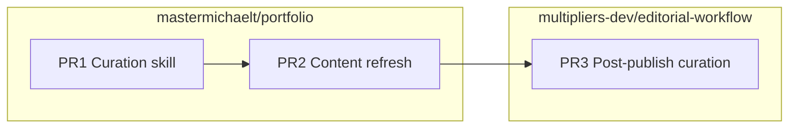

# Articles refresh and editorial curation

## Recommended execution authority

| Slice           | Recommended authority | Agent instruction                        |
| --------------- | --------------------- | ---------------------------------------- |
| slice-skill     | Open PR only          | Do not merge. Stop after opening the PR. |
| slice-content   | Open PR only          | Do not merge. Stop after opening the PR. |
| slice-editorial | Open PR only          | Do not merge. Stop after opening the PR. |
| plan-closure    | Open PR only          | Do not merge. Stop after opening the PR. |

Repo default: **Open PR only** ([planning-standards.md](../standards/planning-standards.md)).

## Scope

- **Finalized** for implementation (investigation complete; taxonomy locked below).
- **Three PRs**, merge order: **curation skill → content refresh → editorial workflow**.
- **Topology:** Each slice starts from latest `origin/main` in its target repo; PR base is `main`; branch carries only that slice.



---

## Taxonomy target (locked for PR2)

| Line id       | Public label                 | Count | Featured lead (unchanged)                                                |
| ------------- | ---------------------------- | ----: | ------------------------------------------------------------------------ |
| `measurement` | Measurement & Telemetry      | **3** | `active-players-which-sessions-counted`                                  |
| `authority`   | Authority & Stop Conditions  | **6** | `agent-plans-authority-handoffs`                                         |
| `critique`    | Evals & Judgment             | **5** | `ai-reviewer-kinds-of-reasoning`                                         |
| `readiness`   | Product Taste & Verification | **5** | `persist-game-state-not-ephemeral-ui-intent`                             |
| `portability` | Agent Portability            | **2** | `agent-portability-does-not-require-centralizing-methodology-behind-mcp` |

**Moves and adds (PR2):**

- Add six rows from hub `editorial-workflow/docs/dev.to/published/` with classifications specified in the investigation.
- Move `schema-first-valid-json-wasnt-enough` from `measurement` → `readiness`.
- Refresh **`argument`** on the four existing line leads only (Measurement, Authority, Evals, Readiness); do not change lead slugs or `featured: true` set (still the three homepage-aligned slugs).

**Proposed lead arguments** (compress only if length breaks layout; do not strengthen claims):

| Line        | Lead slug                                    | New `argument`                                                                                                                                                                       |
| ----------- | -------------------------------------------- | ------------------------------------------------------------------------------------------------------------------------------------------------------------------------------------ |
| Measurement | `active-players-which-sessions-counted`      | A healthy-looking number or funnel only means what your inclusion rules say it means — whether that is which sessions count as active or which hiring transitions belong in history. |
| Authority   | `agent-plans-authority-handoffs`             | Agent work needs explicit stop lines and guardrails you can verify — in plans, in git hooks, and in host lifecycle boundaries — not checklists that only read well in review.        |
| Critique    | `ai-reviewer-kinds-of-reasoning`             | Passing a score, a rubric, or a retrieval fixture is one kind of judgment; product-ready output still needs separate editorial and configuration decisions.                          |
| Readiness   | `persist-game-state-not-ephemeral-ui-intent` | Shipping means honoring what the product has accepted as true — persisted state, requirements QA, and the runtime model — not green pipelines or plausible generated content.        |

**Editorial ordering:** `groupArticleLines` preserves **inventory order within each line** (not DEV publish date). When editing `content/articles.ts`, insert new rows next to thematically related neighbors; do not sort by `published_at`.

Suggested **new portfolio slugs** (hub filename → slug), metadata from frontmatter (`title`, `tags`, `devto_api_url`):

| Hub file                                                                    | Portfolio slug                                                           | `line`        | `relatedProjectSlug` |
| --------------------------------------------------------------------------- | ------------------------------------------------------------------------ | ------------- | -------------------- |
| `we-made-our-agent-plans-portable-then-we-had-to-make-them-verifiable.md`   | `we-made-our-agent-plans-portable-then-we-had-to-make-them-verifiable`   | `authority`   | —                    |
| `hook-availability-was-split-from-product-enforcement-after-silent-skip.md` | `hook-availability-was-split-from-product-enforcement-after-silent-skip` | `authority`   | —                    |
| `the-retrieval-pipeline-worked-the-product-question-remained.md`            | `the-retrieval-pipeline-worked-the-product-question-remained`            | `critique`    | —                    |
| `records-first-chart-second-the-sankey-disagreed.md`                        | `records-first-chart-second-the-sankey-disagreed`                        | `measurement` | —                    |
| `the-agent-host-didnt-have-the-lifecycle-boundaries-i-assumed.md`           | `the-agent-host-didnt-have-the-lifecycle-boundaries-i-assumed`           | `authority`   | —                    |
| `ai-made-translation-cheap-localization-still-needed-human-judgment.md`     | `ai-made-translation-cheap-localization-still-needed-human-judgment`     | `readiness`   | `codenames-ai`       |

Summaries: one sentence each, compressed from opening/takeaway — same discipline as existing header comment in `articles.ts` (no invented metrics or causality).

---

## PR1 — Portfolio curation skill (`mastermichaelt/portfolio`)

**Goal:** Lightweight, **plan-independent**, independently invocable skill that keeps `content/articles.ts` aligned with hub published markdown.

**Add:** `.cursor/skills/articles-curation/SKILL.md` (optional short `verification.md` only if checklist-sized — no scripts).

**Skill contract (procedure, not automation):**

1. **Preflight:** Confirm checkout is `mastermichaelt/portfolio`; confirm sibling hub `multipliers-dev/editorial-workflow` is available (read-only). Portfolio-owned wording — no npm scripts required.
2. **Inventory:** List `editorial-workflow/docs/dev.to/published/*.md`; parse YAML frontmatter; compare `devto_api_url` to each row in `content/articles.ts`.
3. **Gap analysis:** Report missing / stale URLs / hub-only files not in portfolio (flag for editorial review; never auto-invent a sixth line).
4. **For each missing article:** Read full markdown body; classify into one of five `ArticleLine` ids using `content/article-lines.ts` and existing band examples. If no natural fit → **stop and ask** (do not add a category).
5. **Add rows:** Update `articles.ts` with slug, title, tags, year, url, line, optional `relatedProjectSlug`, summary.
6. **Line maintenance:** Consider whether line `argument` or lead should change; **preserve leads and featured** unless justified (document in PR).
7. **Assistant sync:** Extend `scripts/assistant/okf/published-articles.mjs` `PUBLISHED_ARTICLE_HUB_FILES`; copy hub markdown → `tests/fixtures/assistant-okf/published/<slug>.md`; bump `content-source-registry.mjs` SHA when `articles.ts` changes.
8. **Tests:** Update `tests/content-foundation.test.ts` and `tests/article-lines.test.ts`; refresh membership comment in `article-lines.ts`.
9. **Verify:** `npm run lint`, `npm run typecheck`, `npm run format:check`, `npm test`. Note OKF ingest re-run when fixtures change.
10. **Open PR** (Open PR only).

**Explicit non-goals:** No new npm commands, DEV API clients, schedulers, or generic publishing framework.

**Acceptance:**

- Skill lives under `.cursor/skills/articles-curation/` and is invocable without any active `.cursor/plans/` file.
- Documents taxonomy pointers (`domain/article.ts`, `content/article-lines.ts`, `articles.ts` header).
- Includes a **standalone** copy-paste agent prompt (invoke `@.cursor/skills/articles-curation/SKILL.md` only — no plan file reference).
- Skill text must remain valid after this plan is archived.

Mark `slice-skill` **completed** in plan frontmatter in the same PR.

---

## PR2 — Portfolio content refresh (`mastermichaelt/portfolio`)

**Goal:** Execute the articles-curation skill to land **21** curated articles matching the taxonomy table above.

**Primary files:**

| File                                                | Change                                                                                                |
| --------------------------------------------------- | ----------------------------------------------------------------------------------------------------- |
| `content/articles.ts`                               | +6 rows, move `schema-first`, update four lead `argument`s, reorder within lines                      |
| `content/article-lines.ts`                          | Membership comment **3/6/5/5/2**; refresh authority `note` if inaccurate                              |
| `scripts/assistant/okf/published-articles.mjs`      | +6 hub filename mappings                                                                              |
| `tests/fixtures/assistant-okf/published/*.md`       | +6 copies from hub                                                                                    |
| `scripts/assistant/okf/content-source-registry.mjs` | New SHA-256 for `content/articles.ts`                                                                 |
| `tests/content-foundation.test.ts`                  | Counts `{ measurement: 3, authority: 6, critique: 5, readiness: 5, portability: 2 }`, `length === 21` |
| `tests/article-lines.test.ts`                       | `band.count` `[3, 6, 5, 5, 2]`                                                                        |

**Acceptance:**

- Every curated hub published file has matching `devto_api_url` in `articles.ts`.
- Structural invariants: one `lineLead` per line, arguments only on leads, three `featured`, unique slugs/urls.
- `npm test` + pre-commit recipe green.

Mark `slice-content` **completed** in plan frontmatter in the same PR.

---

## PR3 — Editorial post-publish curation (`multipliers-dev/editorial-workflow`)

**Goal:** Make **destination curation** a standard step in the existing **post-publication** flow (`editor-publish` §5), not an optional reminder. **Fail-open:** publication close-loop succeeds even when curation cannot run.

**Behavior (document in skill + runbook):**

After the operator confirms live DEV publish and the agent completes Notion **Published URL** + **Status → Published**:

1. **Determine destination** (docs-only convention for this installation — no new YAML schema in this slice):
   - **Portfolio:** weekly field reports that belong on [michaeltruong.ai/articles](https://michaeltruong.ai/articles) → destination repo `mastermichaelt/portfolio`, skill `.cursor/skills/articles-curation/SKILL.md`.
   - Other destinations: same pattern later (“invoke that repo’s article curation skill”); do not duplicate portfolio taxonomy in the hub.
2. **Invoke curation:** In an Agent session with the **portfolio checkout** available, load and follow the portfolio articles-curation skill (sync hub `docs/dev.to/published/` → portfolio `content/articles.ts` and related fixtures/tests when gaps exist). Scope to the **just-published** article when the skill supports a single-artifact pass; otherwise run gap sync if that is the skill’s documented default.
3. **Fail-open:** If the destination repo checkout, skill file, or hub `published/` source for the article is unavailable, **do not fail** Notion publish or treat post-publish as blocked. Append to the **Required chat report** (and optional Notion audit block):

   `Destination curation: skipped (<reason>)`

   Examples: `portfolio checkout not in workspace`, `articles-curation skill not found`, `markdown not yet under docs/dev.to/published/`.

4. **Open PR:** When curation mutates portfolio content, open a portfolio PR per the skill (Open PR only); that PR is separate from this editorial-workflow docs slice unless the same agent session spans both repos by explicit user direction.

**Files to update:**

| File                             | Change                                                                                                                                                        |
| -------------------------------- | ------------------------------------------------------------------------------------------------------------------------------------------------------------- |
| `skills/editor-publish/SKILL.md` | Extend **§5 Post-publish mode** with steps 1–3 above; extend Required chat report with `Destination curation` outcome (`completed` / `skipped` / `PR opened`) |
| `docs/editorial-workflow.md`     | Add pipeline step after step 12 (close loop): **destination curation invoke** with fail-open semantics; portfolio example only                                |
| `docs/dev.to/README.md`          | Optional one sentence: after move to `published/`, post-publish flow may invoke destination curation                                                          |

**Wording anchor (intent, not duplicated taxonomy):**

> If the published article is associated with a destination repository that maintains a curated article collection, invoke that repository's article curation skill.

**Acceptance:** `npm test` + `npm run typecheck` in editorial-workflow.

**Multi-repo note:** Full curation execution requires `mastermichaelt/portfolio` in the agent environment; hub-only sessions still complete publish but report `Destination curation: skipped`.

Mark `slice-editorial` **completed** in plan frontmatter in the same PR.

---

## Verification matrix

| Repo               | PR  | Required checks                                                                                                 |
| ------------------ | --- | --------------------------------------------------------------------------------------------------------------- |
| portfolio          | PR1 | Skill present; `npm test` if product invariants touched                                                         |
| portfolio          | PR2 | `npm run lint`, `npm run typecheck`, `npm run format:check`, `npm test`, `npm run build` (e2e on content paths) |
| editorial-workflow | PR3 | `npm test`, `npm run typecheck`                                                                                 |

---

## Blockers and decisions

| Item                                           | Status                                               |
| ---------------------------------------------- | ---------------------------------------------------- |
| Taxonomy / counts / six classifications        | **Decided**                                          |
| PR merge order                                 | **Decided:** skill → content → editorial             |
| Skill independent of this plan                 | **Decided** — no plan references in skill acceptance |
| Post-publish curation                          | **Decided** — invoke in flow; fail-open skip         |
| `relatedProjectSlug` for General posts         | **Default none**; translation → `codenames-ai`       |
| Destination registry in `.agents/projects.yml` | **Out of scope** — runbook convention only           |

---

## Plan closure (docs-only PR)

After PR3 merges:

1. Verify implementation todos `completed`
2. Add `# Shipped` closure note at top of plan body
3. Move to `.cursor/plans/archive/2026-10-30-articles-refresh-curation.plan.md`
4. Mark `plan-closure` completed; update agent prompt paths to archived location

---

## Agent prompts (copy/paste for Cursor)

Use a **fresh Agent-mode chat** per slice.

### slice-skill

```text
@.cursor/plans/2026-10-30-articles-refresh-curation.plan.md

Implement slice-skill only. Do not start slice-content, slice-editorial, or plan-closure.

Authority: Open PR only — implement and open the PR; do not merge.

Topology: cd to mastermichaelt/portfolio; prove origin; start from latest origin/main; PR base main; branch represents only this slice.

Deliverables: Add `.cursor/skills/articles-curation/SKILL.md` (optional verification.md) per plan PR1 — plan-independent skill with standalone agent prompt (no @ plan reference inside the skill). Mark slice-skill completed in plan frontmatter in this PR.

Verification: Skill readable and self-contained; portfolio tests green if any tracked files beyond skill/docs change.
```

### slice-content

```text
@.cursor/plans/2026-10-30-articles-refresh-curation.plan.md

Implement slice-content only. Prerequisite: slice-skill merged. Do not start slice-editorial or plan-closure.

Authority: Open PR only — implement and open the PR; do not merge.

Topology: cd to mastermichaelt/portfolio; prove origin; start from latest origin/main; PR base main; branch represents only this slice.

Deliverables: Follow @.cursor/skills/articles-curation/SKILL.md to sync 21 articles (taxonomy table in plan), fixtures, registry hash, tests, article-lines comments. Mark slice-content completed in plan frontmatter in this PR.

Verification: npm run lint, typecheck, format:check, test; build if CI would run e2e on changed paths.
```

### slice-editorial

```text
@.cursor/plans/2026-10-30-articles-refresh-curation.plan.md

Implement slice-editorial only. Prerequisite: slice-content merged. Do not start plan-closure.

Authority: Open PR only — implement and open the PR; do not merge.

Topology: cd to multipliers-dev/editorial-workflow; prove origin; start from latest origin/main; PR base main; branch represents only this slice.

Deliverables: Update editor-publish SKILL §5 and docs/editorial-workflow.md (and optional docs/dev.to/README.md) so post-publish invokes destination curation fail-open per plan PR3. Mark slice-editorial completed in plan frontmatter in this PR.

Verification: npm test && npm run typecheck in editorial-workflow.
```

### plan-closure

```text
@.cursor/plans/2026-10-30-articles-refresh-curation.plan.md

Execute only plan-closure.

Authority: Open PR only — docs-only archive PR; do not merge.

Prerequisites: slice-skill, slice-content, and slice-editorial merged and marked completed in frontmatter.

Topology: cd to mastermichaelt/portfolio; prove origin; start from latest origin/main; PR base main.

Deliverables: # Shipped note, move plan to .cursor/plans/archive/2026-10-30-articles-refresh-curation.plan.md, mark plan-closure completed, update agent prompt @ paths to archived file.

Verification: All implementation PRs merged; frontmatter todos consistent.
```
