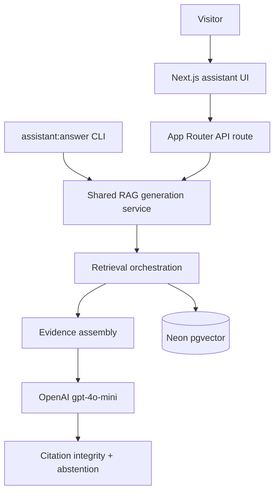
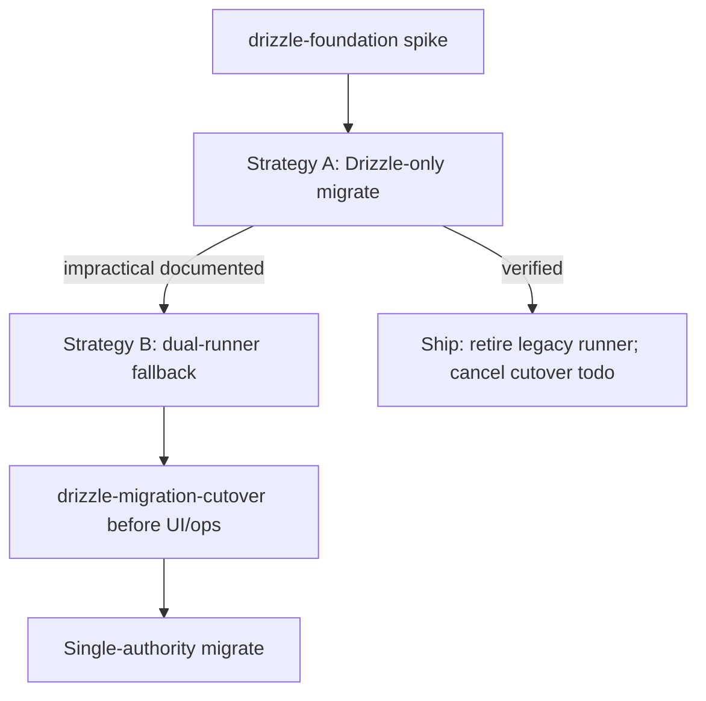

# Assistant grounded RAG generation

## Superseded — responsibility transfer (2026-10-30)

|                           |                                                                                                                   |
| ------------------------- | ----------------------------------------------------------------------------------------------------------------- |
| **Plan status**           | **Superseded** by [2026-10-30-assistant-roadmap.plan.md](../2026-10-30-assistant-roadmap.plan.md) (orchestration) |
| **Implementation status** | **Shipped** — all implementation todos through `generation-ui` completed on `main` (see frontmatter)              |
| **Plan archived**         | 2026-10-30 (filename date **2026-10-08** preserved)                                                               |

**Outstanding obligations transferred (not completed on this plan):**

| Todo                         | Successor owner | Successor reference                                                                                                                              |
| ---------------------------- | --------------- | ------------------------------------------------------------------------------------------------------------------------------------------------ |
| `operational-acceptance`     | Phase 4         | [2026-10-30-assistant-04-production-reopening.plan.md](../2026-10-30-assistant-04-production-reopening.plan.md) — slice `operational-acceptance` |
| `plan-closure` (doc updates) | Phase 4         | Same plan — slice `plan-closure` (`architecture-direction`, `rag-generation-direction`, `generation-eval-findings`)                              |

Frontmatter marks transferred todos **`cancelled`** with transfer rationale — not **`completed`**.

## # Shipped (implementation)

Implementation slices through **`generation-ui`** merged on `main` (contract, CLI, eval, API, Drizzle foundation + queries, `/assistant` UI). **Operational acceptance** and milestone **doc closure** were **not** completed on this plan — transferred to [Phase 4 production reopening](../2026-10-30-assistant-04-production-reopening.plan.md) on **2026-10-30**. Plan **archived** same date; active execution authority is the [assistant roadmap](../2026-10-30-assistant-roadmap.plan.md).

---

## Roadmap reconciliation (2026-10-30)

**Authoritative sequencing:** [2026-10-30-assistant-roadmap.plan.md](../2026-10-30-assistant-roadmap.plan.md).

| Item                                          | Status                                                                                                       |
| --------------------------------------------- | ------------------------------------------------------------------------------------------------------------ |
| Implementation slices through `generation-ui` | **Shipped** on `main` (verified: API, `/assistant`, Drizzle, eval harness)                                   |
| `operational-acceptance`                      | **Transferred** → Phase 4 [04-production-reopening](../2026-10-30-assistant-04-production-reopening.plan.md) |
| `plan-closure`                                | **Transferred** → Phase 4 `plan-closure` slice (doc updates at reopen)                                       |
| This plan                                     | **Archived** — historical record only                                                                        |

**Goal:** Deliver a **working portfolio assistant on [michaeltruong.ai](https://michaeltruong.ai)** — visitor questions answered with **evidence-aware, attributable** responses using the indexed OKF corpus (101 concepts; retrieval-eval baseline on current index), Neon pgvector retrieval, and OpenAI generation. **Generation quality, inspectability, and citation integrity first**; UI stays minimal.

**Plan amendment (2026-10-08):** Milestone scope expanded from dev-only `assistant:answer` to **server-backed deployment**. PR #55 (plan) and PR #56 (`generation-contract`) are merged.

**Plan amendment (2026-10-16):** Generation philosophy revised from **evidence-only** to **evidence-aware generation with observable attribution**. The model may use general knowledge where appropriate; the milestone measures how retrieval contributes to answer quality and keeps personal/professional facts strongly corpus-grounded. Minimal **contract extension** (claim-level attribution) lands in **`generation-cli`** (no separate contract-only slice unless implementation reveals a hard boundary).

**Plan amendment (2026-10-16, contract tightening):** **`claims[]` is the canonical model output** — the service derives `answer_text` and top-level `citations[]`; **`support_level`** measures evidence coverage only (orthogonal to abstention); **`abstention_reason`** is set only when the assistant actually abstains; overlong structured model output is **rejected**, not truncated post-generation.

**Plan amendment (2026-10-16, initial UI placement):** Ship the milestone assistant on a **dedicated `/assistant` route** with a **primary navigation entry** — a deliberate portfolio destination, not a site-wide floating chat widget. Interaction components must stay **reusable** for a future homepage integration; **AI-first homepage composition is deferred** (documented in [rag-generation-direction.md](../../docs/assistant/rag-generation-direction.md)). This amendment does not expand `generation-ui` into a homepage redesign.

**Plan amendment (2026-10-16, visitor-visible token usage):** Expose **OpenAI-reported** model and token counts to visitors on successful `/assistant` answers (compact usage footer). The **`generation-api`** slice returns an explicit, allowlisted `usage` object alongside the public answer; **`generation-ui`** renders it using portfolio design conventions informed by [Codenames AI](https://codenames-ai.com) per-turn token display (muted secondary typography, locale-formatted counts, omit when unavailable). **Server-side PostHog** telemetry (operator tooling) remains independent — no duplicate browser analytics for tokens. Internal `diagnostics` stay server/CLI-only.

**Plan amendment (2026-10-16, production Neon corpus):** Hosted assistant generation on michaeltruong.ai requires a **populated production retrieval index** on Neon — not only schema/migrations. **Production corpus ingestion and verification** are an **operator-controlled operational prerequisite** inside **`operational-acceptance`**, executed **before deployed E2E acceptance**. They use the existing `okf:build` → `assistant:ingest` workflow ([assistant-database.md](../../docs/assistant/assistant-database.md)); **not** a new implementation slice, **not** triggered by Vercel deploys, and **not** agent-executable without explicit operator approval.

**Plan amendment (2026-10-29, production Neon cutover):** One-time operator migration from local Docker to Neon **`portfolio-assistant`** completed successfully (**262** retrieval units, Drizzle fresh schema, no embedding regeneration). Historical record: [`docs/archive/production-neon-cutover-2026.md`](../../docs/archive/production-neon-cutover-2026.md). Routine schema work remains **`assistant:db:migrate`** / **`assistant:db:verify`** only — do not repeat the database-recreation procedure.

**Plan amendment (2026-10-29, conversational UI follow-up):** Product-design work to make `/assistant` feel conversational (session-local transcript, chat composer) while keeping **stateless single-turn** generation is tracked separately in [2026-10-29-assistant-03-conversational-ui.plan.md](../2026-10-29-assistant-03-conversational-ui.plan.md). Does not expand **`generation-ui`** acceptance, **`operational-acceptance`**, or RAG architecture scope.

**Plan amendment (2026-10-28, Drizzle ORM):** Adopt **Drizzle ORM** and **Drizzle Kit** as the **long-term schema, query, and migration authority** for the assistant Postgres + pgvector database (`DATABASE_URL` scope only — not site `PortfolioRepository` persistence). **Intent:** retire the custom legacy migration runner once a safe cutover is verified — not maintain two migration systems indefinitely. Two implementation slices (**`drizzle-foundation`**, **`drizzle-queries`**) land **after `generation-api` and before `generation-ui`**. Preserve historical SQL under `db/migrations/` as **read-only evidence** (do not delete or rewrite files), existing `schema_migrations` rows on populated databases, retrieval semantics, ingest idempotency, generation contract, and operator-controlled Neon operations. **Do not** recreate the database, change embedding model / `vector(1536)`, or replay full CREATE DDL on populated production in these slices.

**Plan amendment (2026-10-28, migration ownership):** **`drizzle-foundation`** must **evaluate a single-authority Drizzle Kit migration path first** (one operator command, one journal, custom runner retired or reduced to a thin Drizzle wrapper). A **dual-journal / dual-runner transitional bridge** is an **acceptable fallback only** if single-authority is documented impractical, together with **ongoing maintenance cost** and a note on when the fallback can be removed.

**Historical record:** At authorship time this milestone plan amended prior assistant direction in place. **Superseded** for execution by [2026-10-30-assistant-roadmap.plan.md](../2026-10-30-assistant-roadmap.plan.md) (2026-10-30) — preserved here as implementation evidence only; do not treat as active execution authority.

**Direction (design background):** [rag-generation-direction.md](../../docs/assistant/rag-generation-direction.md)

**Prerequisites (shipped):** OKF + structure-aware derive/ingest/retrieve; cross-repository corpus + retrieval-eval — [cross-repository-corpus-eval-findings.md](../../docs/assistant/cross-repository-corpus-eval-findings.md); **generation contract** (`scripts/assistant/generation/*`, `tests/assistant-generation-contract.test.ts`).

**Non-goals (milestone):** corpus expansion, retrieval-eval baseline changes, streaming, LangChain/LlamaIndex, automatic corpus updates, live web search, elaborate chat product (threads, memory, tool use), neighbour ±1 expansion, tokenizer-exact budgets, LLM-as-judge in required CI, **homepage replacement or cinematic homepage redesign**, **site-wide floating chat widget**, **agentic tool execution**, **heavy chat framework**, **new design system**, **retrieval architecture changes** (ANN, embedding model/dimension, OKF derive strategy — Drizzle ORM adoption is **not** a retrieval architecture change). Do not reopen the archived cinematic homepage redesign initiative.

## Locked decisions

Preserve unless a future plan amendment explicitly revises them.

| Topic                  | Decision                                                                                                                                                                                                                                                                                                                                                                                                                                                                                                                                                                                                                                                                                                                                                                                                                                                                                                                                                                                      |
| ---------------------- | --------------------------------------------------------------------------------------------------------------------------------------------------------------------------------------------------------------------------------------------------------------------------------------------------------------------------------------------------------------------------------------------------------------------------------------------------------------------------------------------------------------------------------------------------------------------------------------------------------------------------------------------------------------------------------------------------------------------------------------------------------------------------------------------------------------------------------------------------------------------------------------------------------------------------------------------------------------------------------------------- |
| Chat model             | `gpt-4o-mini` default (`ASSISTANT_GENERATION_MODEL` override); **native fetch** Chat Completions (mirror embeddings adapter); no LangChain/LlamaIndex                                                                                                                                                                                                                                                                                                                                                                                                                                                                                                                                                                                                                                                                                                                                                                                                                                         |
| Shared service         | **One** RAG generation implementation: query validation → retrieve → assemble → generate → parse → citation integrity → abstention/diagnostics. **`assistant:answer` CLI and App Router API route are thin adapters** — no shell-out, no duplicate generation paths                                                                                                                                                                                                                                                                                                                                                                                                                                                                                                                                                                                                                                                                                                                           |
| Default assembly       | **Bounded full-parent** at **OKF concept** boundary (`okf_concept_id`); Postgres-backed parent units                                                                                                                                                                                                                                                                                                                                                                                                                                                                                                                                                                                                                                                                                                                                                                                                                                                                                          |
| Eval baseline assembly | `top_k_only` (non-default for operators/eval)                                                                                                                                                                                                                                                                                                                                                                                                                                                                                                                                                                                                                                                                                                                                                                                                                                                                                                                                                 |
| Generation retrieve K  | Default **10** (`--top-k` / service default); retrieve CLI default **5** unchanged                                                                                                                                                                                                                                                                                                                                                                                                                                                                                                                                                                                                                                                                                                                                                                                                                                                                                                            |
| Budget                 | Truncate **unmatched** chunks only, or **`EvidenceBudgetExceeded`** — never silently drop top-K matched units                                                                                                                                                                                                                                                                                                                                                                                                                                                                                                                                                                                                                                                                                                                                                                                                                                                                                 |
| Generation philosophy  | **Evidence-aware** — general technical knowledge allowed; **personal/professional facts about Michael** require corpus grounding or explicit uncertainty; model-declared attribution is observable output, not proof of internal reasoning                                                                                                                                                                                                                                                                                                                                                                                                                                                                                                                                                                                                                                                                                                                                                    |
| Citations              | **Integrity** (deterministic: `evidence_id`, `unit_id`, approved URLs) in contract + runtime; **support** and **attribution accuracy** (semantic) in generation-eval only — structural validity ≠ factual support                                                                                                                                                                                                                                                                                                                                                                                                                                                                                                                                                                                                                                                                                                                                                                             |
| Response contract      | Model: ordered nonempty **`claims[]`** + **`support_level`** (evidence coverage) + **`abstained`** / **`abstention_reason`** when refusing; service derives **`answer_text`** and deduped **`citations[]`** — see [Contract amendment (generation-cli)](#contract-amendment-generation-cli)                                                                                                                                                                                                                                                                                                                                                                                                                                                                                                                                                                                                                                                                                                   |
| Visitor-visible usage  | **`generation-api`** returns allowlisted **`usage`** (`model`, OpenAI `prompt_tokens`, `completion_tokens`, optional `total_tokens`) on **successful** responses only; omit fields when unavailable — **never** coerce missing counts to zero; **no** prompt/evidence/diagnostics in the client payload                                                                                                                                                                                                                                                                                                                                                                                                                                                                                                                                                                                                                                                                                       |
| Resource bounds        | Configurable evidence char budget (120k = **dev default**), approximate prompt token cap, max output tokens, timeouts, max question/body size — no tokenizer-exact budgeting this milestone                                                                                                                                                                                                                                                                                                                                                                                                                                                                                                                                                                                                                                                                                                                                                                                                   |
| Eval baselines         | **`no_retrieval`** (model-only), **`top_k_only`**, **`full_parent`** — `no_retrieval` is eval-only, not production architecture                                                                                                                                                                                                                                                                                                                                                                                                                                                                                                                                                                                                                                                                                                                                                                                                                                                               |
| Index + corpus         | **Neon pgvector** + existing operator-controlled `okf:build` → `assistant:ingest` workflow; no automatic corpus updates; **production Neon must be ingested and verified** before deployed assistant E2E ([operational-acceptance](#slice--operational-acceptance))                                                                                                                                                                                                                                                                                                                                                                                                                                                                                                                                                                                                                                                                                                                           |
| Assistant DB schema    | **Drizzle ORM + Drizzle Kit** are the **intended long-term migration authority** (assistant `DATABASE_URL` only): typed `db/schema.ts`; forward DDL via Drizzle Kit under `drizzle/`. **Strategy A (`drizzle-foundation`):** establish **single-authority** migrate (one operator command, one journal); legacy custom runner **retired** in that slice when verified — **`drizzle-migration-cutover` todo marked `cancelled`**. **Strategy B (fallback only):** **temporarily** retain dual-runner until **`drizzle-migration-cutover`** merges (**after `drizzle-queries`**, **before `generation-ui` and `operational-acceptance`**) unless cutover completes in the foundation PR. **Do not** start **`operational-acceptance`** or **`plan-closure`** with active dual-runner migration. Historical SQL in `db/migrations/` stays **read-only** in Git. **Production migrate/verify remains operator-controlled** ([assistant-database.md](../../docs/assistant/assistant-database.md)). |
| Deployment target      | **michaeltruong.ai** (Vercel production); server-only `DATABASE_URL`, `OPENAI_API_KEY`, and generation config                                                                                                                                                                                                                                                                                                                                                                                                                                                                                                                                                                                                                                                                                                                                                                                                                                                                                 |

## Recommended execution authority

| Slice                     | Recommended authority    | Agent instruction                                                                                                                                                                                                                                  |
| ------------------------- | ------------------------ | -------------------------------------------------------------------------------------------------------------------------------------------------------------------------------------------------------------------------------------------------- |
| generation-contract       | Open PR only             | **Completed** (merged).                                                                                                                                                                                                                            |
| generation-cli            | Open PR only             | **Completed** (merged).                                                                                                                                                                                                                            |
| generation-eval           | Open PR only             | **Completed** (merged).                                                                                                                                                                                                                            |
| generation-api            | Open PR only             | **Completed** (merged).                                                                                                                                                                                                                            |
| drizzle-foundation        | Open PR only             | Do not merge. Stop after opening the PR.                                                                                                                                                                                                           |
| drizzle-queries           | Open PR only             | Do not merge. Stop after opening the PR.                                                                                                                                                                                                           |
| drizzle-migration-cutover | Open PR only             | Do not merge. Stop after opening the PR. **Conditional slice** — skip (mark todo `cancelled`) if foundation shipped Strategy A or same-PR cutover. Required before `generation-ui` / `operational-acceptance` when Strategy B dual-runner remains. |
| generation-ui             | Open PR only             | Do not merge. Stop after opening the PR.                                                                                                                                                                                                           |
| operational-acceptance    | Manual verification gate | No commit/PR; gitignored run notes allowed                                                                                                                                                                                                         |
| plan-closure              | Open PR only             | Do not merge. Stop after opening the PR.                                                                                                                                                                                                           |

Repo default: **Open PR only** ([planning-standards.md](../standards/planning-standards.md)).

## Repository topology (default)

Multi-slice plans stack **execution order**, not Git branches. Integration branch: **`main`**.

**Before each implementation slice:** `git fetch` → fresh branch from `origin/main`.

**Before opening a PR:** branch contains **only** that slice’s changes.

**After opening:** PR base is `main`; diff has no prior-slice work except through merged `main`.

---

## Milestone execution sequence

Implementation slices (Git PRs, merge order):

1. `generation-contract` → `generation-cli` → `generation-eval` → `generation-api` → **`drizzle-foundation` → `drizzle-queries`**
2. **Migration cutover gate (conditional — not a third unconditional Drizzle PR):**
   - **Strategy A** (single-authority shipped in **`drizzle-foundation`**): no cutover PR — mark frontmatter todo **`drizzle-migration-cutover`** `cancelled` with rationale in the foundation PR.
   - **Strategy B** (dual-runner still active after **`drizzle-foundation`**): **`drizzle-migration-cutover`** PR is **required** — merge **after `drizzle-queries`**, **before `generation-ui` and before `operational-acceptance`**; do not proceed with production operational acceptance while dual-runner migration remains active.
3. **`generation-ui`**
4. **`operational-acceptance`** (manual gate — after cutover gate satisfied and UI merged)
5. **`plan-closure`** (docs-only — only after ops sign-off and **no active dual-runner migration path**)

Operational gates (no implementation slice; operator-controlled where noted):

1. **`operational-acceptance` — Phase A: Production Neon corpus** (operator task, **explicit approval required** before any production `DATABASE_URL` ingest) — **only after** migration cutover gate satisfied and final **`assistant:db:verify`** contract confirmed for production migrate path.
2. **`operational-acceptance` — Phase B: Local + deployed verification** — `assistant:answer`, generation API, and `/assistant` UI on michaeltruong.ai (after Phase A and `generation-ui` deploy).
3. **`plan-closure`** — docs-only archive after Phase B sign-off; requires single-authority migration architecture (Strategy A foundation, or **`drizzle-migration-cutover`** merged when Strategy B required it).

Corpus updates remain **operator-controlled** (`okf:build` → `assistant:ingest`); deployments do **not** run ingest automatically.

---

## Target architecture



### Generation philosophy (evidence-aware)

| Principle                     | Requirement                                                                                                                                                                                 |
| ----------------------------- | ------------------------------------------------------------------------------------------------------------------------------------------------------------------------------------------- |
| Retrieval role                | Understand **how retrieved evidence contributes** to answer quality; retrieval remains the production path for corpus-grounded answers                                                      |
| General knowledge             | Allowed for general technical explanations **without** fabricating evidence citations; must not masquerade as retrieved evidence                                                            |
| Personal / professional facts | Stronger grounding — no invented career history, project outcomes, employment, or private details; prefer published evidence or qualify as **`uncertain`**                                  |
| Evidence vs model knowledge   | When evidence conflicts with model prior about Michael's work, prefer published evidence or acknowledge uncertainty                                                                         |
| Attribution                   | Model-declared **claim-level** categories are **observable classifications** for eval and UI — not proof of internal knowledge source                                                       |
| Abstention                    | Meaningful abstention for unverifiable personal claims and unsupported corpus questions; **do not** abstain solely because retrieval is thin when a general technical answer is appropriate |

**Claim-level attribution categories** (per claim/segment in structured output):

- `evidence_supported` — directly supported by retrieved evidence (requires valid citations).
- `evidence_inferred` — reasonable inference from evidence; qualify appropriately (citations required when asserting corpus-specific facts).
- `general_knowledge` — not established by retrieved evidence; no evidence citations.
- `uncertain` — insufficient confidence; answer text must be appropriately qualified.

### Shared RAG generation service (core)

Owns end-to-end generation for **both** CLI and server:

1. **Query validation** — non-empty, max length, max body size, reject obvious abuse patterns (eval expands injection cases).
2. **Retrieval orchestration** — embed question, `top-K` (default 10), optional filters; reuse existing retrieve stack. **`no_retrieval`** skips this step for eval-only baselines.
3. **Evidence assembly** — `full_parent` default; `EvidenceBudgetExceeded` fail-closed; contract packet types; retain invariant that matched retrieval units are never silently discarded.
4. **Generation** — structured JSON via fetch adapter; configurable timeouts and max output tokens; token usage capture.
5. **Response handling** — parse contract schema; **deterministic structural validation** (claim/citation rules below); **citation integrity** + URL whitelist; map failures to safe abstention/errors.
6. **Diagnostics** — structured internal telemetry (latency, tokens, budget, attribution counts, abstention outcomes, error categories); **strip private diagnostics from API client payloads** unless explicitly safe for rendering.

Keep **retrieval**, **assembly**, **generation**, and **validation** independently unit-testable; service composes them.

### Contract amendment (generation-cli)

**Shipped contract (`generation-contract`):** `answer_text`, `support_level` (`full` \| `partial` \| `none`), detached `citations[]`, optional `diagnostics`. Prompt templates today imply evidence-only answers — **superseded in `generation-cli`**.

**Canonical model output** (structured JSON from the LLM — implement in **`generation-cli`**, with contract tests extended in the same slice):

| Field               | Source    | Role                                                                                                                                                                                                                                                                   |
| ------------------- | --------- | ---------------------------------------------------------------------------------------------------------------------------------------------------------------------------------------------------------------------------------------------------------------------- |
| `claims[]`          | **Model** | **Canonical answer.** Ordered, **non-empty** segments: `{ text, attribution, citations? }`. Every visitor-facing statement lives here.                                                                                                                                 |
| `support_level`     | **Model** | **Evidence coverage only** — how much retrieved evidence supports corpus-relevant / personal claims in the answer (`full` \| `partial` \| `none`). **`none` is valid for a good general-knowledge answer** that does not rely on the packet; it is **not** abstention. |
| `abstained`         | **Model** | `true` when the assistant refuses or only explains why it cannot answer substantively; `false` when delivering a normal answer (including general-knowledge-only).                                                                                                     |
| `abstention_reason` | **Model** | **Only when `abstained` is true.** Enum distinguishing no hits, irrelevant evidence, unsupported personal, conflicting evidence, etc. **Independent of `support_level`.**                                                                                              |

**Service-derived public fields** (deterministic — not separate model opinions):

| Field         | Derivation                                                                                                                                          |
| ------------- | --------------------------------------------------------------------------------------------------------------------------------------------------- |
| `answer_text` | Concatenate `claims[].text` in order (with sensible separators, e.g. spaces or paragraph breaks between segments).                                  |
| `citations[]` | **Deduplicated union** of all per-claim `citations` (stable order, e.g. first-seen `evidence_id`). Integrity validated against the evidence packet. |

CLI, API, and UI all consume the **same** `claims[]` plus derived fields — **no** parallel prose or citation lists from the model. UI renders **`claims[]`** (attribution + per-claim citations); derived `answer_text` is for convenience, previews, and clients that want flat prose.

**Deterministic validation (runtime)** — only what is verifiable without semantic interpretation:

- `claims[]` non-empty array; each claim has non-empty `text` and valid `attribution`.
- `evidence_supported` claims: non-empty `citations` with passing **citation integrity** (IDs/units/URLs in packet).
- `general_knowledge` claims: citations optional; must not be the sole basis for invented personal facts (semantic enforcement in eval).
- `uncertain` claims: no structural citation requirement; qualification checked in generation-eval.
- When `abstained` is `true`: require `abstention_reason`; when `false`, `abstention_reason` must be absent.
- Derived `answer_text` non-empty; derived `citations[]` passes integrity when non-empty.
- Fabricated `evidence_id` / `unit_id` / URLs: fail integrity (existing validators).
- **Do not** require every claim to cite evidence.

**Semantic validation (generation-eval only):** citation support, attribution accuracy, unsupported personal claims, injection resistance, abstention appropriateness (including `abstained` vs qualified partial answers).

### Generation resource controls

| Control                         | Notes                                                                                                                                                                                                       |
| ------------------------------- | ----------------------------------------------------------------------------------------------------------------------------------------------------------------------------------------------------------- |
| Evidence character budget       | `DEFAULT_EVIDENCE_CHARACTER_BUDGET` (120_000) = **development default**; production value set via env/config after measurement — **`EvidenceBudgetExceeded`** remains fail-closed                           |
| Approximate prompt token budget | Heuristic cap on evidence + instructions + question metadata (not tokenizer-exact)                                                                                                                          |
| Max generated output tokens     | Server/CLI config; **reject** overlong or unparseable structured JSON with a **controlled error** — do **not** truncate model output after generation (truncation risks invalid JSON and severed citations) |
| Request timeout                 | End-to-end generation timeout; align with Vercel Fluid Compute limits on API slice                                                                                                                          |
| Max question / body size        | Validated before retrieval or model call                                                                                                                                                                    |

Optional **smaller retrieval K** or retry policies are **separate observable policies** — document in eval findings if adopted; never silently drop matched top-K units.

### Prompt-injection and trust boundaries

Retrieved passages are **untrusted as instructions** but are the authoritative source for **corpus-grounded claims about Michael**.

System prompt (in `generation-cli`) must: allow appropriate general knowledge; distinguish evidence from model knowledge; require honest attribution; ignore override instructions embedded in evidence; never expose secrets, raw packets, or internal diagnostics to visitors.

**Tests** (mocked, deterministic — expand across `generation-cli` and `generation-eval`): instruction overrides in evidence, fabricated citation IDs/URLs, malformed JSON, unsupported personal claims (fixtures), overlong responses, conflicting evidence packets, safe rendering assumptions.

### Evidence assembly (`full_parent` default)

1. Retrieve top-K (default 10); record `matched_hits[]`.
2. Distinct parents ordered by best hit rank.
3. Per parent: fetch all `assistant_retrieval_units` for `okf_concept_id`; order by `chunk_index`, `unit_id`.
4. Dedupe `content_hash` **within** OKF concept; matched `unit_id` preserved; matched supersedes unmatched hash duplicates.
5. **Budget:** all matched units, then unmatched chunks until cap; else **`EvidenceBudgetExceeded`** (no LLM).
6. **`top_k_only`:** retrieved rows only (eval baseline).

### Citation layers

| Layer                    | Slice                                                            | Purpose                                                                                                   |
| ------------------------ | ---------------------------------------------------------------- | --------------------------------------------------------------------------------------------------------- |
| **Citation integrity**   | `generation-contract` (done), `generation-cli`, `generation-api` | IDs/URLs refer to supplied packet only; claim-level citations validated where attribution requires them   |
| **Citation support**     | `generation-eval`, operational review                            | Cited evidence backs the associated claim/segment (semantic)                                              |
| **Attribution accuracy** | `generation-eval`, operational review                            | Declared `attribution` matches claim type; personal facts not labeled `general_knowledge` without support |

### Public deployment requirements (API + production)

Resource controls are **server-side**; the browser is untrusted.

**V1 rate limiting and cost containment (practical):**

- **Per-client limits** — IP- or fingerprint-based request budget (e.g. requests per minute/hour/day) enforced in the API route or edge middleware compatible with **Vercel Fluid Compute** (multiple instances). **Do not rely solely on in-memory counters** — use a **durable shared store** (e.g. Vercel KV / Upstash Redis, or Postgres-backed counters on the assistant DB) so limits hold across instances and cold starts.
- **Global safeguards** — OpenAI project budget/alerts (existing operator practice); optional daily cap on generation calls logged in durable store; fail closed with a safe public error when limits trip.
- **Request bounds** — max question length, max JSON body size, server timeouts aligned with platform limits (Node Fluid Compute default duration).
- **Response bounds** — never return raw evidence packets, embedding vectors, SQL errors, stack traces, or API keys; map `EvidenceBudgetExceeded` and validation failures to stable client messages. **Allowlisted exception:** public **`usage`** token fields on successful generation (see `generation-api`); not internal `diagnostics`, budgets, or utilization percentages.
- **Secrets** — `DATABASE_URL`, `OPENAI_API_KEY`, and generation overrides **server-only** (Vercel env); never `NEXT_PUBLIC_*` for credentials.

**Runtime:** App Router route on default **Node.js** runtime (Fluid Compute); no Edge-only APIs required for pgvector access. Document deployment env in [assistant-database.md](../../docs/assistant/assistant-database.md) when `generation-api` lands.

### Deferred

Streaming, neighbour expansion, automatic ingest on deploy, external web search, conversational memory, LLM-as-judge as required CI gate, **AI-first homepage** (assistant as primary discovery surface — product/UX milestone; see [rag-generation-direction.md](../../docs/assistant/rag-generation-direction.md)).

---

## Slice — `generation-contract` (shipped)

**Status:** **Completed** (merged via PR #56).

**Delivered:** `full_parent` + `top_k_only` assembly, `EvidenceBudgetExceeded`, baseline response schema (`answer_text`, `support_level`, `citations[]`), citation integrity (IDs + approved URLs from packet entries), contract tests. Evidence-only prompt wording — superseded by evidence-aware direction in **`generation-cli`**.

**PR boundary:** Contract modules + tests only. **Claim-level attribution** is intentionally deferred to `generation-cli` (extends schema + validators + prompts in one merge-safe slice).

---

## Slice — `generation-cli`

**Recommended authority:** Open PR only

**Rationale:** Introduces the **shared service** and operator CLI before eval and server adapters.

**Agent instruction:** Do not merge. Stop after opening the PR.

**Goal:** Implement **shared RAG generation service** + fetch-based OpenAI chat adapter + **`npm run assistant:answer`** as a thin CLI adapter (`--assembly-mode`, `--top-k`, `--json`, `--dry-run-retrieval`, optional `--no-retrieval` for operator/eval baseline).

**Contract work in this slice:** Model schema = **`claims[]`** (canonical) + **`support_level`** + **`abstained`** / **`abstention_reason`**; service **derives** `answer_text` and deduped `citations[]`; revise prompts; structural validators; reject overlong structured output; update `tests/assistant-generation-contract.test.ts`.

**Non-goals:** `app/api/` route, UI, full generation-eval harness, duplicate generation logic outside the service.

**Likely files:** `scripts/assistant/generation/run-generation.mjs` (or equivalent service entry), `openai-chat.mjs`, `generation-config.mjs`, `validate-response.mjs`, `response-schema.mjs`, `prompt-templates.mjs`, `assistant:answer` script wiring, tests with mocked `fetch`, [assistant-database.md](../../docs/assistant/assistant-database.md), `.env.example`.

**Dependencies:** `generation-contract` on `main`.

**Acceptance:**

- Service callable from CLI without spawning subprocesses.
- Evidence-aware sample question: mix of `general_knowledge` and `evidence_supported` claims with valid citations where required when `DATABASE_URL` + `OPENAI_API_KEY` set.
- **Structured diagnostics** emitted internally (retrieval/assembly/generation latency, model id, token usage, evidence count/char budget, assembly mode/truncation, attribution category counts, abstention/error categories) — reusable by API slice; CLI may print subset with `--json`.
- Configurable resource bounds (evidence budget, heuristic prompt budget, max output tokens, timeout, max question length) with documented production-oriented defaults separate from 120k dev budget.
- Non-zero exit on `EvidenceBudgetExceeded`, integrity failure, structural validation failure, API errors.
- Mocked `fetch` tests for service + adapter boundaries; mocked tests for injection strings in evidence, fabricated citations, malformed model JSON.

**PR boundary:** Service + CLI + contract extension + config/docs; no API route, no UI, no eval harness fixtures.

---

## Slice — `generation-eval`

**Recommended authority:** Open PR only

**Rationale:** Answer-quality and safety signals before exposing a public endpoint.

**Agent instruction:** Do not merge. Stop after opening the PR.

**Goal:** `tests/assistant-generation-eval.test.ts`, **frozen evidence-packet fixtures** (generation independent of live Neon/embeddings), `scripts/assistant/generation/eval.mjs`, stub [generation-eval-findings.md](../../docs/assistant/generation-eval-findings.md).

**Assembly / retrieval modes compared:**

1. **`no_retrieval`** — model-only baseline (empty or minimal packet); eval-only, not production.
2. **`top_k_only`** — matched passages only.
3. **`full_parent`** — default production assembly.

**Question coverage (fixtures):** direct personal/career facts; project architecture decisions; general technical explanations; blended experience + general engineering; multi-unit inference; unsupported/unverifiable personal claims; adversarial prompt-injection in evidence.

**Abstention scenarios (scored in eval, not all deterministic):** no retrieval results; irrelevant evidence; partial evidence; general technical without retrieval; unsupported personal; conflicting evidence.

**Metrics (where practical):** answer correctness, citation integrity, semantic citation support, attribution accuracy, unsupported-claim frequency, completeness, abstention appropriateness, latency, input/output tokens and estimated cost. **Do not change** retrieval-eval fixtures or [eval-cases.json](../../tests/fixtures/assistant-retrieval/eval-cases.json).

**Dependencies:** `generation-cli` merged.

**Acceptance:**

- Deterministic CI: mock model outputs → integrity + structural validators + support/attribution scorers; case where integrity passes but support fails; case where personal claim is wrongly `general_knowledge`.
- Frozen packet fixtures exercised without `DATABASE_URL`.
- Live-model comparison and semantic judgments: **operator-run optional**; no mandatory LLM-as-judge in required CI.
- Integration `skipIf` without secrets for end-to-end spot checks.

**PR boundary:** Eval harness + fixtures + stub doc only.

---

## Slice — `generation-api`

**Recommended authority:** Open PR only

**Rationale:** Production entrypoint; must reuse shared service from `generation-cli`.

**Agent instruction:** Do not merge. Stop after opening the PR.

**Goal:** Next.js **server-side** API route (e.g. `app/api/assistant/...`) that calls the **same shared RAG generation service** as the CLI.

**Non-goals:** Chat UI, shell-out to CLI, client-side retrieval/generation, exposing internal packets or secrets.

**Requirements:**

- Request validation (schema, size, method).
- Server-only secrets and configuration.
- **Rate limiting** and usage controls per [Public deployment requirements](#public-deployment-requirements-api--production).
- Timeouts and safe error mapping for clients.
- **Public response envelope** — separate the visitor answer from optional usage metadata (illustrative shape; reconcile field names with the shipped `AssistantGenerationResponse` contract):

```json
{
  "answer": {
    "claims": [],
    "answer_text": "...",
    "citations": [],
    "support_level": "full",
    "abstained": false
  },
  "usage": {
    "model": "gpt-4o-mini",
    "prompt_tokens": 1842,
    "completion_tokens": 326,
    "total_tokens": 2168
  }
}
```

- **`usage` sourcing** — populate from **OpenAI Chat Completions `usage`** returned by the shared service (`prompt_tokens`, `completion_tokens`, `total_tokens`, resolved `model`). Do **not** expose approximate prompt-budget estimates, `output_token_utilization`, or other heuristic diagnostics.
- **`usage` allowlist** — only `model`, `prompt_tokens`, `completion_tokens`, and `total_tokens` may appear in the client payload. Each field is **optional** when unavailable; **omit** the field or the entire `usage` object — do **not** send `0` as a placeholder for missing OpenAI counts.
- **Failure responses** — stable error codes/messages only; **no** `usage` on failed, timed-out, truncated, or partial generations.
- **Diagnostics boundary** — `runRagGeneration` `diagnostics` (latencies, attribution counts, internal budgets) remain **server/operator-only**; the API adapter maps the allowlisted subset into `usage` for successful responses only.
- Tests: route handler unit tests with mocked service; no live keys in CI.

**Dependencies:** `generation-cli` merged (`generation-eval` may land in parallel only if merge-safe; prefer **eval after CLI**, **API after CLI**).

**Acceptance:**

- Successful `200` responses return `answer` with public-safe fields (`claims[]`, derived `answer_text`, derived `citations[]`, `support_level`, `abstained`, `abstention_reason` when applicable) plus allowlisted `usage` when OpenAI usage is available.
- Handler tests assert **no** raw evidence packets, embeddings, prompts, secrets, stack traces, or full `diagnostics` in JSON; negative test for disallowed diagnostic keys.
- Handler tests assert missing OpenAI usage omits `usage` or individual fields without zero-filling.
- Service integration test or handler test proves no duplicate generation implementation.
- Document production env vars, response envelope, and limits in assistant-database or dedicated assistant API doc section.

**PR boundary:** API route + server wiring + tests + docs; no UI slice work.

---

## Assistant database — Drizzle adoption (direction)

**Scope:** Assistant retrieval index + API rate-limit tables on **`DATABASE_URL` only**. Site `PortfolioRepository` persistence (future Milestone 4) remains a separate connection, schema, and migration lifecycle.

**Long-term authority (target end state):**

| Concern                                         | Authority                                                                                                                                                                                                                           |
| ----------------------------------------------- | ----------------------------------------------------------------------------------------------------------------------------------------------------------------------------------------------------------------------------------- |
| Typed schema + queries                          | **Drizzle ORM** (`db/schema.ts`, shared `db/client.ts`)                                                                                                                                                                             |
| **All** DDL (fresh bootstrap + forward changes) | **Drizzle Kit** (`drizzle.config.ts` → SQL under `drizzle/`, journal `__drizzle_migrations`)                                                                                                                                        |
| Operator entrypoint                             | **Target:** **`npm run assistant:db:migrate`** → Drizzle migrator only (legacy runner **removed** after cutover). **Strategy B interim:** legacy runner + Drizzle migrator until cutover slice or same-PR retirement in foundation. |
| Historical SQL files                            | **`db/migrations/*.sql`** preserved **read-only** in Git (audit trail; not executed after cutover)                                                                                                                                  |
| Legacy `schema_migrations` on existing DBs      | **Frozen** — historical record on Neon/local DBs already migrated; not the authority for new DDL                                                                                                                                    |

**Migration transition — investigation gate (required before locking `drizzle-foundation` implementation):**

Do **not** treat dual-runner / dual-journal as the default. The foundation PR must **evaluate strategies in order** and document results in the PR + [assistant-database.md](../../docs/assistant/assistant-database.md).

**Strategy A — single-authority Drizzle (evaluate first; preferred):**

- **Fresh database:** `assistant:db:migrate` applies Drizzle Kit migrations only (initial migration(s) reproduce current schema + `vector` extension — sourced from `db/schema.ts`, not by re-running legacy files at runtime).
- **Existing database** (legacy `schema_migrations` populated, Drizzle journal empty — production Neon shape today): baseline without replaying CREATE — e.g. mark initial Drizzle migration(s) applied / journal seeding procedure that **does not** recreate tables or re-enable extension on populated DBs.
- **Verify:** idempotent second migrate; `assistant:db:verify` aligned with chosen journal; local Docker spike + documented operator Neon procedure (operator runs production migrate — agents do not by default).
- **Cutover:** remove or reduce [`scripts/assistant/db/migrate.mjs`](../../scripts/assistant/db/migrate.mjs) legacy loop to a thin Drizzle wrapper; legacy SQL files stay in repo but are **not** executed on fresh installs after cutover.

**Strategy B — dual-runner transitional bridge (fallback only if Strategy A is impractical):**

Use only when Strategy A is **documented impractical** (concrete blockers: pgvector baseline in Kit, Neon baseline seeding, verify contract, etc.).

- Two journals: **`schema_migrations`** (legacy filenames) + **`__drizzle_migrations`** (Drizzle Kit).
- **`assistant:db:migrate`** runs legacy runner then Drizzle migrator until a follow-up plan slice retires legacy execution.
- Fresh DB: legacy SQL creates schema; first Drizzle migration is **no-op baseline** (no duplicate CREATE).
- Existing DB: legacy skipped; Drizzle baseline seeds journal only.

**Fallback maintenance cost (required in docs if Strategy B ships):** two runners to test, dual verify rules, operator confusion risk, and every future schema change must consider both journals until legacy execution is removed.

**Strategy B retirement (mandatory — not optional tech debt):**

| Path          | Owner                                                                                               | Acceptance                                                                                                                                                                                                                                                                                                                                                                                                                                                                                                                                |
| ------------- | --------------------------------------------------------------------------------------------------- | ----------------------------------------------------------------------------------------------------------------------------------------------------------------------------------------------------------------------------------------------------------------------------------------------------------------------------------------------------------------------------------------------------------------------------------------------------------------------------------------------------------------------------------------- |
| **Preferred** | **`drizzle-foundation` PR**                                                                         | Same PR completes spike **and** lands single-authority migrate (legacy runner removed; verify + tests match Strategy A end state).                                                                                                                                                                                                                                                                                                                                                                                                        |
| **Fallback**  | **`drizzle-migration-cutover` slice** (required if foundation merges with dual-runner still active) | Open PR only; merge **after `drizzle-queries`**, **before `generation-ui` and `operational-acceptance`**; removes legacy runner execution from `assistant:db:migrate`; updates verify/docs; proves fresh DB + existing DB baseline on local Docker; **no** dual-runner code path left except read-only legacy SQL in Git. Foundation PR must state that cutover slice is **required** before UI/ops. Mark **`drizzle-migration-cutover`** `completed` in cutover PR or **`cancelled`** in foundation PR when same-PR retirement succeeds. |

Dual-runner execution must **not** remain the undocumented permanent architecture past milestone closure.



**Operator controls (unchanged invariants):**

- Production `DATABASE_URL` migrate, verify, ingest, and corpus mutations remain **operator session only** — not Vercel deploy hooks, not agent-default against production without explicit approval ([operational-acceptance](#slice--operational-acceptance)).
- Do **not** hand-edit Neon schema in console; do **not** drop or rewrite legacy SQL files; do **not** re-run full CREATE on populated production.

**Preserved database safety invariants (all Drizzle slices):**

- `text-embedding-3-small` @ **1536** (`vector(1536)`); exact cosine via `<=>`; **no ANN** index in milestone scope.
- Ingest idempotency, stale-unit delete semantics, `assistant_ingestion_runs` observability unchanged.
- Rate limiting: durable Postgres counters, **single transaction** admit/reject, fail-closed on DB unavailable, best-effort expiry cleanup.
- `ASSISTANT_TEST_DATABASE_URL` guards for destructive ingest tests unchanged.
- Retrieval-eval and generation-eval fixtures / baselines unchanged.

**Target repo layout (implementation):**

```text
db/schema.ts              # Drizzle tables (assistant scope)
db/client.ts              # pool + drizzle(db) factory
drizzle/                  # Kit-generated SQL + meta
drizzle.config.ts
db/migrations/            # legacy SQL (read-only history; execution depends on Strategy A vs B)
scripts/assistant/db/     # migrate + verify (Drizzle-first or transitional dual-runner)
```

---

## Slice — drizzle-foundation

**Recommended authority:** Open PR only

**Rationale:** Establishes typed schema and forward migration path **before** UI work; **no** retrieval/generation behaviour change in this slice.

**Agent instruction:** Do not merge. Stop after opening the PR.

**Goal:** Add Drizzle ORM + Drizzle Kit tooling, **`db/schema.ts`** matching existing tables, migration baselining + verified bridge, extended verify CLI, and docs — **without** rewriting retrieve/ingest/rate-limit query paths.

**Non-goals:** Query migration ( **`drizzle-queries`** ); ANN indexes; embedding model change; OKF/ingest workflow change; site persistence; `generation-ui`; production Neon mutations by agent.

**Dependencies:** `generation-api` merged on `main`.

**Investigation gate (required in this slice — order matters):**

**1. Strategy A (single-authority Drizzle) — must evaluate first**

On local Docker, prove (document commands and outcomes in the PR):

- **Fresh DB:** `assistant:db:migrate` builds full assistant schema via **Drizzle only** (no legacy runner execution).
- **Simulated existing DB:** legacy `schema_migrations` rows present, empty `drizzle.__drizzle_migrations` → **`assistant:db:migrate` refuses**; **`assistant:db:baseline`** seeds journal for tag `0000_assistant_initial` **without** CREATE replay or data loss.
- **Idempotency:** after baseline (or fresh migrate), repeated `assistant:db:migrate` is a no-op success.
- **Verify:** `assistant:db:verify` checks match single-authority model (journal + tables + pgvector).

If Strategy A passes, **ship Strategy A** — retire legacy runner execution; keep legacy SQL files in Git as history only.

**2. Strategy B (dual-runner fallback) — only if Strategy A fails**

Document **why** Strategy A is impractical (specific blockers). Then prove the dual-bridge scenarios (fresh DB + simulated existing DB + idempotency) without CREATE replay on populated DBs. **Required addition:** [assistant-database.md](../../docs/assistant/assistant-database.md) section on **ongoing maintenance cost** and **exit criteria** for removing the legacy runner.

Do **not** ship any bridge that replays full CREATE on populated production.

**Deliverables:**

1. Dependencies: `drizzle-orm`; `drizzle-kit` (dev). Keep `pg`; use `drizzle-orm/node-postgres`.
2. **`db/schema.ts`** — `assistant_retrieval_units`, `assistant_ingestion_runs`, `assistant_api_rate_limit_counters`; pgvector `embedding` via `customType` (or supported helper) at **1536** dimensions; indexes reflected for Kit diffs.
3. **`db/client.ts`** + temporary **`scripts/assistant/db/client.mjs`** shim re-export so existing imports keep working until **`drizzle-queries`**.
4. **`drizzle.config.ts`**; npm scripts `assistant:db:generate`, optional `assistant:db:studio`; **`assistant:db:migrate`** (Drizzle migrator only); **`assistant:db:baseline`** (explicit one-time legacy adoption).
5. **`drizzle/`** migration chain + meta per chosen strategy (Strategy A: substantive initial migration(s); Strategy B: no-op baseline + legacy runner still executes historical SQL on fresh DB).
6. Extend **`verify-schema.mjs`** for the **chosen** strategy — **both Strategy A and Strategy B** must assert:
   - All assistant tables exist: **`assistant_retrieval_units`**, **`assistant_ingestion_runs`**, **`assistant_api_rate_limit_counters`**
   - **`vector`** extension enabled; **`embedding`** column is **`vector(1536)`**; **no ANN** index on retrieval units
   - Migration state appropriate to strategy (Drizzle journal baseline recorded; Strategy B **also** records all three legacy filenames in **`schema_migrations`**)
   - Checks sufficient for **[operational-acceptance](#slice--operational-acceptance)** Phase A schema step (operator `assistant:db:verify` against production `DATABASE_URL`)
7. Tests: extend **`tests/assistant-db.test.ts`** for migrate idempotency and verify rules of the **shipped** strategy.
8. Docs: [assistant-database.md](../../docs/assistant/assistant-database.md) (single-authority target, investigation outcome, operator workflow, Neon baseline procedure); short pointer in [architecture-direction.md](../../docs/assistant/architecture-direction.md). If Strategy B: maintenance cost + **which retirement path** (same-PR vs **`drizzle-migration-cutover`**).
9. If Strategy B and dual-runner remains after this PR: **do not mark migration cutover complete** in docs; open **`drizzle-migration-cutover`** or complete cutover in the same PR before merge.
10. If Strategy B: optional hardening — assert baseline SQL contains no `CREATE TABLE` / `CREATE EXTENSION`.
11. If Strategy A **or** legacy runner retired in this PR (same-PR cutover): mark **`drizzle-migration-cutover`** `cancelled` in plan frontmatter with one-line rationale.
12. Mark **`drizzle-foundation`** `completed` in plan frontmatter in this PR.

**Acceptance:**

- `npm run typecheck`, `npm test`, `npm run format:check` pass.
- With local `DATABASE_URL`: `assistant:db:migrate` + `assistant:db:verify` pass; **Strategy A or documented Strategy B** with investigation notes in PR.
- No changes to retrieval SQL, ingest sync, rate-limit logic, or generation service behaviour (queries still raw `pg` in this slice).
- Production operator story documented for the **shipped** strategy — **operator runs migrate** on Neon when adopting; agents do not mutate production without approval.

**PR boundary:** Drizzle tooling, schema, migration bridge, verify, tests, docs only.

---

## Slice — drizzle-queries

**Recommended authority:** Open PR only

**Rationale:** Typed queries at the DB boundary before public UI; keeps retrieval/ingest/rate-limit semantics stable while enabling maintainable schema evolution.

**Agent instruction:** Do not merge. Stop after opening the PR.

**Goal:** Migrate assistant table access from ad hoc `pool.query` / `client.query` to **Drizzle**, using **`sql` fragments** where pgvector `<=>` requires it; preserve all observable behaviour and tests.

**Non-goals:** Schema changes beyond what **`drizzle-foundation`** established; retrieval architecture changes; eval baseline changes; UI; squashing legacy SQL.

**Dependencies:** **`drizzle-foundation`** merged on `main`.

**Conversion order (keep tests green after each step):**

1. [`lib/assistant/api/rate-limit.ts`](../../lib/assistant/api/rate-limit.ts) — transaction + upsert; fail-closed + best-effort expiry unchanged.
2. Parent fetch — [`scripts/assistant/generation/fetch-parent-units.mjs`](../../scripts/assistant/generation/fetch-parent-units.mjs) and/or extracted [`lib/assistant/db/`](../../lib/assistant/db/) module; chunk ordering unchanged.
3. [`scripts/assistant/retrieve/search.mjs`](../../scripts/assistant/retrieve/search.mjs) — exact cosine search; same params, ORDER BY, LIMIT; keep [`formatVectorLiteral`](../../scripts/assistant/ingest/vector-format.mjs).
4. [`scripts/assistant/ingest/sync.mjs`](../../scripts/assistant/ingest/sync.mjs) — fingerprints, upsert, stale delete, `assistant_ingestion_runs` in existing transaction boundaries.
5. Entrypoints: [`run-generation.mjs`](../../scripts/assistant/generation/run-generation.mjs), [`retrieve.mjs`](../../scripts/assistant/retrieve.mjs), [`ingest.mjs`](../../scripts/assistant/ingest.mjs), [`handle-generate-post.ts`](../../lib/assistant/api/handle-generate-post.ts) use shared `db/client.ts` / `createAssistantDb`.
6. Shim cleanup: collapse or remove redundant SQL in **`client.mjs`** when all callers use TS path (Next + Vitest `@/` imports).

**MJS + TypeScript:** Prefer query modules under `lib/assistant/db/*.ts` consumed by Next and by scripts via existing [`register-tsconfig-paths.mjs`](../../scripts/assistant/okf/register-tsconfig-paths.mjs) + `--experimental-strip-types` pattern (see `okf:build` in `package.json`).

**Acceptance:**

- All existing assistant tests pass (`assistant-db`, ingest, retrieve, rate-limit, generation API, contract/eval where applicable).
- Manual smoke when env available: `assistant:retrieve`, `assistant:ingest` on `ASSISTANT_TEST_DATABASE_URL`, `assistant:answer` on local index.
- Retrieval distances, ingest counts, rate-limit semantics unchanged; no ANN; no embedding dimension change.
- Mark **`drizzle-queries`** `completed` in plan frontmatter in this PR.

**PR boundary:** Query migration + wiring only; no UI, no operational-acceptance, no plan archive.

---

## Slice — drizzle-migration-cutover

**Recommended authority:** Open PR only

**Rationale:** Closes Strategy B dual-runner **temporary** state. Required **only when** **`drizzle-foundation`** merged with legacy runner **still executing** and cutover was not completed in that PR. Prevents undocumented permanent dual migration architecture at milestone closure.

**Agent instruction:** Do not merge. Stop after opening the PR. **Do not start** this slice if foundation already shipped single-authority migrate (Strategy A, or Strategy B with same-PR retirement).

**Goal:** Retire legacy migration runner execution from **`npm run assistant:db:migrate`**; align verify/docs with **single Drizzle journal authority**; keep `db/migrations/*.sql` read-only in Git.

**Non-goals:** Query rewrites (**`drizzle-queries`** scope); schema DDL changes beyond what cutover requires; UI; corpus ingest; production Neon mutations by agent.

**Dependencies:** **`drizzle-foundation`** merged with documented Strategy B dual-runner; **`drizzle-queries`** merged on `main`. **Must** merge **before `generation-ui` and before `operational-acceptance`**. **Do not** merge after operational acceptance has started.

**Deliverables:** Remove dual-runner path from migrate entrypoint; update **`assistant:db:verify`** for single-authority migration state; update [assistant-database.md](../../docs/assistant/assistant-database.md) (retirement complete, no maintenance-cost section for dual-runner); tests proving idempotent migrate on fresh + simulated existing DB.

**Acceptance:**

- `assistant:db:migrate` uses **Drizzle migrator only** (legacy SQL files not executed at runtime).
- `assistant:db:verify` passes on local Docker with full assistant table + pgvector + migration checks (same table coverage as foundation verify contract).
- Foundation PR or this PR description records **before/after** migration architecture for operators.
- Mark **`drizzle-migration-cutover`** `completed` in plan frontmatter in this PR, **or** mark **`cancelled`** in frontmatter with one-line rationale if foundation already retired legacy runner (no PR).

**PR boundary:** Migration runner + verify + docs + tests only.

---

## Slice — generation-ui

**Recommended authority:** Open PR only

**Rationale:** First public assistant surface after **generation API** (merged) and **Drizzle adoption** (**`drizzle-queries`** — typed DB access); dedicated portfolio page, not a generic embedded widget.

**Agent instruction:** Do not merge. Stop after opening the PR.

**Goal:** Ship a **standalone, responsive, accessible** assistant experience at **`/assistant`** on [michaeltruong.ai](https://michaeltruong.ai) — a deliberate portfolio destination that reuses existing typography, layout, components, and [design-system.md](../../docs/design-system.md) conventions.

**Scope:**

- **Route:** `app/assistant/page.tsx` (or equivalent App Router page) at `/assistant`.
- **Discovery:** Add a discoverable entry in **primary site navigation** (e.g. extend [lib/nav.ts](../../lib/nav.ts) / [SiteHeader.tsx](../../components/SiteHeader.tsx) — label TBD in implementation, e.g. “Assistant”).
- **Page content:** Concise introduction explaining what visitors can ask; a small curated **suggested-questions** set; question input; loading states; answer rendering from canonical **`claims[]`** (attribution + per-claim citations; same shape as API `answer`); **clickable evidence citations** (public URLs from citation metadata); error surfaces; abstention and **`uncertain`** / qualification messaging when `abstained` or attribution warrants it; **safe rendering** of model-generated text (no raw HTML injection). Do not render a divergent prose path from `answer_text` alone.
- **Per-answer usage footer (successful generations only):** Compact, visually secondary line beneath the answer and citations — model display name + input/output token counts from API `usage` (actual OpenAI-reported values). Example copy pattern: `GPT-4o mini · 1,842 input tokens · 326 output tokens`. Use `toLocaleString()` (or equivalent) for readability. **Reference (behaviour, not a shared component):** Codenames AI shows per-turn usage inline in clue history (`clue-history__tokens` — smaller muted type, `· N tokens` suffix, richer breakdown in `title` + `sr-only`; omits the block when `usage` is absent; cumulative game badge uses pill styling). Portfolio should adapt those conventions to [design-system.md](../../docs/design-system.md) tokens — secondary/muted text, responsive wrapping on narrow viewports, `cursor: help` optional for expanded detail in `title` only.
- **Component architecture:** Extract reusable assistant interaction components (input, message/claim list, citation links, suggested prompts, status states, **usage footer**) so the same experience can later integrate into the homepage **without rebuilding** — **homepage integration is out of scope for this slice**.

**Non-goals:** Site-wide **floating chat widget**; homepage replacement or redesign; cinematic homepage work; thread history or conversational memory; streaming; new design system; heavy chat framework dependencies; agentic tool execution; retrieval or generation architecture changes; eval harness changes; **browser PostHog events** for token usage; displaying prompt budgets, max output ceilings, utilization %, retries, or internal diagnostics; **estimated** token counts presented as actual usage; usage footers on failed/incomplete answers.

**Dependencies:** **`drizzle-queries`** merged on `main`; **`generation-api`** already on `main`. **Migration cutover gate satisfied:** **`drizzle-migration-cutover`** merged (Strategy B) **or** todo **`cancelled`** with rationale (Strategy A or same-PR cutover in foundation). Do not start UI until **`drizzle-foundation`**, **`drizzle-queries`**, and cutover gate are complete — **prefer separate PRs**.

**Likely files:** `app/assistant/page.tsx`, `app/assistant/*` or `components/assistant/*` (reusable interaction modules), `lib/nav.ts`, `components/SiteHeader.tsx`, scoped styles under `app/styles/` as needed; client fetch to the generation API route only.

**Acceptance:**

- **`/assistant`** is live in the app router and reachable on production after deploy; **primary nav** includes a clear link to it.
- Page feels like part of the portfolio (tokens, spacing, typography, existing components) — not a third-party chat embed.
- Full interaction loop: intro → suggested question or typed question → loading → **`claims[]`** rendering with claim-level attribution → clickable citations → **usage footer when API returns `usage`** → API errors and abstention/uncertainty copy handled gracefully (no usage footer on errors).
- Usage footer uses **only** API `usage` fields; gracefully omits the footer or individual metrics when absent; never shows `0` for missing counts; does not show `total_tokens` alone if input/output are required for the chosen layout (prefer input + output when available).
- Uses existing tokens/components ([design-system.md](../../docs/design-system.md)); calls API route only; no secrets in client bundle; **no** client-side PostHog capture for generation tokens (server telemetry remains operator-facing).
- Reusable assistant components are structured for future homepage embedding (no floating widget).
- Basic a11y: labels, focus order, keyboard use, `prefers-reduced-motion` respect; responsive layout (mobile + desktop).
- Playwright or component tests where practical; manual mobile check documented in PR.

**PR boundary:** UI routes/components/styles + nav entry + client fetch; no eval harness changes; no homepage composition changes.

---

## Slice — operational-acceptance

**Recommended authority:** Manual verification gate

**Nature:** **Operational verification only** — not an application feature, not a new implementation slice, and **not** executed by agents against production without explicit operator approval.

**Rationale:** Model quality, cost, abuse resistance, deployment config, and **hosted retrieval index readiness** require operator review before calling the assistant publicly ready.

**Agent instruction:** Do not commit or open a PR. Do **not** run production ingest or mutate production Neon data unless the operator has explicitly approved that step in the current session. Optional `.agent-runs/assistant-generation/**` for gitignored notes.

**Prerequisites:**

- **`drizzle-foundation`** merged on `main`.
- **`drizzle-queries`** merged on `main`.
- **`generation-ui`** merged on `main`.
- **Migration cutover gate satisfied:** **`drizzle-migration-cutover`** merged when Strategy B left dual-runner active after foundation, **or** frontmatter todo **`drizzle-migration-cutover`** marked **`cancelled`** with rationale when Strategy A (or foundation same-PR cutover) retired the legacy runner — **no active dual-runner migration path**.
- **Final migration architecture verified** locally and documented for production: operator confirms `assistant:db:migrate` + `assistant:db:verify` match the **shipped single-authority** contract before Phase A production work.
- Shipped generation slices through **`generation-api`** on `main`; Vercel env configured for michaeltruong.ai (`DATABASE_URL` points at production Neon for runtime).

**Do not** begin **`operational-acceptance`** until all prerequisites above are met.

### Phase A — Production Neon corpus ingestion and verification (before deployed E2E)

**Operator approval required:** Do not export a production Neon `DATABASE_URL` into ingest commands or run `npm run assistant:ingest` against production until the operator confirms target project/branch/database and approves the run.

**Current baseline (2026-10-16):** Neon project `portfolio-assistant`, branch `main`, database `portfolio_assistant` — schema migrated; `assistant_retrieval_units` **empty** on production; local Docker index holds **262** units (reference for parity checks, not an automatic production row-count requirement).

**Checklist** (commands and workflows: [assistant-database.md](../../docs/assistant/assistant-database.md)):

| Step | Action                                                                                                                                                                                                                                                                                                                                                                                                                                      |
| ---- | ------------------------------------------------------------------------------------------------------------------------------------------------------------------------------------------------------------------------------------------------------------------------------------------------------------------------------------------------------------------------------------------------------------------------------------------- |
| 1    | **Confirm target** — Neon project `portfolio-assistant`, intended branch (`main`), database `portfolio_assistant`, and that `DATABASE_URL` is the **assistant retrieval** connection only (not site persistence or other Neon projects).                                                                                                                                                                                                    |
| 2    | **Schema / migration architecture** — Confirm **single-authority** migrate path (no dual-runner). Operator runs `npm run assistant:db:migrate` and `npm run assistant:db:verify` against production `DATABASE_URL` (direct connection for migrate) per **`drizzle-foundation`** (+ **`drizzle-migration-cutover`** if Strategy B). All assistant tables + pgvector checks must pass before ingest. **No agent-default production migrate.** |
| 3    | **Canonical corpus** — `npm run okf:build` (or verify `content/assistant/okf` / manifest matches the intended release).                                                                                                                                                                                                                                                                                                                     |
| 4    | **Ingest** — `npm run assistant:ingest` with production `DATABASE_URL` set (operator session only; never commit secrets).                                                                                                                                                                                                                                                                                                                   |
| 5    | **Post-ingest verify** — non-zero `assistant_retrieval_units` count; ingest summary (upsert/skip/delete); `assistant_ingestion_runs` row with expected `bundle_sha256`; spot-check provenance fields on sample units.                                                                                                                                                                                                                       |
| 6    | **Retrieval smoke** — `npm run assistant:retrieve --` known portfolio questions (e.g. Savepoints, Codenames AI); confirm relevant hits and sane distances.                                                                                                                                                                                                                                                                                  |
| 7    | **Idempotent re-ingest** — second `assistant:ingest` run: expect high skip count, no unintended mass delete; row count stable unless corpus changed.                                                                                                                                                                                                                                                                                        |
| 8    | **Generation smoke (hosted index)** — `npm run assistant:answer` against production `DATABASE_URL`: one **grounded** portfolio question (citations + `evidence_supported` claims) and one **unsupported personal** question (valid abstention, no fabricated citations).                                                                                                                                                                    |

**Phase A acceptance criteria (measurable):**

- **Migration cutover gate satisfied** — single-authority `assistant:db:migrate` / verify contract; no dual-runner path active.
- Production retrieval index is **populated** (`assistant_retrieval_units` count > 0).
- Unit count and `bundle_sha256` align with the **intended canonical corpus**; any delta from local **262** units is **documented** (corpus version, filters, or environment — not silently assumed equal).
- Retrieval returns **relevant evidence** for at least two known portfolio questions recorded in the sign-off notes.
- Hosted-path generation (CLI against production `DATABASE_URL`, then API after deploy) produces **valid grounded answers** and **safe abstentions** without structural validation failures.
- **No accidental data loss** — no manual table truncation; ingest delete semantics only remove stale units per existing sync rules; second ingest does not wipe the index.

### Phase B — Local and deployed E2E acceptance

**Prerequisites:** Phase A complete and signed off; `generation-ui` deployed to michaeltruong.ai (or approved preview).

**Procedure (expanded):**

- **Local:** ~12–15 `assistant:answer` runs (`full_parent`) against dev Docker or production index as appropriate; 3–4 `top_k_only` and 2–3 `no_retrieval` eval comparisons; tokens, resource bounds, `EvidenceBudgetExceeded`, citation-support and attribution spot checks.
- **Deployed:** E2E on production/preview — evidence-backed vs general-knowledge answers, citation links, abstention on unsupported personal questions, **per-answer token usage footer** on successful responses, **rate limit** and quota behavior, timeout/error surfaces (no misleading usage on failures), mobile layout, latency and cost sanity.
- **Cost:** confirm OpenAI project budget/alerts; note observed usage band against configured max tokens and rate limits.
- **Sign-off:** explicit operator approval recorded in findings (no fabricated metrics).

**Acceptance:** [generation-eval-findings.md](../../docs/assistant/generation-eval-findings.md) (or successor ops doc) updated with Phase A corpus notes + Phase B UI/API verdict; operator sign-off; assistant not declared “public-ready” without **both** phases **and** confirmed single-authority migration architecture (cutover gate satisfied before Phase A began).

---

## Slice — plan-closure

**Recommended authority:** Open PR only

**Rationale:**

- Docs-only archival after milestone verification; keeps `.cursor/plans/` for in-progress work only.

**Agent instruction:** Do not merge. Stop after opening the PR.

**Prerequisites:** All implementation slices through **`generation-ui`**; **`drizzle-migration-cutover`** merged when Strategy B required it **or** todo **`cancelled`** with rationale; **operational-acceptance** complete (Phase A + Phase B); assistant **deployed and verified** on michaeltruong.ai; **no active dual-runner migration path** at archive time.

**Deliverables:** `# Shipped` note; move plan to `.cursor/plans/archive/2026-10-08-assistant-grounded-rag-generation.plan.md`; update [architecture-direction.md](../../docs/assistant/architecture-direction.md) and [rag-generation-direction.md](../../docs/assistant/rag-generation-direction.md); mark `plan-closure` completed.

---

## Agent prompts (copy/paste for Cursor)

### generation-cli

```text
@.cursor/plans/archive/2026-10-08-assistant-grounded-rag-generation.plan.md

Implement slice generation-cli only. Prerequisite: generation-contract merged. Do not start generation-eval, generation-api, generation-ui, or later. Do not archive the plan.

Authority: Open PR only — implement and open the PR; do not merge.

Topology: start from latest origin/main; branch represents only this slice; PR base must be main.

Deliverables: shared RAG generation service, fetch OpenAI chat adapter, assistant:answer CLI as thin adapter; canonical claims[] model output with service-derived answer_text and citations[]; abstained/abstention_reason orthogonal to support_level; evidence-aware prompts + structural validators; reject overlong structured JSON; configurable resource bounds; structured internal diagnostics; tests (including injection/fabrication mocks), assistant-database + .env.example docs. Mark generation-cli completed in plan frontmatter in this PR.

Verification: npm run test; npm run lint; npm run typecheck; npm run format:check; manual assistant:answer when DATABASE_URL + OPENAI_API_KEY available.
```

### generation-eval

```text
@.cursor/plans/archive/2026-10-08-assistant-grounded-rag-generation.plan.md

Implement slice generation-eval only. Prerequisite: generation-cli merged. Do not start generation-api, generation-ui, operational-acceptance, or plan-closure. Do not archive the plan.

Authority: Open PR only — implement and open the PR; do not merge.

Topology: start from latest origin/main; branch represents only this slice; PR base must be main.

Deliverables: frozen evidence-packet fixtures; generation eval harness comparing no_retrieval, top_k_only, full_parent; scorers for citation support, attribution accuracy, abstention; tests/assistant-generation-eval.test.ts; docs/assistant/generation-eval-findings.md stub. Do not change assistant-retrieval eval-cases.json. No mandatory LLM-as-judge CI. Mark generation-eval completed in plan frontmatter in this PR.

Verification: npm run test -- tests/assistant-generation-eval.test.ts; npm run lint; npm run typecheck; npm run format:check.
```

### generation-api

```text
@.cursor/plans/archive/2026-10-08-assistant-grounded-rag-generation.plan.md

Implement slice generation-api only. Prerequisite: generation-cli merged. Do not start generation-ui, operational-acceptance, or plan-closure. Do not archive the plan.

Authority: Open PR only — implement and open the PR; do not merge.

Topology: start from latest origin/main; branch represents only this slice; PR base must be main.

Deliverables: Next.js server API route calling the shared RAG generation service (no CLI shell-out); request validation, durable rate limiting strategy, timeouts, safe client errors; public response envelope with allowlisted usage object on success (OpenAI-reported tokens only; diagnostics stay server-side); tests + deployment docs. Mark generation-api completed in plan frontmatter in this PR.

Verification: npm run test; npm run lint; npm run typecheck; npm run format:check; manual route test against local dev with server env vars.
```

### drizzle-foundation

```text
@.cursor/plans/archive/2026-10-08-assistant-grounded-rag-generation.plan.md

Implement slice drizzle-foundation only. Prerequisite: generation-api merged. Do not start drizzle-queries, drizzle-migration-cutover, generation-ui, operational-acceptance, or plan-closure. Do not archive the plan.

Authority: Open PR only — implement and open the PR; do not merge.

Topology: start from latest origin/main; branch represents only this slice; PR base must be main.

Deliverables: Drizzle ORM + Drizzle Kit; db/schema.ts matching existing assistant tables; db/client.ts + temporary client.mjs shim; drizzle.config.ts; migration path per investigation — evaluate Strategy A (single-authority Drizzle migrate, legacy runner retired) first; Strategy B (dual-runner fallback) only if A impractical with documented maintenance cost. If Strategy A or same-PR cutover retires legacy runner: mark drizzle-migration-cutover cancelled in plan frontmatter with rationale. If Strategy B leaves dual-runner active: foundation PR must name drizzle-migration-cutover as required follow-up (merge after drizzle-queries, before generation-ui and operational-acceptance). Extend assistant:db:migrate and assistant:db:verify; assistant:db:generate script; tests/assistant-db.test.ts; docs/assistant/assistant-database.md + architecture-direction pointer. No retrieve/ingest/rate-limit query rewrites. Mark drizzle-foundation completed in plan frontmatter in this PR.

Operator: do not run production Neon migrate unless operator-approved; document Neon baseline procedure for shipped strategy.

Verification: npm run typecheck; npm test; npm run format:check; local Docker migrate + verify with DATABASE_URL; PR documents Strategy A evaluation and outcome (or Strategy B blockers + maintenance cost).
```

### drizzle-queries

```text
@.cursor/plans/archive/2026-10-08-assistant-grounded-rag-generation.plan.md

Implement slice drizzle-queries only. Prerequisite: drizzle-foundation merged. Do not start generation-ui, operational-acceptance, or plan-closure until migration cutover gate satisfied (drizzle-migration-cutover merged if Strategy B required, or cutover todo cancelled). Do not archive the plan.

Authority: Open PR only — implement and open the PR; do not merge.

Topology: start from latest origin/main; branch represents only this slice; PR base must be main.

Deliverables: migrate lib/assistant/api/rate-limit.ts, retrieve/search.mjs, ingest/sync.mjs, generation/fetch-parent-units.mjs (and entrypoints) to Drizzle; preserve pgvector <=> semantics, ingest transactions, rate-limit fail-closed behaviour; lib/assistant/db/* query modules as needed; shim cleanup. Mark drizzle-queries completed in plan frontmatter in this PR.

Verification: npm run test (including assistant-retrieve, assistant-ingest, assistant-api-rate-limit, assistant-generation-api); npm run typecheck; npm run lint; npm run format:check; manual assistant:retrieve / assistant:ingest on test DB when available.
```

### drizzle-migration-cutover

```text
@.cursor/plans/archive/2026-10-08-assistant-grounded-rag-generation.plan.md

Implement slice drizzle-migration-cutover only when drizzle-foundation merged with Strategy B dual-runner still active and legacy runner was not retired in that PR. If foundation already shipped single-authority migrate, mark drizzle-migration-cutover cancelled in plan frontmatter with rationale — do not open an empty PR.

Prerequisite: drizzle-foundation and drizzle-queries merged. Do not start generation-ui or operational-acceptance until cutover complete. Do not start plan-closure. Do not archive the plan.

Authority: Open PR only — implement and open the PR; do not merge.

Topology: start from latest origin/main; branch represents only this slice; PR base must be main.

Deliverables: remove legacy runner from assistant:db:migrate; single Drizzle journal authority; verify all assistant tables + pgvector checks; docs update; tests. Mark drizzle-migration-cutover completed in plan frontmatter in this PR.

Verification: npm run test (assistant-db); npm run typecheck; npm run lint; npm run format:check; local Docker migrate + verify with DATABASE_URL.
```

### generation-ui

```text
@.cursor/plans/archive/2026-10-08-assistant-grounded-rag-generation.plan.md

Implement slice generation-ui only. Prerequisites: drizzle-foundation and drizzle-queries merged; migration cutover gate satisfied (drizzle-migration-cutover merged if Strategy B required, or cutover todo cancelled). Do not start operational-acceptance or plan-closure. Do not archive the plan.

Authority: Open PR only — implement and open the PR; do not merge.

Topology: start from latest origin/main; branch represents only this slice; PR base must be main.

Deliverables: dedicated /assistant page on michaeltruong.ai with primary-nav entry; standalone responsive accessible assistant UI (intro, suggested questions, input, loading/errors, canonical claims[] rendering with attribution, clickable citations, compact per-answer token usage footer on success, abstention/uncertainty messaging, safe text rendering) using existing portfolio design conventions (Codenames AI token-display patterns as behavioural reference only); reusable assistant interaction components (no site-wide floating chat widget; no homepage redesign — future homepage integration is deferred). Client calls generation API only; no browser PostHog token events. Mark generation-ui completed in plan frontmatter in this PR.

Non-goals: homepage replacement, cinematic homepage, streaming, chat memory/history, agentic tools, new design system, heavy chat framework, retrieval architecture changes.

Verification: npm run lint; npm run typecheck; npm run format:check; npm run test; manual desktop + mobile check on /assistant.
```

### operational-acceptance

```text
@.cursor/plans/archive/2026-10-08-assistant-grounded-rag-generation.plan.md

Run the manual verification gate (operational-acceptance) only. Prerequisites: drizzle-foundation, drizzle-queries, and generation-ui merged and marked completed; migration cutover gate satisfied (drizzle-migration-cutover merged under Strategy B, or cutover todo cancelled under Strategy A); single-authority assistant:db:migrate/verify confirmed before Phase A production work. Do not start plan-closure until ops complete and no dual-runner migration path remains. Do not archive the plan.

Authority: Manual verification gate.

Topology: no tracked-file changes unless operator chooses to commit findings doc in a follow-up; optional gitignored .agent-runs/assistant-generation/**.

Deliverables: Phase A — production Neon corpus ingestion checklist (operator approval required before production ingest; do not run ingest unless approved); Phase B — local + deployed E2E on michaeltruong.ai. Report verdict, Phase A corpus metrics (row count, bundle_sha256, any delta vs local 262 explained), and paths to any gitignored notes.

Verification: operator sign-off recorded; Phase A and Phase B checklists completed per slice acceptance; no production ingest without explicit approval.
```

### plan-closure

```text
@.cursor/plans/archive/2026-10-08-assistant-grounded-rag-generation.plan.md

Execute only plan-closure.

Authority: Open PR only — docs-only archive PR; do not merge.

Prerequisites: all implementation slices through generation-ui merged; operational-acceptance complete (Phase A + Phase B); migration cutover gate satisfied (drizzle-migration-cutover merged when Strategy B required, or cutover todo cancelled); assistant verified on michaeltruong.ai; no active dual-runner migration path at archive time.

Topology: start from latest origin/main; branch represents only this slice; PR base must be main.

Deliverables: verify slice todos, add # Shipped note, move plan to .cursor/plans/archive/2026-10-08-assistant-grounded-rag-generation.plan.md, mark plan-closure completed, update architecture-direction and rag-generation-direction.

Verification: confirm prerequisite PRs merged and production verification recorded before archiving.
```
